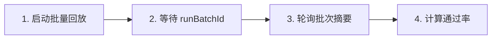

# 通过 API 运行测试

通过 Muggle Test REST API 以编程方式触发测试运行并读取结果。该流程是一次**批量回放**：启动一个工作流运行时，等待它生成运行批次，然后轮询批次摘要，获取通过/失败数量。

> 将同一流程封装进完整的 GitHub Actions、Azure DevOps 或 GitLab 流水线的示例，请参阅 [CI/CD 集成](mcp/mcp-cicd-integration.md)。

## 基础 URL 与身份验证

所有端点都位于 `https://promptservice.muggle-ai.com` 下，并且需要 API 密钥请求头：

```http
x-api-key: mai_sk_your_api_key_here
```

## 工作流概览



## 第 1 步：启动批量回放

创建一个工作流运行时，用于回放项目的测试脚本。

```http
POST /v1/protected/muggle-test/workflow/test-script/test-script-replay/bulk/workflowRuntimes
x-api-key: mai_sk_your_api_key_here
Content-Type: application/json

{
  "projectId": "proj_abc123",
  "namePrefix": "ci"
}
```

| 字段 | 类型 | 必填 | 说明 |
| :----------- | :----- | :------: | :-------------------------------- |
| `projectId` | string | ✓ | 要回放其脚本的项目 |
| `namePrefix` | string | | 运行批次的标签前缀 |

响应会返回工作流运行时的 `id`。

```json
{
  "id": "wfrt_replay_123"
}
```

## 第 2 步：等待运行批次

轮询最新的运行，直到其 `result` 载荷中出现 `runBatchId`。

```http
GET /v1/protected/muggle-test/workflow/test-script/test-script-replay/bulk/{workflowRuntimeId}/run/latest
x-api-key: mai_sk_your_api_key_here
```

`result` 可能是 JSON 字符串，也可能是对象；批次创建后，其中会包含 `runBatchId`。持续轮询（例如每 20 秒一次），直到它出现为止。

## 第 3 步：轮询批次摘要

持续获取批次摘要，直到没有运行中或等待中的脚本。

```http
GET /v1/protected/muggle-test/workflow/test-script/test-script-replay/bulk/run-batch/{runBatchId}/summary
x-api-key: mai_sk_your_api_key_here
```

### 响应

```json
{
  "successCount": 8,
  "failedCount": 2,
  "canceledCount": 0,
  "runningCount": 0,
  "pendingCount": 0
}
```

| 字段 | 说明 |
| :-------------- | :--------------------------- |
| `successCount` | 通过的脚本 |
| `failedCount` | 失败的脚本 |
| `canceledCount` | 已取消的脚本 |
| `runningCount` | 仍在执行中 |
| `pendingCount` | 已排队，尚未开始 |

当 `runningCount` 和 `pendingCount` 都为 `0` 时，批次即已完成。仅基于已执行的运行计算通过率（跳过的运行不计入）：

```text
passRate = successCount / (successCount + failedCount + canceledCount)
```

## 第 4 步（可选）：生成报告

批次完成后，生成并发送项目报告。发送渠道取决于项目的报告偏好设置。

```http
POST /v1/protected/muggle-test/report/final/generate
x-api-key: mai_sk_your_api_key_here
Content-Type: application/json

{ "projectId": "proj_abc123", "exportFormat": "html", "channels": [] }
```

## 错误响应

| 状态 | 含义 | 处理方式 |
| :----: | :------------------------------- | :------------------------------------------ |
| 401 | 缺少 API 密钥或密钥无效 | 检查 `x-api-key` 请求头 |
| 403 | 无权访问该项目 | 确认该密钥所属的账户可以访问此项目 |
| 404 | 运行时或批次尚未就绪 | 继续轮询；它可能尚未创建 |
| 429 | 请求频率超限 | 退避后重试 |

## 后续步骤

| 目标 | 资源 |
| :------------------- | :------------------------------------------------ |
| 完整的 CI/CD 流水线 | [CI/CD 集成](mcp/mcp-cicd-integration.md) |
| 使用 AI 助手 | [远程测试概览](mcp/overview.md) |
| 故障排除 | [常见问题](troubleshooting/common-issues.md) |
