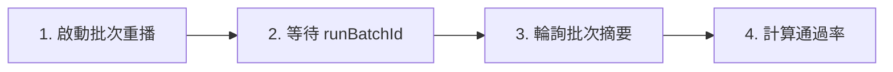

# 透過 API 執行測試

透過 Muggle Test REST API，以程式方式觸發測試執行並讀取結果。此流程是一次**批次重播**：啟動一個工作流程執行階段，等待它產生執行批次，然後輪詢批次摘要，取得通過/失敗的數量。

> 若要查看將同一流程包裝成完整 GitHub Actions、Azure DevOps 或 GitLab 管線的範例，請參閱 [CI/CD 整合](mcp/mcp-cicd-integration.md)。

## 基礎 URL 與身分驗證

所有端點都位於 `https://promptservice.muggle-ai.com` 底下，且需要 API 金鑰標頭：

```http
x-api-key: mai_sk_your_api_key_here
```

## 工作流程總覽



## 步驟 1：啟動批次重播

建立一個工作流程執行階段，用來重播專案的測試腳本。

```http
POST /v1/protected/muggle-test/workflow/test-script/test-script-replay/bulk/workflowRuntimes
x-api-key: mai_sk_your_api_key_here
Content-Type: application/json

{
  "projectId": "proj_abc123",
  "namePrefix": "ci"
}
```

| 欄位 | 類型 | 必填 | 說明 |
| :----------- | :----- | :------: | :-------------------------------- |
| `projectId` | string | ✓ | 要重播其腳本的專案 |
| `namePrefix` | string | | 執行批次的標籤前綴 |

回應會傳回工作流程執行階段的 `id`。

```json
{
  "id": "wfrt_replay_123"
}
```

## 步驟 2：等待執行批次

輪詢最新一次的執行，直到其 `result` 酬載中出現 `runBatchId`。

```http
GET /v1/protected/muggle-test/workflow/test-script/test-script-replay/bulk/{workflowRuntimeId}/run/latest
x-api-key: mai_sk_your_api_key_here
```

`result` 可能是 JSON 字串或物件；批次建立後，其中就會包含 `runBatchId`。請持續輪詢（例如每 20 秒一次），直到它出現為止。

## 步驟 3：輪詢批次摘要

持續取得批次摘要，直到沒有任何執行中或等待中的腳本。

```http
GET /v1/protected/muggle-test/workflow/test-script/test-script-replay/bulk/run-batch/{runBatchId}/summary
x-api-key: mai_sk_your_api_key_here
```

### 回應

```json
{
  "successCount": 8,
  "failedCount": 2,
  "canceledCount": 0,
  "runningCount": 0,
  "pendingCount": 0
}
```

| 欄位 | 說明 |
| :-------------- | :--------------------------- |
| `successCount` | 通過的腳本 |
| `failedCount` | 失敗的腳本 |
| `canceledCount` | 已取消的腳本 |
| `runningCount` | 仍在執行中 |
| `pendingCount` | 已排隊，尚未開始 |

當 `runningCount` 與 `pendingCount` 都是 `0` 時，批次即已完成。計算通過率時只計入已執行的執行項目（略過的執行項目會排除在外）：

```text
passRate = successCount / (successCount + failedCount + canceledCount)
```

## 步驟 4（選用）：產生報告

批次完成後，產生並傳送專案報告。傳送管道取決於專案的報告偏好設定。

```http
POST /v1/protected/muggle-test/report/final/generate
x-api-key: mai_sk_your_api_key_here
Content-Type: application/json

{ "projectId": "proj_abc123", "exportFormat": "html", "channels": [] }
```

## 錯誤回應

| 狀態 | 意義 | 處理方式 |
| :----: | :------------------------------- | :------------------------------------------ |
| 401 | 缺少 API 金鑰或金鑰無效 | 檢查 `x-api-key` 標頭 |
| 403 | 沒有該專案的存取權限 | 確認該金鑰所屬的帳戶能存取此專案 |
| 404 | 執行階段或批次尚未就緒 | 繼續輪詢；它可能還不存在 |
| 429 | 超出速率限制 | 稍候再重試 |

## 後續步驟

| 目標 | 資源 |
| :------------------- | :------------------------------------------------ |
| 完整的 CI/CD 管線 | [CI/CD 整合](mcp/mcp-cicd-integration.md) |
| 使用 AI 助理 | [遠端測試總覽](mcp/overview.md) |
| 疑難排解 | [常見問題](troubleshooting/common-issues.md) |
