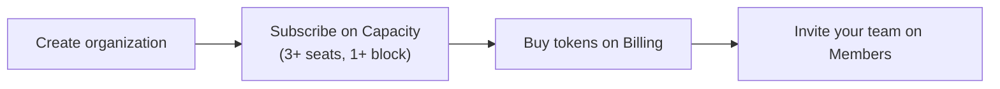

# Enterprise Organizations

Muggle Test Enterprise lets a company run Muggle Test as a team. Your company gets an **organization**: one set of shared projects, one prepaid token balance and one pool of concurrent workflows. You pay a seat for each person who builds and runs tests; people who only view results need no seat.

## What is an Organization

An organization is a company account in Muggle Test that holds:

- A **subscription** for contributor seats and concurrency blocks
- A **prepaid token balance** that pays for work on org projects
- A set of **org-owned projects** shared with every member
- A **member list**, with roles that control who can do what

Organizations live alongside personal accounts. Joining one changes nothing about your personal Muggle Test account: you keep your personal projects, your personal plan and your personal wallet, billed separately. See [Personal vs. Org Billing](#personal-vs-org-billing).

## Pricing at a Glance

| Item | Price |
| :--- | :---- |
| Contributor seat | **$29 / seat / month** for seats 1–10, **$24** for seats 11–50, **$19** from seat 51 |
| Minimum seats | **3** |
| Concurrency block | **$99 / month** for 20 concurrent workflows, minimum 1 block |
| Tokens | Prepaid at **$5 per 1,000,000 tokens**, from $100 per purchase |
| Members who only view | Included, no seat |

Seat bands are graduated: each band prices only the seats inside it, so 12 seats cost 10 × $29 + 2 × $24 = $338 a month. Prices exclude tax.

Organizations that subscribed under earlier pricing keep their existing billing.

## Roles

An organization has four roles. Owners, Admins and Contributors each use a seat; Members do not.

| Capability | OWNER | ADMIN | CONTRIBUTOR | MEMBER |
| :--- | :---: | :---: | :---: | :---: |
| Uses a seat | Yes | Yes | Yes | No |
| View org projects, members, the token balance and usage totals | Yes | Yes | Yes | Yes |
| Create org projects, edit them and run tests | Yes | Yes | Yes | No |
| Invite and remove members, revoke invitations | Yes | Yes | No | No |
| Buy tokens | Yes | Yes | No | No |
| Set per-project limits | Yes | Yes | No | No |
| See usage by member and by project | Yes | Yes | No | No |
| Change seats and concurrency blocks, change member roles, manage billing and auto top-up, rename or delete the organization | Yes | No | No | No |

The person who creates the organization is its Owner, and an organization has exactly one. Invitations offer the ADMIN, CONTRIBUTOR or MEMBER role.

Organization roles also set a project role on every project the organization owns: an Owner is Project Owner, an Admin is Maintainer, a Contributor is Editor and a Member is Viewer. The full cascade is explained in [Organization Roles and Project Access](concepts/organization-roles-and-access.md).

## Setting Up an Organization

1. Choose **Create organization** on the Enterprise card of the pricing page, or on the dashboard's **Billing** page, and enter the organization name. You become its Owner.
2. On the organization's **Capacity** page, under **Subscribe to Enterprise**, choose **Seats** (at least 3, and at least the seats already in use) and **Concurrency blocks** (at least 1), then subscribe. Runs on org projects start once the subscription is active.
3. On the **Billing** page, use **Buy tokens** to fund the organization's balance.
4. Invite your team from **Members**. You can invite before subscribing.

Open the organization from **Organization** in the dashboard sidebar. If you belong to more than one, switch with the workspace switcher on the dashboard home or the projects list. **Enterprise billing** lists every organization you belong to, with its subscription status.

## Seats

- **Seats in use:** every Owner, Admin and Contributor, plus each unexpired pending invitation for an Admin or Contributor. Members use none.
- **Needing a seat:** inviting an Admin or Contributor, or changing a Member to either, needs a seat available. With none, the dashboard shows **No seats available**: the Owner can buy seats, and anyone else asks the Owner.
- **Freeing a seat:** removing a seat holder, revoking their pending invitation, or changing them to Member makes the seat available again. The bill stays the same until the Owner lowers the seat count.
- **Changing seats:** only the Owner, with **Change seats** on the **Billing** page. Added seats are available at once and charged prorated for the rest of the month. A reduction takes effect at the next renewal, never below the seats in use or 3, and nothing is refunded.

## Concurrency

Each block adds 20 concurrent workflows to one pool shared by every run on every org project: scans, test generation, replays and reports. A run that finds the pool full waits for a free slot. Enterprise runs start ahead of Free and Starter runs when the shared runners are busy.

The Owner changes blocks on the **Capacity** page with **Change blocks**, from 1 up to 3. An added block applies at once and is charged prorated for the rest of the month; a removal applies at the next renewal, and nothing is refunded. For more than 3 blocks, choose **Talk to Sales**; once agreed, we raise your organization's ceiling.

### Per-project limits

So one product cannot drain the pool, the Owner or an Admin can cap any org project under **Per-project limits** on the **Capacity** page:

| Limit | Effect |
| :--- | :--- |
| **Max concurrent workflows** | The project's runs use no more of the pool than this |
| **Monthly token cap** | Per calendar month (UTC). A project at its cap refuses new work until the month turns; the call that crosses the cap is recorded in full |

## Tokens

Work on org projects runs on a prepaid token balance; there is no monthly allowance. The Owner or an Admin buys tokens with **Buy tokens** on the **Billing** page, in any whole-dollar amount from $100, at $5 per 1,000,000 tokens. Token purchases are not refundable.

**Auto top-up** is on by default. When the balance falls below the low-balance level, the saved card is charged and the tokens are credited at once. The low-balance level starts at 20% of the most recent purchase, top-up or grant. Under **Low balance and auto top-up**, the Owner can set a fixed level, change the top-up amount (from $100) or switch auto top-up off.

Every active Owner and Admin is emailed once when the balance falls below the level, and once when it reaches zero. At zero, new work on org projects is refused. Work already running finishes and is recorded in full, so the balance can dip below zero by that last run; the next purchase covers it.

## Inviting and Managing Members

Owners and Admins invite members from **Members** with **Invite member**.

### Sending an invitation

1. Click **Invite member**.
2. Enter the person's email address and choose a role: **Member** (views only, doesn't use a seat), **Contributor** (edits and runs, billed seat) or **Admin**.
3. Send the invitation.

The invitee receives an email with the organization name, your name as the inviter, the role offered and an activation link. If they already have a Muggle Test account they sign in and accept; otherwise they sign up first.

### Invitation expiry

Invitation links expire **7 days** after they are sent. An expired invitation holds no seat. To replace an expired or lost invitation, an Owner or Admin revokes it and sends a new one.

### Removing a member

Owners and Admins remove members from **Members**. Removal takes effect immediately:

- Their membership in *this* organization ends, and any seat they held becomes available.
- They lose access to this organization's projects.
- Their personal Muggle Test account is untouched, including their personal plan, wallet and projects.
- Any other organizations they belong to are unaffected.

## Belonging to More Than One Organization

A Muggle Test user can belong to several organizations at once, holding a seat in each one where they are an Owner, Admin or Contributor. Switch between them, and your personal workspace, with the workspace switcher.

## Personal vs. Org Billing

**Project ownership determines where bills go.** When you create a project, **Project owner** chooses Personal or one of your organizations. An org project is billed to the organization and shared with its members.

| | Personal project | Org project |
| :--- | :--- | :--- |
| **Owned by** | The user who created it | The organization |
| **Billed to** | The creator's personal wallet | The organization's prepaid balance |
| **Runs count against** | The creator's plan concurrency | The organization's block pool |
| **Who can access** | The creator and people they share it with | Organization members, by role |

A personal project can be moved into an organization you belong to, provided you can edit it. The dashboard has no control for this yet: set the project's `organizationId` through the projects API. The move is one-way: an org project never moves back to personal ownership or to another organization.

### A worked example

Sara is on a Pro plan personally. Her company's organization invites her as a Contributor.

- Her existing personal project, "weekend-side-project", stays on her Pro plan and her personal wallet.
- She creates "checkout-flow-tests" with **Project owner** set to the organization. Every run on it draws the organization's balance and block pool.
- Her company pays for her seat and for the tokens org projects use. Sara still pays for her Pro plan and her personal projects' tokens.

If Sara cancels her Pro plan, only her personal projects are affected. If the company cancels Enterprise, only the org projects are affected.

### Usage

The organization's **Usage** page shows tokens used. Every member sees the totals; Owners and Admins also see usage by member and by project.

## Limits

| Resource | Limit |
| :--- | :--- |
| Members | Unlimited; Members use no seat |
| Contributor seats | As purchased, minimum 3 |
| Projects, use cases and test cases | Unlimited |
| Concurrent workflows | 20 per block, 1 to 3 blocks self-serve, more through sales |
| Per-project concurrency and monthly tokens | Optional cap on each org project |
| Tokens | Prepaid balance with auto top-up |

See [Quotas and Limits](billing/quotas-and-limits.md) for how the limits are enforced.

## When a Payment Fails

If a scheduled payment fails, the organization is suspended immediately, with no grace period. Every active Owner is emailed, and the dashboard shows a **Payment failed** banner with **Manage billing**. Runs, edits and spending on org projects are refused with an "Organization is suspended" error until the bill is paid.

Recovery is automatic: the next successful payment reactivates the organization. The full rules live on [Billing Suspension and Recovery](billing/billing-suspension-and-recovery.md).

## Managing Billing and Cancelling

The Owner opens **Manage billing** on the **Billing** page to update the card, see invoices, edit billing details, or cancel the subscription at the end of the current period. Seats and blocks change only in the dashboard.

A cancelled organization's members lose access to its projects. Personal accounts and personal projects are unaffected. To reduce spend without cancelling, lower the seats or blocks; the reduction applies at the next renewal.

The Owner can also delete the organization with **Delete organization** on its overview page. Deleting cancels the subscription immediately, removes every member and deletes the organization's saved card and billing details.

## Not Yet Supported

- **SSO / SAML.** Members sign in with their normal Muggle Test credentials.
- **Detailed audit logging.** Billing and status changes are recorded, but a full per-action audit trail is not yet available.
- **Moving an org project.** Org projects cannot move back to personal ownership or to another organization.
- **Moving a personal project into an organization from the dashboard.** Use the projects API.

## Next Steps

| Goal | Resource |
| :--- | :--- |
| Understand how org roles cascade to project access | [Organization Roles and Project Access](concepts/organization-roles-and-access.md) |
| Learn what happens when a payment fails | [Billing Suspension and Recovery](billing/billing-suspension-and-recovery.md) |
| Compare Enterprise to other plans | [Subscription Plans](billing/subscription-plans.md) |
| See how limits are enforced | [Quotas and Limits](billing/quotas-and-limits.md) |
| Talk to sales about more capacity | [sales@muggle-ai.com](mailto:sales@muggle-ai.com) |
