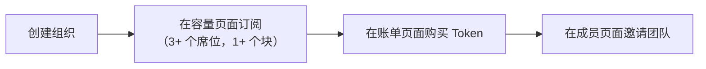

# 企业组织

Muggle Test 企业版让公司以团队形式使用 Muggle Test。你的公司会获得一个**组织**：一组共享项目、一个预付 Token 余额和一个并发工作流池。你为每位构建和运行测试的人购买一个席位；只查看结果的人无需席位。

## 什么是组织

组织是 Muggle Test 中的公司账户，包含：

- 一个**订阅**，涵盖贡献者席位和并发块
- 一个**预付 Token 余额**，用于支付组织项目上的工作
- 一组**组织所有的项目**，与每位成员共享
- 一份**成员列表**，通过角色控制每个人可以执行哪些操作

组织与个人账户并存。加入组织不会改变你个人 Muggle Test 账户的任何内容：你会保留个人项目、个人套餐和个人钱包，两者分开计费。请参阅[个人与组织计费](#personal-vs-org-billing)。

## 定价一览

| 计费项 | 价格 |
| :--- | :---- |
| 贡献者席位 | 席位 1–10 为 **$29 / 席位 / 月**，席位 11–50 为 **$24**，第 51 个席位起为 **$19** |
| 最少席位数 | **3** |
| 并发块 | **$99 / 月**，含 20 个并发工作流，最少 1 个块 |
| Token | 预付，**每 100 万 Token $5**，每次购买 $100 起 |
| 只查看的成员 | 已包含，不占席位 |

席位档位为累进计价：每个档位只为其范围内的席位定价，因此 12 个席位每月费用为 10 × $29 + 2 × $24 = $338。价格不含税。

按早期定价订阅的组织保留其现有计费方式。

## 角色

组织有四种角色。所有者、管理员和贡献者各占用一个席位；成员不占用席位。

| 能力 | 所有者 | 管理员 | 贡献者 | 成员 |
| :--- | :---: | :---: | :---: | :---: |
| 占用席位 | 是 | 是 | 是 | 否 |
| 查看组织项目、成员、Token 余额和用量总计 | 是 | 是 | 是 | 是 |
| 创建组织项目、编辑项目并运行测试 | 是 | 是 | 是 | 否 |
| 邀请和移除成员、撤销邀请 | 是 | 是 | 否 | 否 |
| 购买 Token | 是 | 是 | 否 | 否 |
| 设置按项目限制 | 是 | 是 | 否 | 否 |
| 查看按成员和按项目划分的用量 | 是 | 是 | 否 | 否 |
| 更改席位和并发块、更改成员角色、管理账单和自动充值、重命名或删除组织 | 是 | 否 | 否 | 否 |

创建组织的人是其所有者，每个组织有且只有一位所有者。邀请时可以授予管理员、贡献者或成员角色。

组织角色还会决定用户在组织拥有的每个项目上的项目角色：所有者是项目所有者，管理员是维护者，贡献者是编辑者，成员是查看者。完整的逐级传递规则请参阅[组织角色与项目访问权限](concepts/organization-roles-and-access.md)。

## 设置组织

1. 在定价页面的企业版卡片上，或在控制台的**账单**页面上，选择**创建组织**，并输入组织名称。你将成为其所有者。
2. 在组织的**容量**页面中，于**订阅企业版**下选择**席位**（至少 3 个，且不少于已占用的席位数）和**并发块**（至少 1 个），然后订阅。订阅生效后，组织项目上的运行即可开始。
3. 在**账单**页面上，使用**购买 Token** 为组织余额充值。
4. 在**成员**中邀请你的团队。你可以在订阅之前发出邀请。

从控制台侧边栏的**组织**打开组织。如果你属于多个组织，可以使用控制台首页或项目列表上的工作区切换器进行切换。**企业账单**会列出你所属的每个组织及其订阅状态。

## 席位

- **已占用的席位：** 每位所有者、管理员和贡献者，以及每个尚未过期的管理员或贡献者待处理邀请。成员不占用席位。
- **需要席位：** 邀请管理员或贡献者，或将成员更改为其中任一角色，都需要有可用席位。没有可用席位时，控制台会显示**没有可用席位**：所有者可以购买席位，其他人则需联系所有者。
- **释放席位：** 移除席位持有者、撤销其待处理邀请，或将其更改为成员，都会使该席位重新可用。在所有者降低席位数量之前，账单金额保持不变。
- **更改席位：** 仅限所有者，在**账单**页面上使用**更改席位**。新增的席位立即可用，并按当月剩余时间按比例计费。减少席位在下次续订时生效，不能低于已占用的席位数或 3 个，且不予退款。

## 并发

每个块会向一个共享池增加 20 个并发工作流，该池由所有组织项目上的每次运行共享：扫描、测试生成、回放和报告。运行时如果池已满，它会等待空闲槽位。共享运行器繁忙时，企业版的运行会优先于免费版和入门版的运行启动。

所有者在**容量**页面上使用**更改块数**调整块数，范围为 1 到 3 个。新增的块立即生效，并按当月剩余时间按比例计费；移除的块在下次续订时生效，且不予退款。如需超过 3 个块，请选择**联系销售**；双方达成一致后，我们会提高你组织的上限。

### 按项目限制

为防止单个产品耗尽整个池，所有者或管理员可以在**容量**页面的**按项目限制**下为任意组织项目设置上限：

| 限制 | 效果 |
| :--- | :--- |
| **最大并发工作流** | 该项目的运行占用的池容量不超过此值 |
| **每月 Token 上限** | 按日历月（UTC）计算。达到上限的项目在进入下一个月之前会拒绝新的工作；越过上限的那次调用会被完整记录 |

## Token

组织项目上的工作使用预付 Token 余额；没有每月额度。所有者或管理员在**账单**页面上使用**购买 Token** 购买 Token，金额为 $100 起的任意整数美元，价格为每 100 万 Token $5。购买的 Token 不予退款。

**自动充值**默认开启。余额低于低余额阈值时，系统会从已保存的银行卡扣款，并立即计入 Token。低余额阈值初始为最近一次购买、充值或赠送额度的 20%。在**低余额与自动充值**下，所有者可以设置固定阈值、更改充值金额（$100 起）或关闭自动充值。

余额低于阈值时，每位已激活的所有者和管理员会收到一封邮件；余额归零时会再收到一封。余额归零后，组织项目上的新工作会被拒绝。已在运行的工作会完成并被完整记录，因此余额可能因这最后一次运行降到零以下；下一次购买会补足差额。

## 邀请和管理成员

所有者和管理员可以在**成员**中使用**邀请成员**邀请成员。

### 发送邀请

1. 点击**邀请成员**。
2. 输入对方的邮箱地址并选择角色：**成员**（仅查看，不占用席位）、**贡献者**（编辑和运行，计费席位）或**管理员**。
3. 发送邀请。

受邀者会收到一封邮件，其中包含组织名称、作为邀请人的你的姓名、为其提供的角色，以及一个激活链接。如果对方已有 Muggle Test 账户，登录后即可接受；否则需要先注册。

### 邀请有效期

邀请链接在发送 **7 天**后过期。已过期的邀请不占用席位。要替换已过期或丢失的邀请，所有者或管理员需撤销该邀请并发送新的邀请。

### 移除成员

所有者和管理员可以在**成员**中移除成员。移除会立即生效：

- 该成员在*此*组织中的成员身份终止，其占用的任何席位重新可用。
- 该成员失去对此组织项目的访问权限。
- 该成员的个人 Muggle Test 账户不受影响，包括其个人套餐、钱包和项目。
- 该成员所属的其他组织不受影响。

## 加入多个组织

一个 Muggle Test 用户可以同时属于多个组织，在其担任所有者、管理员或贡献者的每个组织中各占用一个席位。使用工作区切换器在这些组织和你的个人工作区之间切换。

## 个人与组织计费

**项目归属决定账单去向**。创建项目时，在**项目所有者**中选择个人或你的某个组织。组织项目的费用由组织承担，并与组织成员共享。

| | 个人项目 | 组织项目 |
| :--- | :--- | :--- |
| **归属** | 创建它的用户 | 组织 |
| **费用计入** | 创建者的个人钱包 | 组织的预付余额 |
| **运行计入** | 创建者套餐的并发上限 | 组织的块池 |
| **谁可以访问** | 创建者及其共享的人 | 组织成员，按角色 |

如果你有权编辑某个个人项目，可以将其移入你所属的组织。控制台目前还没有此功能的控制项：请通过项目 API 设置项目的 `organizationId`。这一迁移是单向的：组织项目永远不会移回个人所有，也不会移到其他组织。

### 实际示例

Sara 个人使用专业版套餐。她公司的组织邀请她担任贡献者。

- 她现有的个人项目“weekend-side-project”仍使用她的专业版套餐和个人钱包。
- 她创建了“checkout-flow-tests”，并将**项目所有者**设为该组织。该项目上的每次运行都使用组织的余额和块池。
- 她的公司为她的席位以及组织项目消耗的 Token 付费。Sara 仍需支付她的专业版套餐费用，以及她个人项目消耗的 Token 费用。

如果 Sara 取消专业版套餐，只有她的个人项目受影响。如果公司取消企业版，只有组织项目受影响。

### 用量

组织的**用量**页面显示已使用的 Token。每位成员都能看到总计；所有者和管理员还能看到按成员和按项目划分的用量。

## 限制

| 资源 | 上限 |
| :--- | :--- |
| 成员 | 无限制；成员不占用席位 |
| 贡献者席位 | 按购买数量，最少 3 个 |
| 项目、用户旅程和测试用例 | 无限制 |
| 并发工作流 | 每个块 20 个，自助可选 1 到 3 个块，更多需通过销售 |
| 按项目的并发数和每月 Token | 可为每个组织项目设置上限（可选） |
| Token | 预付余额，支持自动充值 |

这些上限如何执行，请参阅[配额与限制](billing/quotas-and-limits.md)。

## 付款失败时

如果定期付款失败，组织会被立即暂停，没有宽限期。每位已激活的所有者都会收到邮件，控制台会显示带有**管理账单**的**付款失败**横幅。在账单付清之前，组织项目上的运行、编辑和支出都会被拒绝，并返回“Organization is suspended”（组织已暂停）错误。

恢复是自动的：下一次成功付款会重新激活组织。完整规则请参阅[账单暂停与恢复](billing/billing-suspension-and-recovery.md)。

## 管理账单和取消

所有者在**账单**页面上打开**管理账单**，可以更新银行卡、查看发票、编辑账单信息，或在当前周期结束时取消订阅。席位和块数只能在控制台中更改。

已取消组织的成员会失去对其项目的访问权限。个人账户和个人项目不受影响。如需在不取消的情况下降低支出，请减少席位或块数；减少会在下次续订时生效。

## 尚不支持的功能

- **单点登录（SSO）/ SAML**。成员使用常规的 Muggle Test 登录凭据登录。
- **详细审计日志**。账单和状态变更会被记录，但目前还没有完整的逐操作审计记录。
- **移动组织项目**。组织项目不能移回个人所有，也不能移到其他组织。
- **在控制台中将个人项目移入组织**。请使用项目 API。

## 后续步骤

| 目标 | 资源 |
| :--- | :--- |
| 了解组织角色如何逐级传递到项目访问权限 | [组织角色与项目访问权限](concepts/organization-roles-and-access.md) |
| 了解付款失败时会发生什么 | [账单暂停与恢复](billing/billing-suspension-and-recovery.md) |
| 将企业版与其他套餐进行对比 | [订阅套餐](billing/subscription-plans.md) |
| 查看上限如何执行 | [配额与限制](billing/quotas-and-limits.md) |
| 联系销售洽谈更多容量 | [sales@muggle-ai.com](mailto:sales@muggle-ai.com) |
