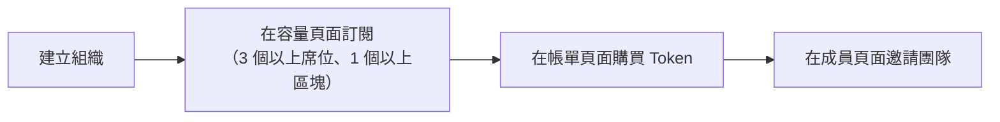

# 企業組織

Muggle Test 企業版讓公司以團隊形式使用 Muggle Test。你的公司會取得一個**組織**：一組共用專案、一筆預付 Token 餘額，以及一個同時執行工作流程的共用池。每位建立並執行測試的人需要一個付費席位；只檢視結果的人不需要席位。

## 什麼是組織

組織是 Muggle Test 中的公司帳戶，包含：

- 一個**訂閱**，涵蓋貢獻者席位與同時執行區塊
- 一筆**預付 Token 餘額**，用來支付組織專案上的工作
- 一組**組織擁有的專案**，與每位成員共用
- 一份**成員清單**，以角色控管每個人能做哪些事

組織與個人帳戶並存。加入組織不會改變你個人 Muggle Test 帳戶的任何內容：你仍保有個人專案、個人方案與個人錢包，並分開計費。請參閱[個人與組織計費](#personal-vs-org-billing)。

## 定價一覽

| 計費項目 | 價格 |
| :--- | :---- |
| 貢獻者席位 | 第 1–10 個席位 **$29 / 席位 / 月**，第 11–50 個席位 **$24**，第 51 個席位起 **$19** |
| 最少席位數 | **3** |
| 同時執行區塊 | 每 20 個同時執行的工作流程 **$99 / 月**，至少 1 個區塊 |
| Token | 預付，**每 100 萬 Token $5**，每次購買 $100 起 |
| 僅檢視的成員 | 已包含，不占席位 |

席位級距採累進計價：每個級距只計算落在該級距內的席位，因此 12 個席位每月費用為 10 × $29 + 2 × $24 = $338。價格未含稅。

依先前定價訂閱的組織維持原有的計費方式。

## 角色

組織有四種角色。擁有者、管理員與貢獻者各占用一個席位；成員則不占席位。

| 功能 | 擁有者 | 管理員 | 貢獻者 | 成員 |
| :--- | :---: | :---: | :---: | :---: |
| 占用席位 | 是 | 是 | 是 | 否 |
| 檢視組織專案、成員、Token 餘額與用量總計 | 是 | 是 | 是 | 是 |
| 建立組織專案、編輯專案並執行測試 | 是 | 是 | 是 | 否 |
| 邀請與移除成員、撤銷邀請 | 是 | 是 | 否 | 否 |
| 購買 Token | 是 | 是 | 否 | 否 |
| 設定每個專案的上限 | 是 | 是 | 否 | 否 |
| 查看依成員與依專案區分的用量 | 是 | 是 | 否 | 否 |
| 變更席位與同時執行區塊、變更成員角色、管理帳單與自動加值、重新命名或刪除組織 | 是 | 否 | 否 | 否 |

建立組織的人就是該組織的擁有者，而每個組織只有一位擁有者。邀請時可以指派管理員、貢獻者或成員角色。

組織角色也會決定使用者在組織擁有的每個專案上的專案角色：擁有者是專案擁有者，管理員是維護者，貢獻者是編輯者，成員則是檢視者。完整的向下套用規則請參閱[組織角色與專案存取權限](concepts/organization-roles-and-access.md)。

## 設定組織

1. 在定價頁面的企業版卡片上，或在儀表板的**帳單**頁面選擇**建立組織**，然後輸入組織名稱。你會成為該組織的擁有者。
2. 在組織的**容量**頁面，於**訂閱企業版**下選擇**席位**（至少 3 個，且不少於已占用的席位數）與**同時執行區塊**（至少 1 個），然後訂閱。訂閱生效後，組織專案上的執行才會開始。
3. 在**帳單**頁面使用**購買 Token** 為組織的餘額儲值。
4. 從**成員**邀請你的團隊。你可以在訂閱之前就先邀請。

從儀表板側邊欄的**組織**開啟組織。如果你隸屬於多個組織，可以在儀表板首頁或專案清單上使用工作區切換器切換。**企業版帳單**會列出你所屬的每個組織及其訂閱狀態。

## 席位

- **已占用的席位：** 每位擁有者、管理員與貢獻者，加上每個尚未過期、邀請對象為管理員或貢獻者的待接受邀請。成員不占席位。
- **需要席位的情況：** 邀請管理員或貢獻者，或將成員變更為這兩種角色之一時，需要有可用的席位。沒有可用席位時，儀表板會顯示**沒有可用的席位**：擁有者可以購買席位，其他人則需請擁有者處理。
- **釋出席位：** 移除席位持有者、撤銷其待接受的邀請，或將其變更為成員，都會讓該席位重新可用。在擁有者降低席位數量之前，帳單金額不會改變。
- **變更席位：** 只有擁有者可以在**帳單**頁面使用**變更席位**。新增的席位會立即可用，並依當月剩餘時間按比例計費。減少的席位會在下次續訂時生效，不得低於已占用的席位數或 3 個，且不予退款。

## 同時執行

每個區塊會在一個共用池中增加 20 個同時執行的工作流程，由每個組織專案上的每次執行共用：掃描、測試產生、重播與報告。遇到共用池已滿的執行會等待空出的名額。共用執行器忙碌時，企業版的執行會比免費版與入門版的執行優先啟動。

擁有者可以在**容量**頁面使用**變更區塊**調整區塊數，範圍為 1 到 3 個。新增的區塊會立即生效，並依當月剩餘時間按比例計費；移除的區塊會在下次續訂時生效，且不予退款。如需 3 個以上的區塊，請選擇**洽詢業務**；雙方議定後，我們會提高你組織的上限。

### 每個專案的上限

為避免單一產品耗盡共用池，擁有者或管理員可以在**容量**頁面的**每個專案的上限**下，為任何組織專案設定上限：

| 上限 | 效果 |
| :--- | :--- |
| **同時執行工作流程上限** | 該專案的執行最多只會使用共用池中這個數量的名額 |
| **每月 Token 上限** | 依日曆月（UTC）計算。已達上限的專案會拒絕新的工作，直到下個月開始；超過上限的那次呼叫會完整記錄 |

## Token

組織專案上的工作使用預付 Token 餘額；沒有每月額度。擁有者或管理員可以在**帳單**頁面使用**購買 Token** 購買，金額為 $100 起的任意整數美元，價格為每 100 萬 Token $5。購買的 Token 不予退款。

**自動加值**預設為開啟。當餘額低於低餘額門檻時，系統會向已儲存的信用卡收費，並立即將 Token 計入餘額。低餘額門檻一開始為最近一次購買、加值或贈送金額的 20%。擁有者可以在**低餘額與自動加值**下設定固定門檻、變更加值金額（$100 起），或關閉自動加值。

餘額低於門檻時，以及餘額歸零時，每位已啟用的擁有者與管理員都會各收到一封電子郵件。餘額歸零後，組織專案上的新工作會遭到拒絕。已在執行中的工作會執行完畢並完整記錄，因此餘額可能因最後那次執行而降到零以下；下一次購買會補足這筆差額。

## 邀請與管理成員

擁有者與管理員可以在**成員**中使用**邀請成員**邀請成員。

### 傳送邀請

1. 點選**邀請成員**。
2. 輸入對方的電子郵件地址並選擇角色：**成員**（僅檢視，不占席位）、**貢獻者**（編輯與執行，計費席位）或**管理員**。
3. 傳送邀請。

受邀者會收到一封電子郵件，內含組織名稱、身為邀請者的你的姓名、指派的角色，以及一個啟用連結。如果對方已有 Muggle Test 帳戶，登入後即可接受；否則需要先註冊。

### 邀請期限

邀請連結會在寄出 **7 天**後失效。已失效的邀請不占席位。若要取代已失效或遺失的邀請，擁有者或管理員需撤銷該邀請並重新傳送。

### 移除成員

擁有者與管理員可以在**成員**中移除成員。移除會立即生效：

- 對方在*此*組織中的成員資格終止，其占用的任何席位都會重新可用。
- 對方會失去此組織專案的存取權限。
- 對方的個人 Muggle Test 帳戶不受影響，包括個人方案、錢包與專案。
- 對方所屬的其他組織不受影響。

## 隸屬於多個組織

一位 Muggle Test 使用者可以同時隸屬於多個組織，並在自己擔任擁有者、管理員或貢獻者的每個組織中各占用一個席位。使用工作區切換器，即可在這些組織與你的個人工作區之間切換。

## 個人與組織計費

**專案歸屬決定帳單寄往何處**。建立專案時，可以在**專案擁有者**中選擇個人或你所屬的某個組織。組織專案會向組織計費，並與組織成員共用。

| | 個人專案 | 組織專案 |
| :--- | :--- | :--- |
| **歸屬** | 建立它的使用者 | 組織 |
| **費用計入** | 建立者的個人錢包 | 組織的預付餘額 |
| **執行計入** | 建立者方案的同時執行上限 | 組織的區塊共用池 |
| **誰可以存取** | 建立者及其分享的對象 | 組織成員，依角色而定 |

只要你有權編輯，就能將個人專案移入你所屬的組織。儀表板目前還沒有這項控制項：請透過專案 API 設定專案的 `organizationId`。這項移轉是單向的：組織專案永遠不會移回個人擁有，也不會移到其他組織。

### 實際範例

Sara 個人使用專業版方案。她公司的組織邀請她成為貢獻者。

- 她現有的個人專案「weekend-side-project」仍使用她的專業版方案與個人錢包。
- 她建立「checkout-flow-tests」時，將**專案擁有者**設為該組織。這個專案上的每次執行都會使用組織的餘額與區塊共用池。
- 她的公司負擔她的席位費用，以及組織專案使用的 Token 費用。Sara 仍需支付她的專業版方案費用，以及她個人專案的 Token 費用。

如果 Sara 取消專業版方案，只有她的個人專案會受到影響。如果公司取消企業版，只有組織專案會受到影響。

### 用量

組織的**用量**頁面會顯示已使用的 Token。每位成員都能看到總計；擁有者與管理員還能看到依成員與依專案區分的用量。

## 限制

| 資源 | 上限 |
| :--- | :--- |
| 成員 | 無限制；成員不占席位 |
| 貢獻者席位 | 依購買數量，至少 3 個 |
| 專案、使用者旅程與測試案例 | 無限制 |
| 同時執行的工作流程 | 每個區塊 20 個，可自助購買 1 至 3 個區塊，更多請洽業務 |
| 每個專案的同時執行數量與每月 Token | 可為每個組織專案設定上限（選用） |
| Token | 預付餘額，提供自動加值 |

上限如何執行，請參閱[配額與限制](billing/quotas-and-limits.md)。

## 付款失敗時

如果排定的付款失敗，組織會立即遭到停權，沒有寬限期。每位已啟用的擁有者都會收到電子郵件，儀表板也會顯示含有**管理帳單**的**付款失敗**橫幅。在帳單付清之前，組織專案上的執行、編輯與支出都會遭到拒絕，並傳回「Organization is suspended」（組織已停權）錯誤。

恢復是自動進行的：下一筆成功的付款會重新啟用組織。完整規則請參閱[帳單停權與恢復](billing/billing-suspension-and-recovery.md)。

## 管理帳單與取消

擁有者可以在**帳單**頁面開啟**管理帳單**，更新信用卡、查看發票、編輯帳單詳細資料，或在目前週期結束時取消訂閱。席位與區塊只能在儀表板中變更。

組織取消後，其成員會失去該組織專案的存取權限。個人帳戶與個人專案不受影響。若想在不取消的情況下減少支出，可以降低席位或區塊數量；減少會在下次續訂時生效。

## 尚未支援的功能

- **單一登入（SSO）/ SAML**。成員使用一般的 Muggle Test 登入憑證登入。
- **詳細的稽核記錄**。帳單與狀態變更會留下記錄，但目前還沒有完整的逐項操作稽核軌跡。
- **移動組織專案**。組織專案無法移回個人擁有，也無法移到其他組織。
- **從儀表板將個人專案移入組織**。請使用專案 API。

## 後續步驟

| 目標 | 資源 |
| :--- | :--- |
| 了解組織角色如何向下套用到專案存取權限 | [組織角色與專案存取權限](concepts/organization-roles-and-access.md) |
| 了解付款失敗時會發生什麼事 | [帳單停權與恢復](billing/billing-suspension-and-recovery.md) |
| 比較企業版與其他方案 | [訂閱方案](billing/subscription-plans.md) |
| 查看上限如何執行 | [配額與限制](billing/quotas-and-limits.md) |
| 與業務洽談更多容量 | [sales@muggle-ai.com](mailto:sales@muggle-ai.com) |
