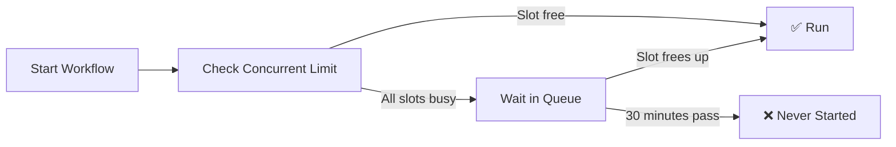

# Quotas and Limits

Every plan includes unlimited use cases and test cases per project; usage is metered in tokens. Two limits apply to your account: your token balance and your concurrent workflow limit. For each plan's values, see [Subscription Plans](billing/subscription-plans.md).

## Token Metering

The AI work behind scans, test generation, replays, and reports draws tokens from your wallet as it runs.

| Wallet Balance | Result |
| :------------- | :----- |
| Above zero | Work runs and is debited as it completes |
| Zero | New AI work is refused until you add tokens |

A step that starts while your balance is above zero finishes, even if it takes the balance below zero.

[Subscription Plans](billing/subscription-plans.md) covers how grants refill, how purchased tokens work, and which balance is spent first.

## Concurrent Workflows

Your plan sets how many workflows (scans, test generations, replays) can run at the same time.

| Situation | Result |
| :-------- | :----- |
| Under your limit | The workflow starts immediately |
| At your limit | The workflow waits and starts when a running workflow finishes |
| Still waiting after 30 minutes | The run fails without starting |

## Enterprise Organizations

The concurrent workflow limit applies **per member**: it comes from the account of the member doing the work — their personal plan's limit, or the Enterprise value where it has been applied to their account.

### Enterprise quotas

| Resource | Enterprise limit |
| :------- | :--------------- |
| Projects | Unlimited |
| Use cases and test cases per project | Unlimited |
| Concurrent workflows | 20+ (starting at 20 per member) |
| Monthly tokens | Pay-per-use ($5 per 1,000,000 tokens) |
| Seats | As purchased (minimum 4) |

The starting concurrency is a soft limit that can be raised on request. Contact support if you need more.

### How quota enforcement applies

| Scope | What it counts against |
| :--- | :--- |
| Workflow runs against an org project | The running member's concurrency limit, and the org wallet |
| Workflow runs against a personal project | The running member's concurrency limit, and their personal wallet |

A member whose account still carries a personal-plan limit runs at that limit inside org projects too — for example, a Free account runs at most 3 workflows at a time.

For the full picture of seats, roles, billing, and the personal-vs-org model, see the [Enterprise Organizations guide](enterprise-organizations.md).

## Error Messages

| Message | Meaning | Solution |
| :------ | :------ | :------- |
| "Your token balance is insufficient to complete this request" | Your wallet balance is zero | Buy a token package or upgrade your plan |
| "Never started: the account's concurrent workflow limit was saturated" | Every concurrency slot stayed busy for the 30 minutes the run could wait | Start the run again once running workflows finish, or upgrade for a higher limit |

## FAQ

### Is there a limit on use cases or test cases?

No. Every plan includes unlimited use cases and test cases per project.

### What happens to my tests if I downgrade?

Your use cases and test cases are unaffected. The new plan's concurrency limit applies, and a downgrade never takes tokens away.

### Do plan changes take effect immediately?

Yes. A new plan's concurrency limit applies as soon as the plan changes.

## Next Steps

| Goal | Resource |
| :--- | :------- |
| Compare plans | [Subscription Plans](subscription-plans.md) |
| Set up a team account | [Enterprise Organizations](enterprise-organizations.md) |
| Upgrade your plan | [Billing Dashboard](https://www.muggle-ai.com) |
| Learn about use cases | [How Muggle Test Works](concepts/how-muggle-test-works.md) |
