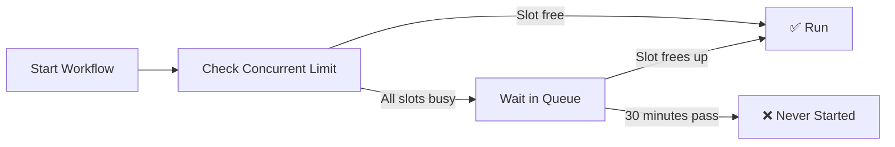

# Quotas and Limits

Every plan includes unlimited use cases and test cases per project; usage is metered in tokens. Two limits apply to your account: your token balance and your concurrent workflow limit. For each plan's values, see [Subscription Plans](billing/subscription-plans.md).

## Token Metering

The AI work behind scans, test generation, replays, and reports draws tokens from your wallet as it runs.

| Wallet Balance | Result |
| :------------- | :----- |
| Above zero | Work runs and is debited as it completes |
| Zero | New AI work is refused until you add tokens |

A step that starts while your balance is above zero finishes, even if it takes the balance below zero.

[Subscription Plans](billing/subscription-plans.md) covers how grants refill, how purchased tokens work, and which balance is spent first.

## Concurrent Workflows

Your plan sets how many workflows (scans, test generations, replays) can run at the same time.

| Situation | Result |
| :-------- | :----- |
| Under your limit | The workflow starts immediately |
| At your limit | The workflow waits and starts when a running workflow finishes |
| Still waiting after 30 minutes | The run fails without starting |

## Enterprise Organizations

An organization's concurrency blocks form **one pool** of 20 workflows per block, shared by every run on every org project, whoever starts it. A run that finds the pool full waits for a free slot, as above. Enterprise runs start ahead of Free and Starter runs when the shared runners are busy.

### Enterprise quotas

| Resource | Enterprise limit |
| :------- | :--------------- |
| Projects | Unlimited |
| Use cases and test cases per project | Unlimited |
| Concurrent workflows | 20 per block; 1 to 3 blocks self-serve, more through sales |
| Per-project concurrency and monthly tokens | Optional cap on each org project, set by the Owner or an Admin |
| Tokens | Prepaid balance, no monthly grant |
| Seats | As purchased (minimum 3); members who only view use none |

### How quota enforcement applies

| Scope | What it counts against |
| :--- | :--- |
| Workflow runs against an org project | The organization's block pool, the project's caps if set, and the organization's token balance |
| Workflow runs against a personal project | The running member's personal plan concurrency, and their personal wallet |

A project at its monthly token cap refuses new work until the calendar month (UTC) turns. When the organization's balance reaches zero, new work on org projects is refused until tokens are bought.

For the full picture of seats, roles, billing, and the personal-vs-org model, see the [Enterprise Organizations guide](billing/enterprise-organizations.md).

## Error Messages

| Message | Meaning | Solution |
| :------ | :------ | :------- |
| "Your token balance is insufficient to complete this request" | Your wallet balance is zero | Buy a token package or upgrade your plan |
| "Never started: the account's concurrent workflow limit was saturated" | Every concurrency slot stayed busy for the 30 minutes the run could wait | Start the run again once running workflows finish, or upgrade for a higher limit |

## FAQ

### Is there a limit on use cases or test cases?

No. Every plan includes unlimited use cases and test cases per project.

### What happens to my tests if I downgrade?

Your use cases and test cases are unaffected. The new plan's concurrency limit applies, and a downgrade never takes tokens away.

### Do plan changes take effect immediately?

Yes. A new plan's concurrency limit applies as soon as the plan changes.

## Next Steps

| Goal | Resource |
| :--- | :------- |
| Compare plans | [Subscription Plans](subscription-plans.md) |
| Set up a team account | [Enterprise Organizations](enterprise-organizations.md) |
| Upgrade your plan | [Billing Dashboard](https://www.muggle-ai.com) |
| Learn about use cases | [How Muggle Test Works](concepts/how-muggle-test-works.md) |
