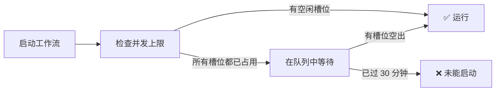

# 配额与限制

每个套餐都包含每个项目无限量的用户旅程和测试用例；用量以 Token 计量。你的账户受两项限制：Token 余额和并发工作流上限。各套餐的具体数值请参阅[订阅套餐](billing/subscription-plans.md)。

## Token 计量

扫描、测试生成、回放和报告背后的 AI 工作会在运行过程中从你的钱包扣除 Token。

| 钱包余额 | 结果 |
| :------------- | :----- |
| 大于零 | 工作照常运行，并在完成时扣费 |
| 为零 | 在你补充 Token 之前，新的 AI 工作会被拒绝 |

在余额大于零时开始的步骤会运行完毕，即使它使余额降到零以下。

[订阅套餐](billing/subscription-plans.md)介绍了赠送额度如何补充、购买的 Token 如何运作，以及先消耗哪一部分余额。

## 并发工作流

你的套餐决定了可以同时运行多少个工作流（扫描、测试生成、回放）。

| 情况 | 结果 |
| :-------- | :----- |
| 未达上限 | 工作流立即启动 |
| 已达上限 | 工作流进入等待，并在某个正在运行的工作流结束后启动 |
| 等待 30 分钟后仍未启动 | 该运行未启动即失败 |

## 企业组织

并发工作流上限**按成员**计算：它取决于执行该工作的成员的账户——即其个人套餐的上限，或已应用到其账户上的企业版数值。

### 企业版配额

| 资源 | 企业版上限 |
| :------- | :--------------- |
| 项目 | 无限制 |
| 每个项目的用户旅程和测试用例 | 无限制 |
| 并发工作流 | 20+（每位成员从 20 起） |
| 每月 Token | 按量付费（每 100 万 Token $5） |
| 席位 | 按购买数量（最少 4 个） |

初始并发数是一个软限制，可按需提高。如需更多，请联系支持团队。

### 配额执行方式

| 范围 | 计入哪些限制 |
| :--- | :--- |
| 针对组织项目的工作流运行 | 执行运行的成员的并发上限，以及组织钱包 |
| 针对个人项目的工作流运行 | 执行运行的成员的并发上限，以及其个人钱包 |

如果成员的账户仍沿用个人套餐的上限，那么在组织项目中也按该上限运行——例如，免费版账户最多同时运行 3 个工作流。

关于席位、角色、账单以及个人与组织模型的完整说明，请参阅[企业组织指南](enterprise-organizations.md)。

## 错误消息

| 消息 | 含义 | 解决方法 |
| :------ | :------ | :------- |
| “Your token balance is insufficient to complete this request” | 你的钱包余额为零 | 购买 Token 充值包或升级套餐 |
| “Never started: the account's concurrent workflow limit was saturated” | 在该运行可等待的 30 分钟内，所有并发槽位一直被占用 | 等正在运行的工作流结束后重新启动该运行，或升级套餐以获得更高的上限 |

## 常见问题

### 用户旅程或测试用例有数量限制吗？

没有。每个套餐都包含每个项目无限量的用户旅程和测试用例。

### 降级后我的测试会怎样？

你的用户旅程和测试用例不受影响。系统会应用新套餐的并发上限，而且降级绝不会收回 Token。

### 更改套餐会立即生效吗？

是的。套餐一经更改，新套餐的并发上限即刻生效。

## 后续步骤

| 目标 | 资源 |
| :--- | :------- |
| 对比套餐 | [订阅套餐](subscription-plans.md) |
| 设置团队账户 | [企业组织](enterprise-organizations.md) |
| 升级套餐 | [控制台账单页](https://www.muggle-ai.com) |
| 了解用户旅程 | [Muggle Test 的工作原理](concepts/how-muggle-test-works.md) |
