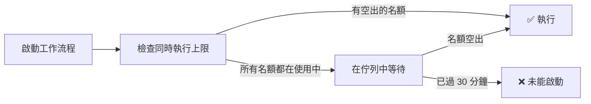

# 配額與限制

每個方案都包含每個專案無限量的使用者旅程與測試案例；用量以 Token 計量。你的帳戶受兩項限制：Token 餘額與同時執行的工作流程上限。各方案的數值請參閱[訂閱方案](billing/subscription-plans.md)。

## Token 計量

掃描、測試產生、重播與報告背後的 AI 工作會在執行時從你的錢包扣除 Token。

| 錢包餘額 | 結果 |
| :------------- | :----- |
| 大於零 | 工作照常執行，並在完成時扣款 |
| 為零 | 在你補充 Token 之前，新的 AI 工作會遭到拒絕 |

在餘額大於零時開始的步驟會執行完畢，即使它讓餘額降到零以下。

[訂閱方案](billing/subscription-plans.md)說明了贈送額度如何補充、購買的 Token 如何運作，以及會先扣抵哪一筆餘額。

## 同時執行的工作流程

你的方案決定可以同時執行多少個工作流程（掃描、測試產生、重播）。

| 情況 | 結果 |
| :-------- | :----- |
| 未達上限 | 工作流程立即啟動 |
| 已達上限 | 工作流程會等待，並在某個執行中的工作流程結束後啟動 |
| 等待 30 分鐘後仍未啟動 | 該次執行未啟動即失敗 |

## 企業組織

同時執行的工作流程上限**依成員**計算：上限來自執行該工作的成員帳戶——也就是其個人方案的上限，或已套用到其帳戶的企業版數值。

### 企業版配額

| 資源 | 企業版上限 |
| :------- | :--------------- |
| 專案 | 無限制 |
| 每個專案的使用者旅程與測試案例 | 無限制 |
| 同時執行的工作流程 | 20+（每位成員從 20 起算） |
| 每月 Token | 按用量計費（每 100 萬 Token $5） |
| 席位 | 依購買數量（至少 4 個） |

起始的同時執行數量屬於軟性限制，可依需求提高。如需更多，請聯絡支援團隊。

### 配額的計算方式

| 範圍 | 計入哪些限制 |
| :--- | :--- |
| 針對組織專案的工作流程執行 | 執行者的同時執行上限，以及組織錢包 |
| 針對個人專案的工作流程執行 | 執行者的同時執行上限，以及其個人錢包 |

如果成員的帳戶仍沿用個人方案的上限，在組織專案中也會以該上限執行——例如，免費版帳戶一次最多執行 3 個工作流程。

關於席位、角色、帳單，以及個人與組織模型的完整說明，請參閱[企業組織指南](enterprise-organizations.md)。

## 錯誤訊息

| 訊息 | 意義 | 解決方法 |
| :------ | :------ | :------- |
| 「Your token balance is insufficient to complete this request」 | 你的錢包餘額為零 | 購買 Token 加值包或升級方案 |
| 「Never started: the account's concurrent workflow limit was saturated」 | 在該次執行可等待的 30 分鐘內，所有同時執行名額一直被占用 | 等執行中的工作流程結束後重新啟動該次執行，或升級方案以取得更高的上限 |

## 常見問題

### 使用者旅程或測試案例有數量限制嗎？

沒有。每個方案都包含每個專案無限量的使用者旅程與測試案例。

### 降級後我的測試會怎麼樣？

你的使用者旅程與測試案例不受影響。系統會套用新方案的同時執行上限，而且降級絕不會收回 Token。

### 變更方案會立即生效嗎？

會。方案一變更，新方案的同時執行上限就會立即生效。

## 後續步驟

| 目標 | 資源 |
| :--- | :------- |
| 比較方案 | [訂閱方案](subscription-plans.md) |
| 設定團隊帳戶 | [企業組織](enterprise-organizations.md) |
| 升級方案 | [儀表板帳單頁面](https://www.muggle-ai.com) |
| 了解使用者旅程 | [Muggle Test 的運作方式](concepts/how-muggle-test-works.md) |
