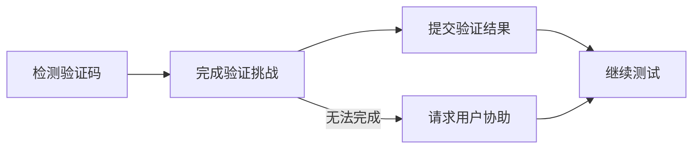

# 自动处理验证码

Muggle Test 会自动处理测试执行过程中遇到的验证码，让你的测试不间断地通过受保护的页面。

## 为什么这很重要

验证码的设计初衷就是阻止自动化访问，因此一直是端到端测试的一大障碍。如果没有自动处理，每当出现验证码时，测试就会失败或需要人工干预。

| 挑战 | Muggle Test 如何帮助 |
| :------------------------------- | :------------------------------------------------- |
| 测试被验证码阻断 | 自动完成常见类型的验证码 |
| 需要人工干预 | 测试运行期间无需人工输入 |
| 测试结果不一致 | 在受保护的流程中稳定执行 |
| 测试登录和注册流程 | 完整覆盖身份验证流程 |

## 支持的验证码类型

Muggle Test 可以自动处理以下类型的验证码：

| 验证码类型 | 说明 |
| :------------------- | :----------------------------------------------- |
| **reCAPTCHA v2** | 复选框（“我不是机器人”）验证 |
| **reCAPTCHA v3** | 基于评分的无感验证 |
| **hCaptcha** | 图片选择和复选框验证 |
| **图片验证码** | 识别扭曲图片中的文字 |

## 工作原理

当 AI 智能体在测试执行过程中遇到验证码时：

| 步骤 | 过程 |
| :------------------ | :----------------------------------------------------- |
| **检测** | 智能体识别页面上的验证码元素 |
| **完成验证** | 系统自动处理并完成验证挑战 |
| **提交** | 将验证结果提交到页面 |
| **继续** | 测试进入下一步 |

## 回退行为

如果验证码无法自动完成（例如类型不受支持或服务不可用），智能体会暂停并请求用户介入。这样可以确保你的测试仍能完成，且受到的干扰最小。

## 最佳实践

| 建议 | 原因 |
| :-------------------------------------- | :------------------------------------------------------ |
| 在关闭验证码的预发布环境中测试 | 不需要防护时，测试执行更快 |
| 在生产环境中使用自动处理 | 验证包含验证码在内的真实用户体验 |
| 检查失败的验证码步骤 | 可能意味着出现了新的验证码类型或配置问题 |

## 限制

| 限制 | 说明 |
| :----------------------------- | :------------------------------------------------------- |
| **滑块验证码** | 目前不支持（需拖动完成的拼图） |
| **音频验证码** | 不支持 |
| **企业自定义验证码** | 可能需要额外配置 |

## 后续步骤

| 目标 | 资源 |
| :-------------------------- | :-------------------------------------------------------------------------- |
| 运行你的第一个测试 | [快速入门：运行测试](getting-started/quickstart-running-tests.md) |
| 了解测试执行 | [Muggle Test 的工作原理](how-muggle-test-works.md) |
| 排查验证码问题 | [常见问题](troubleshooting/common-issues.md) |
