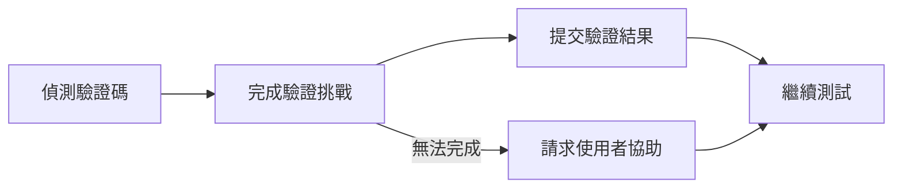

# 自動處理驗證碼

Muggle Test 會自動處理測試執行期間遇到的驗證碼，讓你的測試能不中斷地通過受保護的頁面。

## 為什麼這很重要

驗證碼的設計目的就是阻擋自動化存取，因此一直是端對端測試的一大障礙。若無法自動處理，每次出現驗證碼時，測試就會失敗或需要人工介入。

| 挑戰 | Muggle Test 如何協助 |
| :------------------------------- | :------------------------------------------------- |
| 測試遭驗證碼阻擋 | 自動完成常見類型的驗證碼 |
| 需要人工介入 | 測試執行期間不需人工輸入 |
| 測試結果不一致 | 在受保護的流程中穩定執行 |
| 測試登入與註冊流程 | 完整涵蓋身分驗證流程 |

## 支援的驗證碼類型

Muggle Test 可以自動處理以下類型的驗證碼：

| 驗證碼類型 | 說明 |
| :------------------- | :----------------------------------------------- |
| **reCAPTCHA v2** | 核取方塊（「我不是機器人」）驗證 |
| **reCAPTCHA v3** | 以分數為基礎的隱形驗證 |
| **hCaptcha** | 圖片選取與核取方塊驗證 |
| **圖片驗證碼** | 辨識扭曲圖片中的文字 |

## 運作方式

當 AI 代理程式在測試執行期間遇到驗證碼時：

| 步驟 | 過程 |
| :------------------ | :----------------------------------------------------- |
| **偵測** | 代理程式辨識頁面上的驗證碼元素 |
| **完成驗證** | 系統自動處理並完成驗證挑戰 |
| **提交** | 將驗證結果提交到頁面 |
| **繼續** | 測試進入下一個步驟 |

## 備援行為

如果驗證碼無法自動完成（例如類型不受支援或服務無法使用），代理程式會暫停並請求使用者介入。如此可確保你的測試仍能完成，並將干擾降到最低。

## 最佳實務

| 建議 | 原因 |
| :-------------------------------------- | :------------------------------------------------------ |
| 在停用驗證碼的預備環境中測試 | 不需要防護時，測試執行速度更快 |
| 在正式環境中使用自動處理 | 驗證包含驗證碼在內的真實使用者體驗 |
| 檢查失敗的驗證碼步驟 | 可能代表出現了新的驗證碼類型或設定問題 |

## 限制

| 限制 | 備註 |
| :----------------------------- | :------------------------------------------------------- |
| **滑塊驗證碼** | 目前不支援（需拖曳完成的拼圖） |
| **音訊驗證碼** | 不支援 |
| **企業自訂驗證碼** | 可能需要額外設定 |

## 後續步驟

| 目標 | 資源 |
| :-------------------------- | :-------------------------------------------------------------------------- |
| 執行你的第一個測試 | [快速入門：執行測試](getting-started/quickstart-running-tests.md) |
| 了解測試執行 | [Muggle Test 的運作方式](how-muggle-test-works.md) |
| 排解驗證碼問題 | [常見問題](troubleshooting/common-issues.md) |
