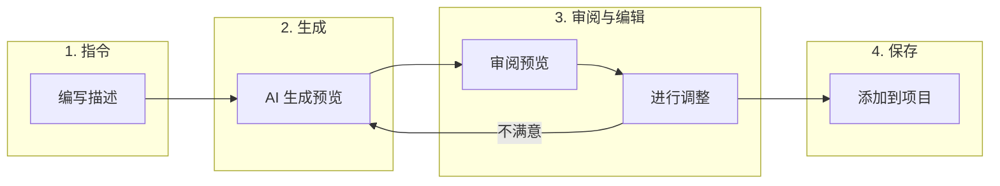

# 根据指令生成用户旅程和测试用例

Muggle Test 让你用自然语言描述需求，即可创建用户旅程和测试用例。无需手动填写表单，只需写一条简短的指令，AI 就会为你生成详细内容。

## 概览

| 阶段 | 会发生什么 |
| :---- | :----------- |
| **指令** | 你用自然语言描述想要测试的内容 |
| **生成** | AI 根据你的描述创建结构化预览 |
| **审阅与编辑** | 你审阅、修改或重新生成预览 |
| **保存** | 你将定稿的条目添加到项目中 |

## 根据指令添加用户旅程

用户旅程代表你想要测试的用户流程或场景。描述用户的使用过程，即可快速生成用户旅程。

### 如何生成用户旅程

1. 在 Muggle Test 控制台中打开你的项目
2. 进入**用户旅程**部分
3. 点击**添加用户旅程**，然后选择**根据指令生成**
4. 在文本框中写下你的指令
5. 点击**生成预览**
6. 审阅并编辑生成的用户旅程
7. 满意后点击**添加到测试计划**

### 编写有效的用户旅程指令

| 建议 | 避免 |
| :- | :---- |
| 清楚描述用户的目标 | 只写含糊的单个词 |
| 包含涉及的关键步骤 | 罗列每一个细微交互 |
| 说明预期结果 | 假定 AI 了解你的业务领域 |
| 提及具体功能 | 使用缺乏上下文的内部术语 |

### 指令示例

| 指令 | 生成的内容 |
| :---------- | :------------------ |
| “作为已登录用户，我可以从商品页面将商品加入购物车、查看购物车、更新数量，然后进入结账” | 购物车流程，并按每个步骤拆解 |
| “用户使用邮箱注册，收到验证邮件，点击链接，然后完成个人资料设置” | 包含验证步骤的注册流程 |
| “管理员可以创建新用户账户、分配角色，以及停用现有用户” | 包含 CRUD 操作的用户管理用户旅程 |

### 预览包含的内容

| 字段 | 说明 |
| :---- | :---------- |
| **标题** | 用户旅程的简短名称 |
| **类别** | 负责该流程的子系统或服务 |
| **网址** | 流程的起始页面 |
| **用户故事** | “作为[用户]，我想要[操作]，以便[收益]” |
| **描述** | 场景的详细说明 |
| **拆解** | 各个子场景，以及对应的需求和验收标准 |
| **状态** | 审批状态（默认为已批准） |
| **优先级** | 测试执行的重要程度 |

## 根据指令添加测试用例

测试用例是从用户旅程中派生出的具体场景。描述你想验证的方面，即可一次生成多个测试用例。

### 如何生成测试用例

1. 在项目中打开一个用户旅程
2. 点击**添加测试用例**，然后选择**根据指令生成**
3. 查看显示用户旅程详情的上下文面板
4. 写下描述测试内容的指令
5. 点击**生成预览**
6. 审阅生成的测试用例
7. 使用复选框选择要添加的测试用例
8. 点击**将所选项添加到计划**

### 编写有效的测试用例指令

| 建议 | 避免 |
| :- | :---- |
| 明确要覆盖的场景 | 重复用户旅程的描述 |
| 提及边界情况和错误条件 | 只关注正常路径 |
| 包含边界条件 | 编写过于笼统的指令 |
| 引用现有的测试覆盖以避免重复 | 忽略已经测试过的内容 |

### 指令示例

| 指令 | 生成的内容 |
| :---------- | :------------------ |
| “测试使用有效凭据、错误密码和账户被锁定三种场景下的用户登录” | 覆盖成功和失败路径的三个测试用例 |
| “验证将数量改为 0、1 和允许的最大值时，购物车是否正确更新” | 针对数量字段的边界测试 |
| “测试使用过期银行卡、余额不足和支付成功三种情况下的结账” | 支付校验测试用例 |

### 每个测试用例预览包含的内容

| 字段 | 说明 |
| :---- | :---------- |
| **标题** | 简短的描述性名称 |
| **目标** | 测试要验证的内容 |
| **描述** | 详细的测试场景 |
| **前置条件** | 测试运行前所需的状态 |
| **预期结果** | 测试通过时应当发生的情况 |
| **优先级** | 测试的重要程度 |
| **类别** | 测试分组标签 |
| **标签** | 用于筛选的关键词 |
| **网址** | 测试的起始页面 |

## 使用预览

### 编辑生成的内容

预览中的所有字段都可编辑。点击任意字段即可修改：

| 操作 | 方法 |
| :----- | :----- |
| 编辑文本字段 | 点击后直接输入 |
| 更改优先级/状态 | 使用下拉选择器 |
| 修改拆解条目 | 展开条目后编辑 |
| 添加拆解条目 | 点击**添加条目**按钮 |
| 移除拆解条目 | 点击条目上的**移除** |

### 重新生成预览

如果生成的预览不符合你的预期：

1. 为你的指令补充更多细节
2. 再次点击**生成预览**
3. 新的预览会完全替换当前预览

### 放弃提案

如果你想重新开始或取消：

1. 在预览区域点击**放弃提案**
2. 预览会被清空
3. 你可以编写新的指令，或关闭弹窗

### 选择测试用例

生成测试用例时，你可以选择要添加哪些：

| 操作 | 结果 |
| :----- | :----- |
| **全选** | 勾选所有生成的测试用例 |
| **取消全选** | 取消勾选所有测试用例 |
| **单个复选框** | 切换单个测试用例的选中状态 |

点击**将所选项添加到计划**时，只会添加已选中的测试用例。

## 最佳实践

### 提升 AI 生成效果

| 技巧 | 好处 |
| :-- | :------ |
| 明确用户角色 | 生成合适的权限上下文 |
| 包含成功和失败场景 | 测试覆盖更全面 |
| 提及集成点 | 捕捉跨系统交互 |
| 描述预期数据 | 生成贴近真实的测试场景 |

### 提高工作效率

| 技巧 | 好处 |
| :-- | :------ |
| 先查看已有的用户旅程 | 避免重复覆盖 |
| 从高优先级流程开始 | 让 AI 聚焦关键路径 |
| 优先编辑而不是重新生成 | 保留预览中好的部分 |
| 使用一致的术语 | 更便于搜索和整理 |

## 上下文感知

AI 会利用可用的上下文生成更好的结果：

### 用户旅程

| 上下文 | 作用 |
| :------ | :----------- |
| **项目名称** | 理解应用所属的领域 |
| **项目描述** | 了解系统的功能 |

### 测试用例

| 上下文 | 作用 |
| :------ | :----------- |
| **用户旅程标题** | 生成相关的测试场景 |
| **用户故事** | 理解用户的目标 |
| **已有测试用例** | 避免生成重复内容 |

## 故障排除

### 常见问题

| 问题 | 解决方法 |
| :---- | :------- |
| 生成的内容过于笼统 | 在指令中补充更具体的细节 |
| 遗漏重要场景 | 在指令中明确提及边界情况 |
| 对业务领域的假设有误 | 补充有关你的应用的上下文 |
| 生成了重复的测试用例 | 在指令中引用已有测试 |

### 获得更好结果的技巧

| 情况 | 可以尝试 |
| :-------- | :---------- |
| AI 误解了意图 | 改用“作为[用户]，我想要[操作]”的格式重新表述 |
| 拆解条目太少 | 要求“全面”或“详细”的覆盖 |
| 拆解条目太多 | 要求只包含“关键”或“必要”的场景 |

## 后续步骤

| 目标 | 资源 |
| :--- | :------- |
| 改为上传 PRD 文件 | [上传 PRD 文件](prd-upload.md) |
| 运行你生成的测试 | [快速入门：运行你的第一批测试](getting-started/quickstart-running-tests.md) |
| 了解测试执行 | [Muggle Test 的工作原理](how-muggle-test-works.md) |
