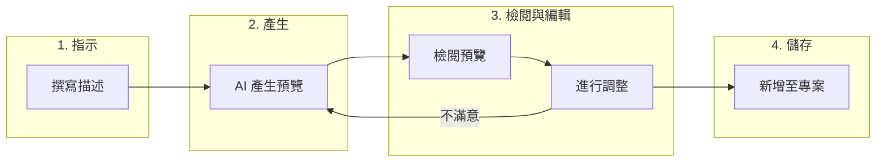

# 依指示產生使用者旅程與測試案例

Muggle Test 讓你用日常語言描述需求，就能建立使用者旅程與測試案例。不必手動填寫表單，只要寫下一段簡短的指示，AI 就會為你產生詳細內容。

## 總覽

| 階段 | 會發生什麼事 |
| :---- | :----------- |
| **指示** | 你用自然語言描述想要測試的內容 |
| **產生** | AI 根據你的描述建立結構化的預覽 |
| **檢閱與編輯** | 你檢閱、修改或重新產生預覽 |
| **儲存** | 你將定案的項目新增至專案 |

## 依指示新增使用者旅程

使用者旅程代表你想要測試的使用者流程或情境。只要描述使用者的操作歷程，就能快速產生使用者旅程。

### 產生使用者旅程的步驟

1. 在 Muggle Test 儀表板中開啟你的專案
2. 前往**使用者旅程**區塊
3. 點選**新增使用者旅程**，然後選擇**根據指令產生**
4. 在文字區域中寫下你的指示
5. 點選**產生預覽**
6. 檢閱並編輯產生的使用者旅程
7. 確認沒問題後，點選**新增至測試計畫**

### 撰寫有效的使用者旅程指示

| 建議做法 | 避免做法 |
| :- | :---- |
| 清楚描述使用者的目標 | 只寫含糊的單一詞彙 |
| 列出涉及的關鍵步驟 | 列出每一個細微的互動 |
| 說明預期結果 | 假設 AI 了解你的業務領域 |
| 提及特定功能 | 使用沒有上下文的內部術語 |

### 指示範例

| 指示 | 產生的內容 |
| :---------- | :------------------ |
| 「身為已登入的使用者，我可以從商品頁面將商品加入購物車、檢視購物車、更新數量，然後前往結帳」 | 購物車流程，並依每個步驟細分 |
| 「使用者以電子郵件註冊、收到驗證信、點選連結，然後完成個人資料設定」 | 含驗證步驟的註冊流程 |
| 「管理員可以建立新的使用者帳戶、指派角色，以及停用現有使用者」 | 含 CRUD 操作的使用者管理旅程 |

### 預覽包含的內容

| 欄位 | 說明 |
| :---- | :---------- |
| **標題** | 使用者旅程的簡短名稱 |
| **類別** | 負責此流程的子系統或服務 |
| **網址** | 流程的起始頁面 |
| **使用者故事** | 「身為[使用者]，我想要[動作]，以便[效益]」 |
| **說明** | 情境的詳細說明 |
| **細分** | 各個子情境，以及對應的需求與驗收標準 |
| **狀態** | 核准狀態（預設為已核准） |
| **優先順序** | 測試執行的重要程度 |

## 依指示新增測試案例

測試案例是從使用者旅程衍生出的具體情境。只要描述你想驗證的面向，就能一次產生多個測試案例。

### 產生測試案例的步驟

1. 在專案中開啟一個使用者旅程
2. 點選**新增測試案例**，然後選擇**根據指令產生**
3. 查看顯示使用者旅程詳細資料的上下文面板
4. 寫下描述測試內容的指示
5. 點選**產生預覽**
6. 檢閱產生的測試案例
7. 使用核取方塊選取要新增的測試案例
8. 點選**將選取項目新增至計畫**

### 撰寫有效的測試案例指示

| 建議做法 | 避免做法 |
| :- | :---- |
| 指明要涵蓋的情境 | 重複使用者旅程的描述 |
| 提及邊界情況與錯誤狀況 | 只關注正常路徑 |
| 納入邊界條件 | 撰寫過於籠統的指示 |
| 參照現有的測試涵蓋範圍，避免重複 | 忽略已經測試過的內容 |

### 指示範例

| 指示 | 產生的內容 |
| :---------- | :------------------ |
| 「測試使用有效憑證、錯誤密碼與帳戶遭鎖定三種情境下的使用者登入」 | 涵蓋成功與失敗路徑的三個測試案例 |
| 「驗證將數量改為 0、1 與允許的最大值時，購物車是否正確更新」 | 針對數量欄位的邊界測試 |
| 「測試使用過期信用卡、餘額不足與付款成功三種情況下的結帳」 | 付款驗證測試案例 |

### 每個測試案例預覽包含的內容

| 欄位 | 說明 |
| :---- | :---------- |
| **標題** | 簡短的描述性名稱 |
| **目標** | 測試要驗證的內容 |
| **說明** | 詳細的測試情境 |
| **前置條件** | 測試執行前必須具備的狀態 |
| **預期結果** | 測試通過時應該發生的情況 |
| **優先順序** | 測試的重要程度 |
| **類別** | 測試分組標籤 |
| **標籤** | 用於篩選的關鍵字 |
| **網址** | 測試的起始頁面 |

## 使用預覽

### 編輯產生的內容

預覽中的所有欄位都可以編輯。點選任一欄位即可修改：

| 動作 | 做法 |
| :----- | :----- |
| 編輯文字欄位 | 點選後直接輸入 |
| 變更優先順序/狀態 | 使用下拉式選單 |
| 修改細分項目 | 展開項目後編輯 |
| 新增細分項目 | 點選**新增項目**按鈕 |
| 移除細分項目 | 點選該項目上的**移除** |

### 重新產生預覽

如果產生的預覽不符合你的預期：

1. 為你的指示補充更多細節
2. 再按一次**產生預覽**
3. 新的預覽會完全取代目前的預覽

### 放棄提案

如果你想重新開始或取消：

1. 在預覽區塊點選**放棄提案**
2. 預覽會被清除
3. 你可以撰寫新的指示，或關閉彈出視窗

### 選取測試案例

產生測試案例時，你可以選取要新增哪些：

| 動作 | 結果 |
| :----- | :----- |
| **全選** | 勾選所有產生的測試案例 |
| **取消全選** | 取消勾選所有測試案例 |
| **個別核取方塊** | 切換單一測試案例的選取狀態 |

點選**將選取項目新增至計畫**時，只會新增已選取的測試案例。

## 最佳做法

### 讓 AI 產生更好的結果

| 秘訣 | 效益 |
| :-- | :------ |
| 明確指出使用者角色 | 產生合適的權限上下文 |
| 納入成功與失敗情境 | 測試涵蓋範圍更完整 |
| 提及整合點 | 掌握跨系統的互動 |
| 描述預期的資料 | 產生貼近真實的測試情境 |

### 提升工作效率

| 秘訣 | 效益 |
| :-- | :------ |
| 先檢閱現有的使用者旅程 | 避免重複涵蓋 |
| 從高優先順序的流程開始 | 讓 AI 聚焦在關鍵路徑 |
| 以編輯取代重新產生 | 保留預覽中好的部分 |
| 使用一致的術語 | 更容易搜尋與整理 |

## 上下文感知

AI 會運用可取得的上下文來產生更好的結果：

### 使用者旅程

| 上下文 | 幫助 |
| :------ | :----------- |
| **專案名稱** | 了解應用程式所屬的領域 |
| **專案說明** | 了解系統的用途 |

### 測試案例

| 上下文 | 幫助 |
| :------ | :----------- |
| **使用者旅程標題** | 產生相關的測試情境 |
| **使用者故事** | 了解使用者的目標 |
| **現有測試案例** | 避免產生重複的內容 |

## 疑難排解

### 常見問題

| 問題 | 解決方法 |
| :---- | :------- |
| 產生的內容過於籠統 | 在指示中補充更具體的細節 |
| 遺漏重要情境 | 在指示中明確提及邊界情況 |
| 對業務領域的假設有誤 | 補充與你的應用程式相關的上下文 |
| 產生了重複的測試案例 | 在指示中參照現有的測試 |

### 取得更好結果的秘訣

| 情況 | 可以嘗試 |
| :-------- | :---------- |
| AI 誤解了意圖 | 改用「身為[使用者]，我想要[動作]」的格式重新描述 |
| 細分項目太少 | 要求「完整」或「詳細」的涵蓋範圍 |
| 細分項目太多 | 要求只納入「關鍵」或「必要」的情境 |

## 後續步驟

| 目標 | 資源 |
| :--- | :------- |
| 改為上傳 PRD 檔案 | [上傳 PRD 檔案](prd-upload.md) |
| 執行你產生的測試 | [快速入門：執行你的第一批測試](getting-started/quickstart-running-tests.md) |
| 了解測試執行 | [Muggle Test 的運作方式](how-muggle-test-works.md) |
