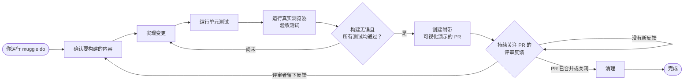

# Muggle Do 的工作原理

`muggle do` 为你运行完整的开发周期——从一条自然语言请求，到一个经过测试、可供评审的 PR。你只需在开始时回答一组简短的问题，之后它就会自主工作：编写变更、在真实浏览器中测试、创建附带可视化证据的 PR，并跟进评审反馈，直到 PR 合并。

## 工作流

## 各步骤的作用

| 步骤 | 会发生什么 |
| :--- | :--- |
| **确认要构建的内容** | 你回答一份简短的问卷，描述变更内容以及测试方式。此后无需再提供任何输入。 |
| **实现变更** | 按照你现有代码的风格和结构编写变更。 |
| **运行单元测试** | 运行单元测试套件，尽早发现逻辑回归。 |
| **真实浏览器验收测试** | Muggle Test 会检测你的变更影响了哪些用户流程，并在真实浏览器中对这些流程运行端到端验收测试。 |
| **质量关卡** | 只有在构建无误、单元测试通过且验收结果已记录后，才会创建 PR。如果某项检查失败，它会回到前面的步骤再次尝试。 |
| **创建 PR** | 创建一个附带可视化演示的 PR——包含每个已测试流程的截图和通过/失败结果。 |
| **跟进评审** | 在 PR 处于打开状态期间，它会持续关注评审者的反馈。每当评审者发表评论，它就会应用修改、重新测试、推送更新并回复——如此往复，直到 PR 合并或关闭。 |
| **清理** | PR 合并后，它会清理工作分支。 |

## 为何重要

| 不使用 muggle do | 使用 muggle do |
| :--- | :--- |
| 在编码、测试和 PR 评审之间来回切换 | 一条命令运行整个周期 |
| 手动在浏览器中测试每个改动过的流程 | 受影响的流程会自动进行验收测试 |
| 评审者看到的代码没有任何能正常工作的证据 | 每个 PR 都附带通过流程的可视化演示 |
| 评审反馈要等你回头才会处理 | 反馈一到就会被处理并重新测试 |
