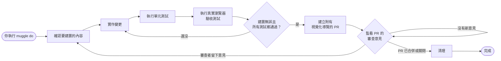

# Muggle Do 的運作方式

`muggle do` 會為你執行完整的開發週期——從一段日常語言的需求，到一個經過測試、可供審查的 PR。你只需要在一開始回答一組簡短的問題，之後它就會自行運作：撰寫變更、在真實瀏覽器中測試、建立附有視覺化證明的 PR，並持續追蹤審查意見，直到 PR 合併為止。

## 工作流程

## 各步驟的作用

| 步驟 | 會發生什麼事 |
| :--- | :--- |
| **確認要建置的內容** | 你回答一份簡短的問卷，說明變更內容與測試方式。之後就不需要再提供任何輸入。 |
| **實作變更** | 依照你現有程式碼的風格與結構撰寫變更。 |
| **執行單元測試** | 執行單元測試套件，及早抓出邏輯上的迴歸問題。 |
| **真實瀏覽器驗收測試** | Muggle Test 會偵測你的變更影響了哪些使用者流程，並在真實瀏覽器中針對這些流程執行端對端驗收測試。 |
| **品質關卡** | 只有在建置無誤、單元測試通過，且驗收結果都已記錄之後，才會建立 PR。如果某項檢查失敗，它會回到前面的步驟再試一次。 |
| **建立 PR** | 建立一個附有視覺化導覽的 PR——包含每個受測流程的螢幕截圖與通過/失敗結果。 |
| **追蹤審查** | 在 PR 開啟期間，它會持續監看審查者的意見。每當審查者留言，它就會套用修改、重新測試、推送更新並回覆——不斷重複，直到 PR 合併或關閉為止。 |
| **清理** | PR 合併後，它會清理工作分支。 |

## 為何重要

| 不使用 muggle do | 使用 muggle do |
| :--- | :--- |
| 在撰寫程式碼、測試與 PR 審查之間不斷切換 | 一個指令就能跑完整個週期 |
| 手動在瀏覽器中測試每個變更過的流程 | 受影響的流程會自動進行驗收測試 |
| 審查者看到的程式碼沒有任何能正常運作的證明 | 每個 PR 都附有通過流程的視覺化導覽 |
| 審查意見要等你回頭才會處理 | 意見一進來就會被處理並重新測試 |
