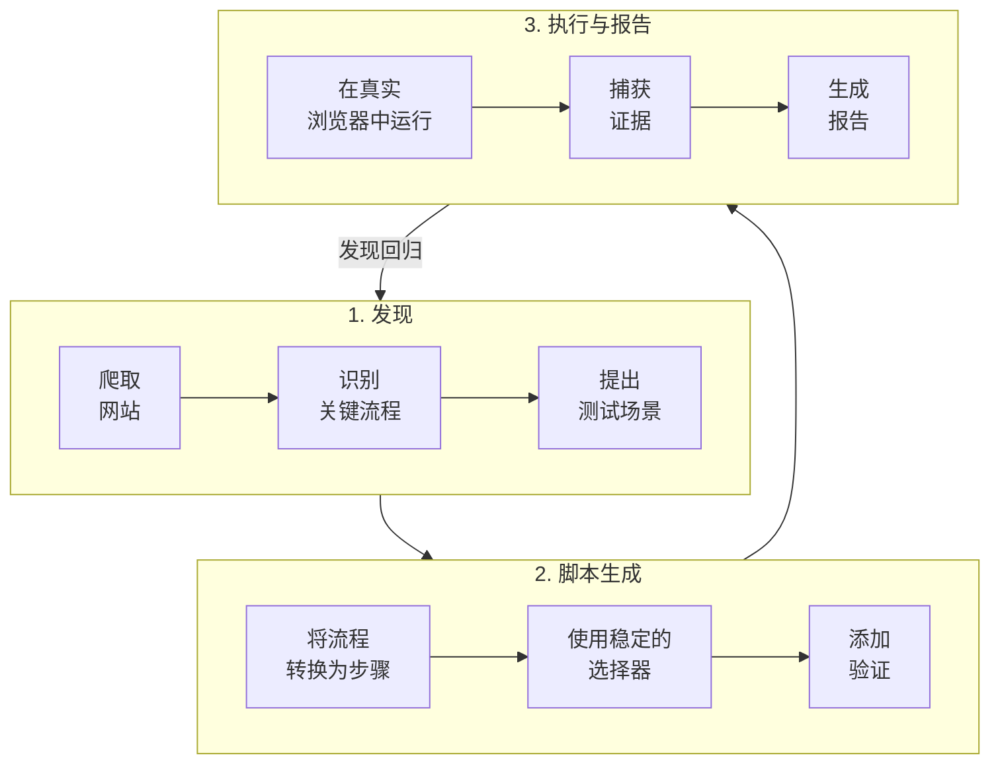
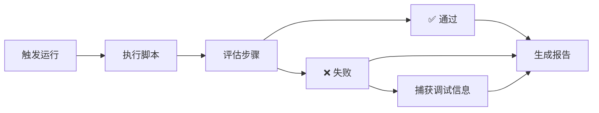

# Muggle Test 架构

从整体上看，Muggle Test 做三件事：

1. **发现**你的应用中的重要流程
2. 根据这些流程**生成**可执行的测试脚本
3. 在每次变更时**重新运行**这些脚本，并呈现回归问题

## 发现

Muggle Test 提供两种发现测试场景的方式：

### 方式 1：网站扫描

AI 智能体会在真实浏览器中探索你的应用。

| 阶段 | 说明 |
| :----------- | :--------------------------------------------------------- |
| **爬取** | 从你的基础网址出发，沿着链接和按钮进行导航 |
| **识别** | 识别关键页面和操作（登录、表单、仪表盘） |
| **提出** | 在你的项目中创建带标签的场景 |

### 方式 2：上传 PRD

上传你的需求文档，让 AI 提取场景。

| 阶段 | 说明 |
| :----------- | :--------------------------------------------------------- |
| **上传** | 提供一个 PRD 文件（PDF、DOC、DOCX、TXT） |
| **提取** | AI 识别用户故事和验收标准 |
| **生成** | 场景转化为用户旅程，可直接用于生成测试脚本 |

详细指导请参阅[上传 PRD 文件](prd-upload.md)。

### 智能体能应对的挑战

| 挑战 | 解决方式 |
| :------------------- | :-------------------------------------------------- |
| 多步骤工作流 | 智能体沿着真实的用户路径操作 |
| 动态内容 | 等待异步加载完成 |
| 身份验证 | 使用你提供的凭据访问受保护的区域 |

## 测试脚本

每个发现的场景都会成为一系列具体的步骤。

### 步骤示例

| 步骤 | 说明 |
| :--- | :-------------------------------------------- |
| 1 | 点击**登录**按钮 |
| 2 | 在标签为**邮箱**的字段中输入邮箱 |
| 3 | 在标签为**密码**的字段中输入密码 |
| 4 | 点击**提交** |
| 5 | 等待仪表盘加载完成 |

### 脚本稳定性

| 策略 | 好处 |
| :------------------- | :----------------------------------------- |
| 人眼可见的标签 | 比脆弱的 CSS 选择器更稳定 |
| 灵活匹配 | 能容忍细微的布局和内容变化 |
| 智能等待 | 能应对不同的加载时间 |

## 运行与报告

运行测试时，脚本会在浏览器环境中执行。

### 失败时捕获的内容

| 产物 | 用途 |
| :------------------- | :------------------------------ |
| **网址** | 失败发生的位置 |
| **步骤描述** | 尝试执行的操作 |
| **截图** | 失败时的页面视觉状态 |
| **错误摘要** | 用于调试的技术细节 |

### 报告的作用

| 使用场景 | 好处 |
| :--------------------- | :----------------------------------- |
| 一眼看清健康状况 | 了解哪些流程运行正常 |
| 确定修复优先级 | 聚焦于对业务至关重要的失败 |
| 与团队共享 | 非工程人员也能看懂结果 |

## 后续步骤

| 目标 | 资源 |
| :---------------- | :-------------------------------------------------------------------------- |
| 开始使用 | [快速入门：运行你的第一批测试](getting-started/quickstart-running-tests.md) |
| 上传 PRD 文件 | [上传 PRD 文件](prd-upload.md) |
| 通过 API 集成 | [API 概览](api/api-overview.md) |
| 使用 AI 助手 | [远程测试概览](mcp/overview.md) |
