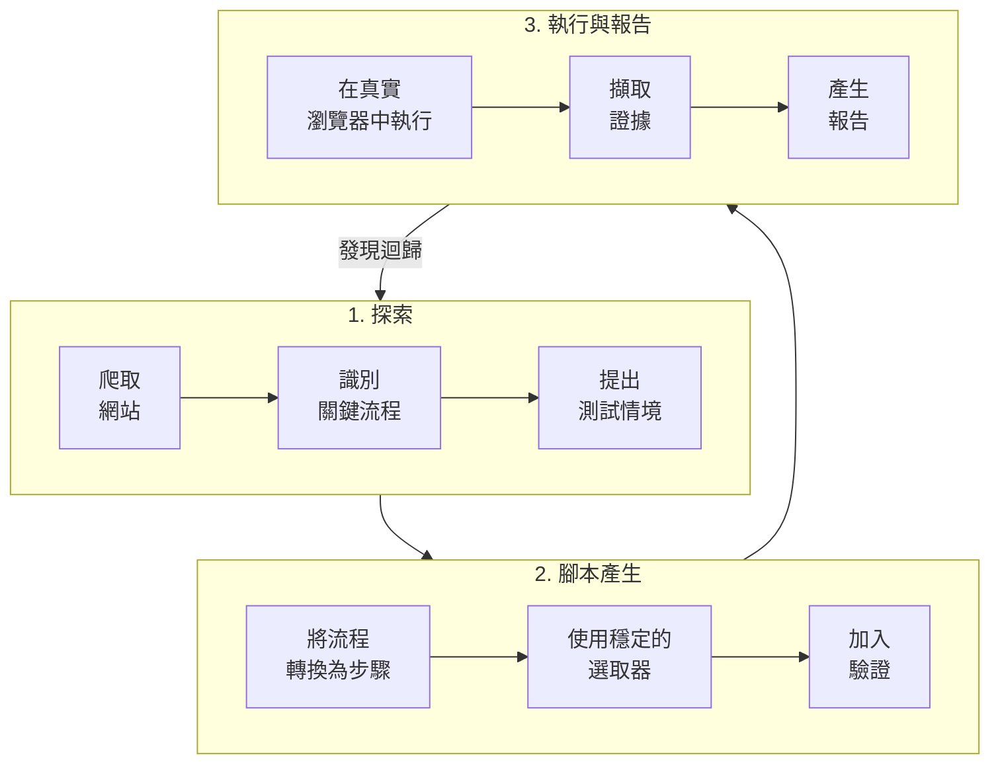
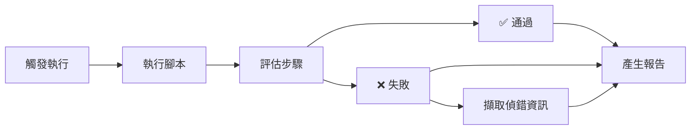

# Muggle Test 架構

從整體來看，Muggle Test 會做三件事：

1. **探索**你的應用程式中的重要流程
2. 根據這些流程**產生**可執行的測試腳本
3. 在每次變更時**重新執行**這些腳本，並找出迴歸問題

## 探索

Muggle Test 提供兩種探索測試情境的方式：

### 選項 1：網站掃描

AI 代理程式會在真實瀏覽器中探索你的應用程式。

| 階段 | 說明 |
| :----------- | :--------------------------------------------------------- |
| **爬取** | 從你的基礎網址開始，沿著連結與按鈕瀏覽 |
| **識別** | 辨識關鍵頁面與動作（登入、表單、儀表板） |
| **提出** | 在你的專案中建立帶有標籤的情境 |

### 選項 2：上傳 PRD

上傳你的需求文件，讓 AI 擷取情境。

| 階段 | 說明 |
| :----------- | :--------------------------------------------------------- |
| **上傳** | 提供 PRD 檔案（PDF、DOC、DOCX、TXT） |
| **擷取** | AI 識別使用者故事與驗收標準 |
| **產生** | 情境會轉為使用者旅程，可直接用來產生測試腳本 |

詳細說明請參閱[上傳 PRD 檔案](prd-upload.md)。

### 代理程式能克服的挑戰

| 挑戰 | 解決方式 |
| :------------------- | :-------------------------------------------------- |
| 多步驟工作流程 | 代理程式會依循真實的使用者路徑操作 |
| 動態內容 | 等待非同步載入完成 |
| 身分驗證 | 使用你提供的憑證存取受保護的區域 |

## 測試腳本

每個探索到的情境都會轉換成一連串具體的步驟。

### 步驟範例

| 步驟 | 說明 |
| :--- | :-------------------------------------------- |
| 1 | 點選**登入**按鈕 |
| 2 | 在標示為**電子郵件**的欄位中輸入電子郵件 |
| 3 | 在標示為**密碼**的欄位中輸入密碼 |
| 4 | 點選**送出** |
| 5 | 等待儀表板載入完成 |

### 腳本穩定性

| 策略 | 效益 |
| :------------------- | :----------------------------------------- |
| 人眼可見的標籤 | 比脆弱的 CSS 選取器更穩定 |
| 彈性比對 | 能容許細微的版面與內容變化 |
| 智慧等待 | 能因應不同的載入時間 |

## 執行與報告

當你執行測試時，腳本會在瀏覽器環境中執行。

### 失敗時擷取的內容

| 產出物 | 用途 |
| :------------------- | :------------------------------ |
| **網址** | 失敗發生的位置 |
| **步驟說明** | 嘗試執行的動作 |
| **螢幕截圖** | 失敗當下的畫面狀態 |
| **錯誤摘要** | 用於偵錯的技術細節 |

### 報告的幫助

| 使用情境 | 效益 |
| :--------------------- | :----------------------------------- |
| 一眼掌握健康狀態 | 了解哪些流程運作正常 |
| 排定修正的優先順序 | 聚焦在影響業務的關鍵失敗 |
| 與團隊分享 | 非工程人員也能看懂結果 |

## 後續步驟

| 目標 | 資源 |
| :---------------- | :-------------------------------------------------------------------------- |
| 開始使用 | [快速入門：執行你的第一批測試](getting-started/quickstart-running-tests.md) |
| 上傳 PRD 檔案 | [上傳 PRD 檔案](prd-upload.md) |
| 透過 API 整合 | [API 總覽](api/api-overview.md) |
| 使用 AI 助理 | [遠端測試總覽](mcp/overview.md) |
