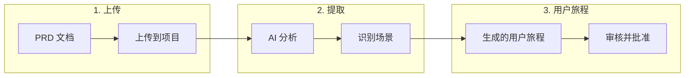

# 上传 PRD 文件

Muggle Test 可以从你的产品需求文档（PRD）中自动提取测试场景。无需手动定义用户旅程，只需上传现有文档，让 AI 识别需要测试的关键流程。

## 概览

| 阶段 | 过程 |
| :---- | :----------- |
| **上传** | 你提供一个 PRD 文件（TXT、PDF、DOC、DOCX） |
| **提取** | AI 阅读文档并识别可测试的场景 |
| **用户旅程** | 场景转化为用户旅程，可直接用于生成测试 |

## 支持的文件格式

| 格式 | 扩展名 | 说明 |
| :----- | :-------- | :---- |
| 纯文本 | `.txt` | 最适合简单、整洁的文档 |
| PDF | `.pdf` | 支持从标准 PDF 中提取文本 |
| Word 文档 | `.doc`、`.docx` | Microsoft Word 格式 |

## 如何上传 PRD

### 从控制台上传

1. 在 Muggle Test 控制台中打开你的项目
2. 进入**用户旅程**部分
3. 点击**从 PRD 添加用户旅程**
4. 拖放你的文件，或点击浏览选择文件
5. 等待处理完成

### 创建项目时上传

1. 使用你的网站网址创建新项目
2. 在**添加用户旅程**步骤中，选择**上传 PRD**
3. 上传你的需求文档
4. 继续之前，先审核提取出的用户旅程

## 提取内容

AI 会分析你的 PRD，识别以下内容：

| 要素 | 说明 |
| :------ | :---------- |
| **用户故事** | “作为用户，我希望……”形式的陈述 |
| **验收标准** | 必须满足的具体条件 |
| **用户流程** | 与系统的逐步交互 |
| **业务规则** | 需要验证的逻辑 |

### 提取示例

**对于这段 PRD 文本：**
> 用户应能使用邮箱和密码登录。登录成功后，用户应看到包含近期活动的控制台。登录失败时应显示错误消息。

**Muggle Test 会提取出：**

| 用户旅程 | 说明 |
| :------- | :---------- |
| 登录成功 | 用户使用有效凭据登录并看到控制台 |
| 登录失败 | 用户输入无效凭据并看到错误消息 |
| 控制台显示 | 已登录用户在控制台上看到近期活动 |

## 重复检测

Muggle Test 会自动检测重复上传的文件，避免重复处理。

### 工作原理

| 场景 | 结果 |
| :------- | :----- |
| 同一文件两次上传到**同一项目** | 被阻止——显示已有文件 |
| 同一文件上传到**不同项目** | 允许——各项目独立处理 |
| 同名但已修改的文件 | 允许——内容不同 |

### 出现重复时会发生什么

当你上传项目中已存在的文件时：

1. 上传会被拒绝，并显示明确的提示消息
2. 重复的文件会被自动清理
3. 系统会向你显示已有文件的信息
4. 你可以改为重新处理已有文件

## 最佳实践

### 编写更易于提取的 PRD 内容

| 推荐做法 | 避免做法 |
| :- | :---- |
| 使用清晰的用户故事格式 | 编写模糊的需求 |
| 包含具体的验收标准 | 不定义成功条件 |
| 描述逐步的流程 | 假定读者具备隐含知识 |
| 列出错误场景 | 只关注正常路径 |

### 整理你的文档

| 技巧 | 好处 |
| :-- | :------ |
| 每个章节只写一个功能 | 用户旅程分组更清晰 |
| 使用标题和项目符号 | 更易于解析 |
| 包含示例 | 测试场景更具体 |

## 上传之后

PRD 处理完成后：

| 步骤 | 操作 |
| :--- | :----- |
| **审核** | 检查提取出的用户旅程是否准确 |
| **编辑** | 修改标题、描述或优先级 |
| **批准** | 将用户旅程转为启用状态 |
| **生成** | 根据已批准的用户旅程创建测试脚本 |

## 处理状态

| 状态 | 含义 |
| :----- | :------ |
| **等待中** | 文件已上传，等待处理 |
| **运行中** | AI 正在分析文档 |
| **已完成** | 已成功提取用户旅程 |
| **失败** | 处理出错（请检查文件格式） |

## 故障排除

### 常见问题

| 问题 | 解决方法 |
| :---- | :------- |
| 未提取到任何用户旅程 | 确保 PRD 包含清晰的需求 |
| 处理卡住 | 检查文件是否损坏或为空 |
| 重复错误 | 使用已有文件，或先将其删除 |
| 格式不受支持 | 转换为 TXT、PDF、DOC 或 DOCX |

### 文件大小限制

| 限制 | 值 |
| :---- | :---- |
| 最大文件大小 | 10 MB |
| 建议大小 | 2 MB 以下，处理更快 |

## 后续步骤

| 目标 | 资源 |
| :--- | :------- |
| 生成测试脚本 | [Muggle Test 的工作原理](how-muggle-test-works.md) |
| 运行你的测试 | [快速入门：运行测试](getting-started/quickstart-running-tests.md) |
| 使用 API 上传 | [API 概览](api/api-overview.md) |
