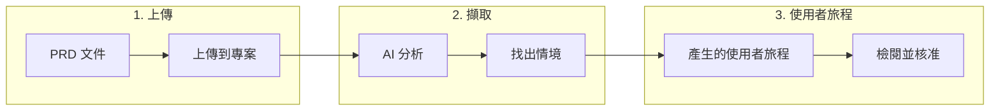

# 上傳 PRD 檔案

Muggle Test 可以從你的產品需求文件（PRD）中自動擷取測試情境。你不必手動定義使用者旅程，只要上傳現有的文件，就能讓 AI 找出需要測試的關鍵流程。

## 總覽

| 階段 | 過程 |
| :---- | :----------- |
| **上傳** | 你提供一個 PRD 檔案（TXT、PDF、DOC、DOCX） |
| **擷取** | AI 讀取文件並找出可測試的情境 |
| **使用者旅程** | 情境轉為使用者旅程，可直接用於產生測試 |

## 支援的檔案格式

| 格式 | 副檔名 | 備註 |
| :----- | :-------- | :---- |
| 純文字 | `.txt` | 最適合簡單、乾淨的文件 |
| PDF | `.pdf` | 支援從標準 PDF 擷取文字 |
| Word 文件 | `.doc`、`.docx` | Microsoft Word 格式 |

## 如何上傳 PRD

### 從儀表板上傳

1. 在 Muggle Test 儀表板中開啟你的專案
2. 前往**使用者旅程**區塊
3. 點選**從 PRD 新增使用者旅程**
4. 拖放你的檔案，或點選以瀏覽選取檔案
5. 等待處理完成

### 建立專案時上傳

1. 使用你的網站網址建立新專案
2. 在**新增使用者旅程**步驟中，選取**上傳 PRD**
3. 上傳你的需求文件
4. 繼續之前，先檢閱擷取出的使用者旅程

## 擷取內容

AI 會分析你的 PRD，找出以下內容：

| 要素 | 說明 |
| :------ | :---------- |
| **使用者故事** | 「身為使用者，我希望……」形式的敘述 |
| **驗收標準** | 必須符合的具體條件 |
| **使用者流程** | 與系統的逐步互動 |
| **商業規則** | 需要驗證的邏輯 |

### 擷取範例

**以這段 PRD 文字為例：**
> 使用者應能以電子郵件與密碼登入。登入成功後，使用者應看到含有近期活動的儀表板。登入失敗時應顯示錯誤訊息。

**Muggle Test 會擷取出：**

| 使用者旅程 | 說明 |
| :------- | :---------- |
| 登入成功 | 使用者以有效憑證登入並看到儀表板 |
| 登入失敗 | 使用者輸入無效憑證並看到錯誤訊息 |
| 儀表板顯示 | 已登入的使用者在儀表板上看到近期活動 |

## 重複偵測

Muggle Test 會自動偵測重複上傳的檔案，避免重複處理。

### 運作方式

| 情境 | 結果 |
| :------- | :----- |
| 同一個檔案兩次上傳到**同一個專案** | 遭到阻擋——顯示既有檔案 |
| 同一個檔案上傳到**不同專案** | 允許——各專案獨立處理 |
| 同名但內容已修改的檔案 | 允許——內容不同 |

### 重複上傳時會發生什麼事

當你上傳專案中已存在的檔案時：

1. 上傳會遭到拒絕，並顯示清楚的訊息
2. 重複的檔案會自動清除
3. 系統會顯示既有檔案的資訊
4. 你可以改為重新處理既有檔案

## 最佳實務

### 撰寫更利於擷取的 PRD 內容

| 建議做法 | 避免做法 |
| :- | :---- |
| 使用清楚的使用者故事格式 | 撰寫含糊的需求 |
| 列出具體的驗收標準 | 不定義成功條件 |
| 描述逐步的流程 | 假設讀者具備隱含的背景知識 |
| 列出錯誤情境 | 只著重正常路徑 |

### 整理你的文件

| 技巧 | 好處 |
| :-- | :------ |
| 每個章節只寫一項功能 | 使用者旅程分組更清楚 |
| 使用標題與項目符號 | 更容易解析 |
| 附上範例 | 測試情境更具體 |

## 上傳之後

PRD 處理完成後：

| 步驟 | 動作 |
| :--- | :----- |
| **檢閱** | 檢查擷取出的使用者旅程是否正確 |
| **編輯** | 修改標題、說明或優先順序 |
| **核准** | 將使用者旅程轉為啟用狀態 |
| **產生** | 從已核准的使用者旅程建立測試腳本 |

## 處理狀態

| 狀態 | 意義 |
| :----- | :------ |
| **等待中** | 檔案已上傳，等待處理 |
| **執行中** | AI 正在分析文件 |
| **已完成** | 已成功擷取使用者旅程 |
| **失敗** | 處理時發生錯誤（請檢查檔案格式） |

## 疑難排解

### 常見問題

| 問題 | 解決方法 |
| :---- | :------- |
| 未擷取到任何使用者旅程 | 確認 PRD 含有清楚的需求 |
| 處理卡住 | 確認檔案未損毀且不是空白檔案 |
| 重複錯誤 | 使用既有檔案，或先將它刪除 |
| 不支援的格式 | 轉換為 TXT、PDF、DOC 或 DOCX |

### 檔案大小限制

| 限制 | 數值 |
| :---- | :---- |
| 檔案大小上限 | 10 MB |
| 建議大小 | 2 MB 以下，處理速度較快 |

## 後續步驟

| 目標 | 資源 |
| :--- | :------- |
| 產生測試腳本 | [Muggle Test 的運作方式](how-muggle-test-works.md) |
| 執行你的測試 | [快速入門：執行測試](getting-started/quickstart-running-tests.md) |
| 使用 API 上傳 | [API 總覽](api/api-overview.md) |
