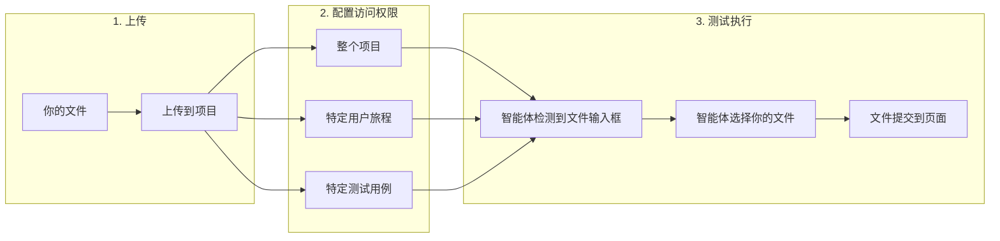

# 工作流文件

Muggle Test 允许你上传测试在执行过程中可以使用的文件。在测试需要上传文件的功能时，这一点必不可少，例如上传头像、提交文档或导入功能。

## 概览

| 阶段 | 过程 |
| :---- | :----------- |
| **上传** | 你向项目提供文件（图片、文档等） |
| **配置访问权限** | 你指定每个文件可供哪些测试使用 |
| **测试执行** | AI 智能体遇到文件输入框时，会自动使用你的文件 |

## 何时使用工作流文件

当你的应用包含需要上传文件的功能时，请上传工作流文件：

| 使用场景 | 示例 |
| :------- | :------ |
| **个人头像** | 测试头像上传功能 |
| **文档上传** | 提交简历、PDF 或报告 |
| **导入功能** | CSV 导入、数据文件上传 |
| **媒体上传** | 图库、视频上传 |
| **表单附件** | 带附件的支持工单 |

## 支持的文件类型

Muggle Test 支持常见的文件格式：

| 类别 | 格式 |
| :------- | :------ |
| **图片** | JPG、PNG、GIF、WebP、SVG |
| **文档** | PDF、DOC、DOCX、TXT、CSV、XLS、XLSX |
| **压缩包** | ZIP |
| **其他** | 大多数常见的 MIME 类型 |

| 限制 | 值 |
| :---- | :---- |
| 最大文件大小 | 每个文件 10 MB |
| 每个项目的文件数 | 无限制 |

## 如何上传文件

### 从项目控制台上传

1. 在 Muggle Test 控制台中打开你的项目
2. 进入**文件**标签页（或点击**文件**按钮）
3. 点击**上传**，打开上传对话框
4. 拖放文件，或点击浏览选择文件
5. 添加**描述**，说明该文件的用途
6. 可选：添加**标签**以便整理
7. 配置**文件访问权限**，指定哪些测试可以使用该文件

### 上传时：配置文件访问权限

上传时，你可以选择哪些测试可以访问该文件：

| 访问级别 | 说明 |
| :----------- | :---------- |
| **整个项目** | 项目中的所有测试都可以使用此文件 |
| **特定用户旅程** | 只有所选用户旅程中的测试才能使用此文件 |
| **特定测试用例** | 只有选中的单个测试用例才能使用此文件 |

### 文件描述的最佳实践

| 推荐做法 | 避免做法 |
| :- | :---- |
| 清楚说明文件的用途 | 将描述留空 |
| 注明文件类型和内容 | 使用含糊的描述 |
| 说明文件应如何使用 | 假定智能体知道它的用途 |

**优秀的描述示例：**

- “用于求职申请上传测试的示例简历 PDF”
- “用于头像测试的有效 200x200 PNG 头像图片”
- “用于批量导入测试、包含 100 条产品记录的 CSV 文件”

## 管理文件访问权限

你可以随时更改哪些测试可以访问某个文件。

### 编辑文件访问权限

1. 进入项目的**文件**标签页
2. 点击某个文件将其选中
3. 右侧会显示**文件访问权限**面板
4. 勾选或取消勾选用户旅程和测试用例
5. 点击**保存访问权限**以应用更改

### 理解选择层级

| 选择方式 | 效果 |
| :-------- | :----- |
| **选中用户旅程** | 该用户旅程下的所有测试用例都继承访问权限 |
| **选中单个测试用例** | 只有该测试用例拥有访问权限 |
| **混合选择** | 用户旅程显示部分选中标记；只有勾选的测试用例拥有访问权限 |

## 测试执行期间如何使用文件

AI 智能体运行你的测试时，会自动处理文件上传：

```mermaid
sequenceDiagram
    participant Agent as AI 智能体
    participant Page as 网页
    participant Files as 工作流文件
    
    Agent->>Page: 导航到含文件输入框的页面
    Agent->>Agent: 检测到 <input type="file">
    Agent->>Files: 查找此测试可用的文件
    Files-->>Agent: 返回匹配的文件
    Agent->>Page: 使用 FileSelectAction 选择文件
    Page-->>Agent: 文件已附加到表单
    Agent->>Page: 继续提交表单
```

### 智能体看到的信息

测试执行期间，智能体会收到有关可用文件的信息：

| 信息 | 用途 |
| :---------- | :------ |
| **文件名** | 标识文件 |
| **描述** | 帮助智能体判断何时使用该文件 |
| **文件类型** | 确保符合输入框的要求 |
| **标签** | 为选择文件提供额外的上下文 |

### 自动选择文件

AI 智能体会根据你的文件描述，智能地选择合适的文件：

| 场景 | 智能体行为 |
| :------- | :------------- |
| 只有一个可用文件 | 将该文件用于输入框 |
| 有多个可用文件 | 根据描述匹配程度和文件类型进行选择 |
| 没有匹配的文件 | 报告该问题并暂停，等待人工干预 |

## 文件整理技巧

### 使用标签

标签有助于整理文件，并为智能体提供上下文：

| 标签策略 | 示例标签 |
| :----------- | :----------- |
| **按文件类型** | `image`、`document`、`csv` |
| **按测试场景** | `valid-input`、`invalid-input`、`edge-case` |
| **按功能** | `profile`、`import`、`attachment` |

### 命名规范

| 技巧 | 示例 |
| :-- | :------ |
| 使用描述性的文件名 | 用 `valid-resume-2024.pdf`，而不是 `doc1.pdf` |
| 包含测试上下文 | 用于大小上限测试的 `oversized-image-5mb.png` |
| 必要时标注版本 | `product-import-v2.csv` |

## 测试文件上传场景

### 正常路径测试

| 测试 | 要上传的文件 |
| :--- | :------------- |
| 有效的头像 | 未超出大小上限的标准 JPG |
| 提交文档 | 内容符合预期的干净 PDF |
| 数据导入 | 格式规范、数据有效的 CSV |

### 边界情况测试

| 测试 | 要上传的文件 |
| :--- | :------------- |
| 大小上限验证 | 略低于和略高于上限的文件 |
| 格式验证 | 错误的文件扩展名（例如将 `.txt` 重命名为 `.pdf`） |
| 空文件处理 | 0 字节文件 |
| 特殊字符 | 包含空格和 Unicode 字符的文件名 |

## 故障排除

### 常见问题

| 问题 | 解决方法 |
| :---- | :------- |
| 测试中看不到文件 | 检查该测试用例的文件访问权限设置 |
| 选错了文件 | 改进文件描述，使其更具体 |
| 上传失败 | 确认文件小于 10 MB 且格式受支持 |
| 智能体找不到文件输入框 | 确保输入元素可见、未被隐藏 |

### 文件访问权限不生效

如果你的测试无法访问已上传的文件：

1. 确认文件已上传到正确的项目
2. 检查该测试用例是否已配置文件访问权限
3. 确认该文件没有被限定在其他用户旅程中
4. 检查文件描述是否清晰

## 后续步骤

| 目标 | 资源 |
| :--- | :------- |
| 创建你的第一个测试 | [快速入门：运行测试](getting-started/quickstart-running-tests.md) |
| 了解测试执行 | [Muggle Test 的工作原理](concepts/how-muggle-test-works.md) |
| 通过 API 运行测试 | [通过 API 运行测试](api/running-tests-via-api.md) |
