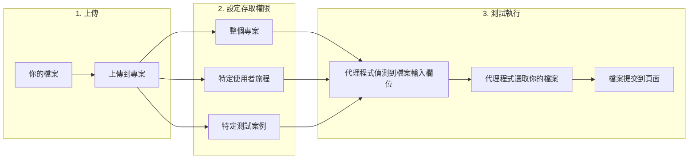

# 工作流程檔案

Muggle Test 可讓你上傳測試在執行期間可以使用的檔案。測試需要上傳檔案的功能時，這項能力不可或缺，例如上傳大頭貼、提交文件或匯入功能。

## 總覽

| 階段 | 過程 |
| :---- | :----------- |
| **上傳** | 你將檔案（圖片、文件等）提供給專案 |
| **設定存取權限** | 你指定每個檔案可供哪些測試使用 |
| **測試執行** | AI 代理程式遇到檔案輸入欄位時，會自動使用你的檔案 |

## 何時使用工作流程檔案

當你的應用程式含有需要上傳檔案的功能時，請上傳工作流程檔案：

| 使用情境 | 範例 |
| :------- | :------ |
| **大頭貼** | 測試大頭貼上傳功能 |
| **文件上傳** | 提交履歷、PDF 或報告 |
| **匯入功能** | CSV 匯入、資料檔上傳 |
| **媒體上傳** | 圖庫、影片上傳 |
| **表單附件** | 含附件的支援工單 |

## 支援的檔案類型

Muggle Test 支援常見的檔案格式：

| 類別 | 格式 |
| :------- | :------ |
| **圖片** | JPG、PNG、GIF、WebP、SVG |
| **文件** | PDF、DOC、DOCX、TXT、CSV、XLS、XLSX |
| **壓縮檔** | ZIP |
| **其他** | 大多數常見的 MIME 類型 |

| 限制 | 數值 |
| :---- | :---- |
| 檔案大小上限 | 每個檔案 10 MB |
| 每個專案的檔案數 | 無限制 |

## 如何上傳檔案

### 從專案儀表板上傳

1. 在 Muggle Test 儀表板中開啟你的專案
2. 前往**檔案**分頁（或點選**檔案**按鈕）
3. 點選**上傳**，開啟上傳對話方塊
4. 拖放檔案，或點選以瀏覽選取檔案
5. 新增**說明**，描述這個檔案的用途
6. 視需要新增**標籤**，方便整理
7. 設定**檔案存取權限**，指定哪些測試可以使用這個檔案

### 上傳時：設定檔案存取權限

上傳時，你可以選擇哪些測試能存取這個檔案：

| 存取層級 | 說明 |
| :----------- | :---------- |
| **整個專案** | 專案中的所有測試都能使用這個檔案 |
| **特定使用者旅程** | 只有所選使用者旅程中的測試才能使用這個檔案 |
| **特定測試案例** | 只有選取的個別測試案例才能使用這個檔案 |

### 檔案說明的最佳實務

| 建議做法 | 避免做法 |
| :- | :---- |
| 清楚描述檔案的用途 | 將說明留白 |
| 註明檔案類型與內容 | 使用含糊的說明 |
| 說明檔案應如何使用 | 假設代理程式知道它的用途 |

**良好的說明範例：**

- 「用於求職申請上傳測試的範例履歷 PDF」
- 「用於大頭貼測試的有效 200x200 PNG 大頭貼圖片」
- 「用於批次匯入測試、含 100 筆產品資料的 CSV 檔案」

## 管理檔案存取權限

你可以隨時變更哪些測試能存取某個檔案。

### 編輯檔案存取權限

1. 前往專案的**檔案**分頁
2. 點選檔案以選取
3. 右側會出現**檔案存取權限**面板
4. 勾選或取消勾選使用者旅程與測試案例
5. 點選**儲存存取權限**以套用變更

### 了解選取層級

| 選取方式 | 效果 |
| :-------- | :----- |
| **選取使用者旅程** | 該使用者旅程下的所有測試案例都會繼承存取權限 |
| **選取個別測試案例** | 只有該測試案例具有存取權限 |
| **混合選取** | 使用者旅程會顯示部分選取標記；只有勾選的測試案例具有存取權限 |

## 測試執行期間如何使用檔案

AI 代理程式執行你的測試時，會自動處理檔案上傳：

```mermaid
sequenceDiagram
    participant Agent as AI 代理程式
    participant Page as 網頁
    participant Files as 工作流程檔案
    
    Agent->>Page: 前往含檔案輸入欄位的頁面
    Agent->>Agent: 偵測到 <input type="file">
    Agent->>Files: 查詢此測試可用的檔案
    Files-->>Agent: 傳回相符的檔案
    Agent->>Page: 使用 FileSelectAction 選取檔案
    Page-->>Agent: 檔案已附加到表單
    Agent->>Page: 繼續提交表單
```

### 代理程式看到的資訊

測試執行期間，代理程式會收到可用檔案的相關資訊：

| 資訊 | 用途 |
| :---------- | :------ |
| **檔名** | 識別檔案 |
| **說明** | 協助代理程式判斷何時使用該檔案 |
| **檔案類型** | 確保符合輸入欄位的要求 |
| **標籤** | 為選取檔案提供額外上下文 |

### 自動選取檔案

AI 代理程式會根據你的檔案說明，聰明地選取合適的檔案：

| 情境 | 代理程式行為 |
| :------- | :------------- |
| 只有一個可用檔案 | 將該檔案用於輸入欄位 |
| 有多個可用檔案 | 依說明的相符程度與檔案類型來選取 |
| 沒有相符的檔案 | 回報問題並暫停，等待人工介入 |

## 檔案整理技巧

### 使用標籤

標籤有助於整理檔案，也能為代理程式提供上下文：

| 標籤策略 | 範例標籤 |
| :----------- | :----------- |
| **依檔案類型** | `image`、`document`、`csv` |
| **依測試情境** | `valid-input`、`invalid-input`、`edge-case` |
| **依功能** | `profile`、`import`、`attachment` |

### 命名慣例

| 技巧 | 範例 |
| :-- | :------ |
| 使用具描述性的檔名 | 用 `valid-resume-2024.pdf`，而不是 `doc1.pdf` |
| 加入測試情境 | 用於大小上限測試的 `oversized-image-5mb.png` |
| 必要時標示版本 | `product-import-v2.csv` |

## 測試檔案上傳情境

### 正常路徑測試

| 測試 | 要上傳的檔案 |
| :--- | :------------- |
| 有效的大頭貼 | 未超過大小上限的標準 JPG |
| 提交文件 | 內容符合預期的乾淨 PDF |
| 資料匯入 | 格式正確、資料有效的 CSV |

### 邊界情況測試

| 測試 | 要上傳的檔案 |
| :--- | :------------- |
| 大小上限驗證 | 略低於與略高於上限的檔案 |
| 格式驗證 | 錯誤的副檔名（例如將 `.txt` 重新命名為 `.pdf`） |
| 空白檔案處理 | 0 位元組的檔案 |
| 特殊字元 | 含空格與 Unicode 字元的檔名 |

## 疑難排解

### 常見問題

| 問題 | 解決方法 |
| :---- | :------- |
| 測試中看不到檔案 | 檢查該測試案例的檔案存取權限設定 |
| 選錯了檔案 | 改善檔案說明，讓它更具體 |
| 上傳失敗 | 確認檔案小於 10 MB 且格式受支援 |
| 代理程式找不到檔案輸入欄位 | 確認輸入元素可見且未隱藏 |

### 檔案存取權限沒有作用

如果你的測試無法存取已上傳的檔案：

1. 確認檔案已上傳到正確的專案
2. 檢查該測試案例是否已設定檔案存取權限
3. 確認該檔案沒有被限定在其他使用者旅程
4. 檢查檔案說明是否清楚

## 後續步驟

| 目標 | 資源 |
| :--- | :------- |
| 建立你的第一個測試 | [快速入門：執行測試](getting-started/quickstart-running-tests.md) |
| 了解測試執行 | [Muggle Test 的運作方式](concepts/how-muggle-test-works.md) |
| 透過 API 執行測試 | [透過 API 執行測試](api/running-tests-via-api.md) |
