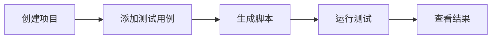

# MCP 快速入门

在 5 分钟内将你的 AI 助手连接到 Muggle Test。

## 本页内容

| 章节 | 说明 |
| :------ | :---------- |
| [选择你的平台](#choose-your-platform) | 为 Claude Code、Cursor 或 Antigravity 安装和配置 |
| [验证安装](#verify-installation) | 确认一切正常工作 |
| [身份验证](#authentication) | 登录以运行测试 |
| [运行你的第一个测试](#run-your-first-test) | 本地和云端测试的分步演练 |
| [对话示例](#example-conversation) | 完整的端到端会话示例 |
| [工具概览](#tool-overview) | 可用的工具类别 |
| [选择本地还是云端](#choosing-local-vs-cloud) | 每种模式的适用时机 |
| [托管网关](#hosted-gateway-alternative) | 无需本地安装的纯云端配置 |
| [故障排除](#troubleshooting) | 常见问题与解决方法 |
| [后续步骤](#next-steps) | 延伸阅读 |

## 前提条件

| 要求 | 说明 |
| :---------- | :---------- |
| Node.js | 22 或更高版本 |
| MCP 客户端 | Claude Code、Cursor 或 Antigravity |

---

## 选择你的平台

### Claude Code

通过插件系统安装——无需手动编写配置文件：

```
/plugin marketplace add https://github.com/multiplex-ai/muggle-ai-works
/plugin install muggleai@muggle-works
```

这会通过插件生命周期提供技能、MCP 服务器和钩子。

### Cursor

**1. 全局安装 npm 包：**

```bash
npm install -g @muggleai/works@latest
```

对于 Cursor，这样就完成了——安装过程会自动配置 `~/.cursor/mcp.json`。只需重启 Cursor 即可。

对于其他 MCP 客户端，请将以下内容添加到客户端的配置中：

```json
{
  "mcpServers": {
    "muggle": {
      "command": "muggle",
      "args": ["serve"]
    }
  }
}
```

**2. 重启 Cursor**，使新配置生效。

### Antigravity

**1. 全局安装 npm 包：**

```bash
npm install -g @muggleai/works@latest
```

**2. 配置 MCP**，配置文件为 `~/.gemini/antigravity/mcp_config.json`：

```json
{
  "mcpServers": {
    "muggle": {
      "command": "muggle",
      "args": ["serve"]
    }
  }
}
```

你也可以通过 Antigravity 界面添加：打开 **Agent panel** → **MCP Servers** → **Manage MCP Servers** → **View raw config**。

**3. 重启 Antigravity**，使新配置生效。

---

## 验证安装

| 平台 | 验证方法 |
| :------- | :------------ |
| **Claude Code** | 运行 `/muggle:status` |
| **Cursor** | 询问你的助手：**“检查 Muggle Test 状态”** |
| **Antigravity** | 询问你的智能体：**“检查 Muggle Test 状态”** |

---

## 身份验证

运行测试（无论本地还是云端）都需要登录，因为测试执行的是你 Muggle Test 账户中的测试用例。连接服务器不需要任何凭据；在首次运行前完成身份验证即可：

### 方式 A：智能体身份验证（推荐）

询问你的助手：**“帮我登录 Muggle Test”**

助手会：
1. 生成登录网址和登录码
2. 等待你在浏览器中完成登录
3. 在本地存储凭据

### 方式 B：API 密钥

1. 登录 [Muggle Test 控制台](https://www.muggle-ai.com)
2. 前往**设置** → **API 密钥**
3. 创建并复制你的 API 密钥
4. 将密钥添加到你的 MCP 配置中：

**Claude Code**：API 密钥通过智能体身份验证流程存储——无需更改配置。

**Cursor**（`~/.cursor/mcp.json`）：

```json
{
  "mcpServers": {
    "muggle": {
      "command": "muggle",
      "args": ["serve"],
      "env": {
        "MCP_API_KEY": "mai_sk_your_api_key_here"
      }
    }
  }
}
```

**Antigravity**（`~/.gemini/antigravity/mcp_config.json`）：

```json
{
  "mcpServers": {
    "muggle": {
      "command": "muggle",
      "args": ["serve"],
      "env": {
        "MCP_API_KEY": "mai_sk_your_api_key_here"
      }
    }
  }
}
```

---

## 运行你的第一个测试

### 本地测试（localhost）



**1. 创建项目：**

> “为我的应用创建一个测试项目，地址是 http://localhost:3000”

**2. 添加测试用例：**

> “创建一个测试用例，验证登录表单在邮箱无效时会显示错误”

**3. 生成测试脚本：**

> “为登录测试用例生成测试脚本”

**4. 运行测试：**

> “运行登录测试”

### 云端 E2E 验收测试（远程网址）

适用于测试预发布、预览或生产环境的网址：

**1. 创建项目：**

> “创建一个名为‘我的网站测试’的 E2E 验收测试项目，用于测试 https://example.com”

**2. 发现用户旅程：**

> “扫描网站，发现可能的测试用户旅程”

**3. 审阅并批准：**

> “显示已发现的用户旅程候选项”
> “批准登录和结账这两个用户旅程”

**4. 生成并运行测试：**

> “为已批准的用户旅程生成测试用例，然后运行所有测试”

**5. 查看结果：**

> “显示测试结果摘要”

---

## 对话示例

**你**：我想测试运行在 localhost:3000 上的应用

**助手**：我来帮你设置测试。先创建一个项目。

*[创建项目]*

完成！我已创建一个名为“localhost:3000 测试”的项目。你想测试什么？

---

**你**：测试注册表单是否会校验邮箱格式

**助手**：我来为邮箱校验创建一个测试用例。

*[创建测试用例]*

创建好了！接下来我会通过自动操作浏览器来生成测试脚本。

*[启动浏览器，执行测试步骤，捕获截图]*

测试脚本生成成功！测试导航到注册页面，输入了一个无效邮箱，并确认错误消息已出现。

要我现在运行测试吗？

---

**你**：好的，运行吧

**助手**：正在运行测试……

*[执行测试脚本]*

**结果：通过**（2.3 秒）

提交无效邮箱时，注册表单正确显示了“请输入有效的邮箱地址”。

---

## 工具概览

| 类别 | 工具 | 用途 |
| :------- | :---- | :------ |
| **云端实体** | `muggle-remote-project-*`、`muggle-remote-use-case-*`、`muggle-remote-test-case-*` | 创建和管理项目、用户旅程和测试用例（本地和云端测试都会用到） |
| **云端工作流** | `muggle-remote-workflow-*`、`muggle-remote-report-*` | 云端测试生成、回放和报告 |
| **本地执行** | `muggle-local-execute-*`、`muggle-local-run-result-*` | 在本地生成和回放脚本，查看结果 |
| **发布** | `muggle-local-publish-test-script` | 将本地生成的脚本发布到云端 |

**共计 100 多个工具**，覆盖本地和云端测试。

---

## 选择本地还是云端

| 场景 | 建议 |
| :------- | :------------- |
| 开发期间测试 | **本地**（`muggle serve --local`） |
| 测试 localhost 网址 | **本地** |
| 测试预览/预发布部署 | **云端**（`muggle serve --e2e`） |
| CI/CD 集成 | **云端** |
| 团队协作 | **云端** |
| 同时使用本地和云端 | **默认**（`muggle serve`） |

---

## 托管网关（备选方案）

如果只需云端测试、不想在本地安装，可以使用托管网关。它适用于任何兼容 MCP 的客户端：

**Cursor**（`~/.cursor/mcp.json`）：

```json
{
  "mcpServers": {
    "muggle": {
      "url": "https://mcp.muggle-ai.com/mcp",
      "headers": {
        "x-api-key": "mai_sk_your_api_key_here"
      }
    }
  }
}
```

**Antigravity**（`~/.gemini/antigravity/mcp_config.json`）：

```json
{
  "mcpServers": {
    "muggle": {
      "url": "https://mcp.muggle-ai.com/mcp",
      "headers": {
        "x-api-key": "mai_sk_your_api_key_here"
      }
    }
  }
}
```

---

## 故障排除

### 连接问题

| 检查项 | 解决方法 |
| :---- | :------- |
| npm 包已安装？ | `npm list -g @muggleai/works` |
| 配置正确？ | 检查平台配置文件中的 JSON 语法 |
| 客户端已重启？ | 更改配置后重启 |
| 运行诊断？ | `muggle doctor` |

### 身份验证错误

| 检查项 | 解决方法 |
| :---- | :------- |
| API 密钥正确？ | 在控制台中核对密钥 |
| 密钥已过期？ | 在控制台中重新生成 |
| 密钥格式？ | 应以 `mai_sk_` 开头 |

### 各平台的配置文件路径

| 平台 | 配置文件位置 |
| :------- | :------------------- |
| Claude Code | 由插件系统管理——无需手动配置 |
| Cursor | `~/.cursor/mcp.json` |
| Antigravity | `~/.gemini/antigravity/mcp_config.json` |

---

## 后续步骤

- **[MCP 安装](mcp/mcp-installation.md)**——详细的安装选项
- **[本地测试安装与配置](local-testing/setup.md)**——深入的本地测试指南
- **[MCP 概念](mcp/mcp-concepts.md)**——了解架构
- **[MCP API 参考](mcp/mcp-api-reference.md)**——完整的工具文档
- **[CI/CD 集成](mcp/mcp-cicd-integration.md)**——在流水线中实现自动化
