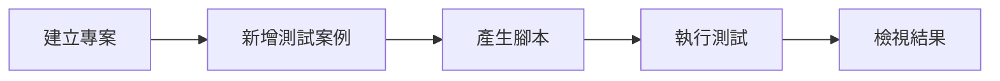

# MCP 快速入門

在 5 分鐘內將你的 AI 助理連接到 Muggle Test。

## 本頁內容

| 章節 | 說明 |
| :------ | :---------- |
| [選擇你的平台](#choose-your-platform) | 為 Claude Code、Cursor 或 Antigravity 安裝並設定 |
| [驗證安裝](#verify-installation) | 確認一切運作正常 |
| [身分驗證](#authentication) | 登入以執行測試 |
| [執行你的第一個測試](#run-your-first-test) | 本機與雲端測試的逐步說明 |
| [對話範例](#example-conversation) | 完整的端對端工作階段範例 |
| [工具總覽](#tool-overview) | 可用的工具類別 |
| [選擇本機或雲端](#choosing-local-vs-cloud) | 各模式的使用時機 |
| [託管閘道](#hosted-gateway-alternative) | 不需在本機安裝、僅使用雲端的設定方式 |
| [疑難排解](#troubleshooting) | 常見問題與解決方法 |
| [後續步驟](#next-steps) | 延伸閱讀 |

## 必要條件

| 需求 | 說明 |
| :---------- | :---------- |
| Node.js | 22 版或更新版本 |
| MCP 用戶端 | Claude Code、Cursor 或 Antigravity |

---

## 選擇你的平台

### Claude Code

透過外掛程式系統安裝——不需要手動編寫設定檔：

```
/plugin marketplace add https://github.com/multiplex-ai/muggle-ai-works
/plugin install muggleai@muggle-works
```

這會透過外掛程式的生命週期提供技能、MCP 伺服器與掛鉤。

### Cursor

**1. 全域安裝套件：**

```bash
npm install -g @muggleai/works@latest
```

對 Cursor 而言，這樣就完成了——安裝程序會自動設定 `~/.cursor/mcp.json`。只要重新啟動 Cursor 即可。

若是其他 MCP 用戶端，請將以下內容加入用戶端的設定：

```json
{
  "mcpServers": {
    "muggle": {
      "command": "muggle",
      "args": ["serve"]
    }
  }
}
```

**2. 重新啟動 Cursor**，讓新設定生效。

### Antigravity

**1. 全域安裝套件：**

```bash
npm install -g @muggleai/works@latest
```

**2. 設定 MCP**，設定檔為 `~/.gemini/antigravity/mcp_config.json`：

```json
{
  "mcpServers": {
    "muggle": {
      "command": "muggle",
      "args": ["serve"]
    }
  }
}
```

你也可以透過 Antigravity 介面加入：開啟 **Agent panel** → **MCP Servers** → **Manage MCP Servers** → **View raw config**。

**3. 重新啟動 Antigravity**，讓新設定生效。

---

## 驗證安裝

| 平台 | 驗證方式 |
| :------- | :------------ |
| **Claude Code** | 執行 `/muggle:status` |
| **Cursor** | 詢問你的助理：**「檢查 Muggle Test 狀態」** |
| **Antigravity** | 詢問你的代理程式：**「檢查 Muggle Test 狀態」** |

---

## 身分驗證

執行測試（無論本機或雲端）都需要登入，因為測試執行的是你 Muggle Test 帳戶中的測試案例。連接伺服器不需要任何憑證；請在第一次執行前完成身分驗證：

### 方式 A：代理程式身分驗證（建議）

詢問你的助理：**「幫我登入 Muggle Test」**

助理會：
1. 產生登入網址與登入碼
2. 等待你在瀏覽器中完成登入
3. 將憑證儲存在本機

### 方式 B：API 金鑰

1. 登入 [Muggle Test 儀表板](https://www.muggle-ai.com)
2. 前往**設定** → **API 金鑰**
3. 建立並複製你的 API 金鑰
4. 將金鑰加入你的 MCP 設定：

**Claude Code**：API 金鑰會透過代理程式身分驗證流程儲存——不需要變更設定。

**Cursor**（`~/.cursor/mcp.json`）：

```json
{
  "mcpServers": {
    "muggle": {
      "command": "muggle",
      "args": ["serve"],
      "env": {
        "MCP_API_KEY": "mai_sk_your_api_key_here"
      }
    }
  }
}
```

**Antigravity**（`~/.gemini/antigravity/mcp_config.json`）：

```json
{
  "mcpServers": {
    "muggle": {
      "command": "muggle",
      "args": ["serve"],
      "env": {
        "MCP_API_KEY": "mai_sk_your_api_key_here"
      }
    }
  }
}
```

---

## 執行你的第一個測試

### 本機測試（localhost）



**1. 建立專案：**

> 「為我的應用程式建立一個測試專案，網址是 http://localhost:3000」

**2. 新增測試案例：**

> 「建立一個測試案例，驗證登入表單在電子郵件無效時會顯示錯誤」

**3. 產生測試腳本：**

> 「為登入測試案例產生測試腳本」

**4. 執行測試：**

> 「執行登入測試」

### 雲端 E2E 驗收測試（遠端網址）

用於測試預備、預覽或正式環境的網址：

**1. 建立專案：**

> 「建立一個名為『我的網站測試』的 E2E 驗收測試專案，用來測試 https://example.com」

**2. 探索使用者旅程：**

> 「掃描網站，探索可能的測試使用者旅程」

**3. 檢閱並核准：**

> 「顯示已探索到的使用者旅程候選項目」
> 「核准登入與結帳這兩個使用者旅程」

**4. 產生並執行測試：**

> 「為已核准的使用者旅程產生測試案例，然後執行所有測試」

**5. 檢視結果：**

> 「顯示測試結果摘要」

---

## 對話範例

**你**：我想測試在 localhost:3000 上執行的應用程式

**助理**：我來協助你設定測試。先建立一個專案。

*[建立專案]*

完成！我已建立名為「localhost:3000 測試」的專案。你想測試什麼？

---

**你**：測試註冊表單是否會驗證電子郵件格式

**助理**：我來為電子郵件驗證建立一個測試案例。

*[建立測試案例]*

建立完成！接著我會透過自動操作瀏覽器來產生測試腳本。

*[啟動瀏覽器、執行測試步驟、擷取螢幕截圖]*

已成功產生測試腳本！測試已前往註冊頁面、輸入無效的電子郵件，並確認錯誤訊息有出現。

要我現在執行測試嗎？

---

**你**：好，執行吧

**助理**：正在執行測試……

*[執行測試腳本]*

**結果：通過**（2.3 秒）

送出無效的電子郵件時，註冊表單正確顯示了「請輸入有效的電子郵件地址」。

---

## 工具總覽

| 類別 | 工具 | 用途 |
| :------- | :---- | :------ |
| **雲端實體** | `muggle-remote-project-*`、`muggle-remote-use-case-*`、`muggle-remote-test-case-*` | 建立與管理專案、使用者旅程與測試案例（本機與雲端測試皆會使用） |
| **雲端工作流程** | `muggle-remote-workflow-*`、`muggle-remote-report-*` | 雲端測試產生、重播與報告 |
| **本機執行** | `muggle-local-execute-*`、`muggle-local-run-result-*` | 在本機產生與重播腳本、檢視結果 |
| **發布** | `muggle-local-publish-test-script` | 將本機產生的腳本發布到雲端 |

**總計 100 多個工具**，涵蓋本機與雲端測試。

---

## 選擇本機或雲端

| 情境 | 建議 |
| :------- | :------------- |
| 開發期間測試 | **本機**（`muggle serve --local`） |
| 測試 localhost 網址 | **本機** |
| 測試預覽/預備環境部署 | **雲端**（`muggle serve --e2e`） |
| CI/CD 整合 | **雲端** |
| 團隊協作 | **雲端** |
| 同時使用本機與雲端 | **預設**（`muggle serve`） |

---

## 託管閘道（替代方案）

如果只需要雲端測試、不想在本機安裝，可以使用託管閘道。它適用於任何相容 MCP 的用戶端：

**Cursor**（`~/.cursor/mcp.json`）：

```json
{
  "mcpServers": {
    "muggle": {
      "url": "https://mcp.muggle-ai.com/mcp",
      "headers": {
        "x-api-key": "mai_sk_your_api_key_here"
      }
    }
  }
}
```

**Antigravity**（`~/.gemini/antigravity/mcp_config.json`）：

```json
{
  "mcpServers": {
    "muggle": {
      "url": "https://mcp.muggle-ai.com/mcp",
      "headers": {
        "x-api-key": "mai_sk_your_api_key_here"
      }
    }
  }
}
```

---

## 疑難排解

### 連線問題

| 檢查項目 | 解決方法 |
| :---- | :------- |
| 套件已安裝？ | `npm list -g @muggleai/works` |
| 設定正確？ | 檢查平台設定檔中的 JSON 語法 |
| 用戶端已重新啟動？ | 變更設定後重新啟動 |
| 執行診斷？ | `muggle doctor` |

### 身分驗證錯誤

| 檢查項目 | 解決方法 |
| :---- | :------- |
| API 金鑰正確？ | 在儀表板中確認金鑰 |
| 金鑰已過期？ | 在儀表板中重新產生 |
| 金鑰格式？ | 應以 `mai_sk_` 開頭 |

### 各平台的設定檔路徑

| 平台 | 設定檔位置 |
| :------- | :------------------- |
| Claude Code | 由外掛程式系統管理——不需手動設定 |
| Cursor | `~/.cursor/mcp.json` |
| Antigravity | `~/.gemini/antigravity/mcp_config.json` |

---

## 後續步驟

- **[MCP 安裝](mcp/mcp-installation.md)**——詳細的安裝選項
- **[本機測試安裝與設定](local-testing/setup.md)**——深入的本機測試指南
- **[MCP 概念](mcp/mcp-concepts.md)**——了解架構
- **[MCP API 參考](mcp/mcp-api-reference.md)**——完整的工具文件
- **[CI/CD 整合](mcp/mcp-cicd-integration.md)**——在管線中自動化
