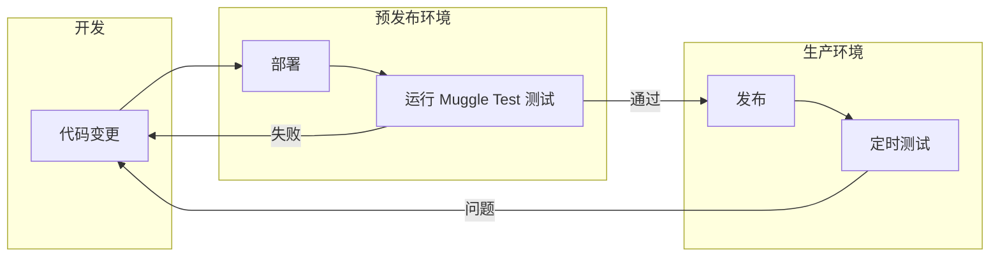

# Muggle Test 概览

Muggle Test 是一个 AI 驱动的 Web 测试平台，可在真实浏览器中针对你的 Web 应用运行 E2E 验收测试。它能发现用户流程，根据自然语言描述生成可回放的测试脚本，并验证注册、结账、仪表盘等功能是否正常运行——同时提供截图作为证据。

## 本页内容

| 章节 | 说明 |
| :------ | :---------- |
| [何时使用 Muggle Test](#when-to-use-muggle-test) | Muggle Test 能发挥作用的场景 |
| [你将获得什么](#what-you-get) | 自动发现的流程、测试脚本、报告 |
| [如何融入你的工作流](#how-it-fits-into-your-workflow) | 开发、预发布和生产环境 |

## 何时使用 Muggle Test

| 场景 | Muggle Test 如何帮助你 |
| :------------------------------------------- | :-------------------------------------------------- |
| 你每周或更频繁地发布变更 | 在回归问题影响用户之前发现它们 |
| 你不想手动维护 E2E 验收测试 | 自动生成并更新测试脚本 |
| 你重视贴近真实的测试覆盖 | 测试实际的用户旅程，而不是脆弱的选择器 |

## 你将获得什么

| 功能 | 说明 |
| :-------------------------- | :---------------------------------------- |
| **自动发现的流程** | 登录、CRUD、搜索、仪表盘等 |
| **可执行的测试脚本** | 每次变更后都可重新运行 |
| **易读的报告** | 与整个团队分享结果 |

## 如何融入你的工作流

| 阶段 | Muggle Test 如何帮助你 |
| :--------------------- | :-------------------------------------------------------- |
| **发布前** | 针对预发布环境运行测试，发现回归问题 |
| **发布后** | 通过定时任务定期运行，验证关键流程 |
| **开发期间** | 快速验证新功能不会破坏现有的用户旅程 |
