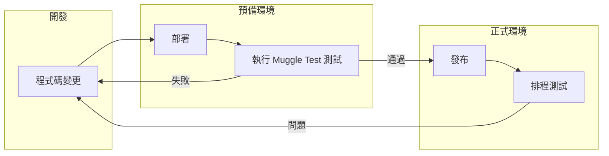

# Muggle Test 總覽

Muggle Test 是一套 AI 驅動的 Web 測試平台，能在真實瀏覽器中對你的 Web 應用程式執行 E2E 驗收測試。它會探索使用者流程，依據日常語言描述產生可重播的測試腳本，並驗證註冊、結帳、儀表板等功能是否正常運作——同時附上螢幕截圖作為佐證。

## 本頁內容

| 章節 | 說明 |
| :------ | :---------- |
| [何時使用 Muggle Test](#when-to-use-muggle-test) | Muggle Test 能派上用場的情境 |
| [你會得到什麼](#what-you-get) | 自動探索的流程、測試腳本、報告 |
| [如何融入你的工作流程](#how-it-fits-into-your-workflow) | 開發、預備與正式環境 |

## 何時使用 Muggle Test

| 情境 | Muggle Test 如何協助你 |
| :------------------------------------------- | :-------------------------------------------------- |
| 你每週或更頻繁地發布變更 | 在迴歸問題影響使用者之前就抓出來 |
| 你不想手動維護 E2E 驗收測試 | 自動產生並更新測試腳本 |
| 你重視貼近真實的測試涵蓋範圍 | 測試實際的使用者旅程，而不是脆弱的選取器 |

## 你會得到什麼

| 功能 | 說明 |
| :-------------------------- | :---------------------------------------- |
| **自動探索的流程** | 登入、CRUD、搜尋、儀表板等 |
| **可執行的測試腳本** | 每次變更後都能重新執行 |
| **淺顯易懂的報告** | 與整個團隊分享結果 |

## 如何融入你的工作流程

| 階段 | Muggle Test 如何協助你 |
| :--------------------- | :-------------------------------------------------------- |
| **發布前** | 對預備環境執行測試，抓出迴歸問題 |
| **發布後** | 排程定期執行，驗證關鍵流程 |
| **開發期間** | 快速驗證新功能不會破壞現有的使用者旅程 |
