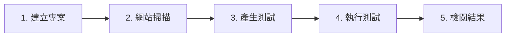

# 快速入門：執行你的第一批測試

本指南會帶你在幾分鐘內從零開始，完成第一次成功的測試執行。

## 總覽

## 步驟 1：建立專案

1. 前往**儀表板 → 專案 → 新增專案**
2. 輸入你要測試之環境的**基礎 URL**
3. 如有需要登入的流程，可選擇加入**登入憑證**

### 建議設定

| 設定項目 | 建議 |
| :---------------- | :---------------------------------------------------- |
| **環境** | 使用穩定的預備環境 |
| **雙重驗證（2FA）/ 驗證碼** | 在測試環境中關閉，讓自動化穩定可靠 |
| **測試帳戶** | 建立一個具備必要權限的專用帳戶 |

## 步驟 2：新增使用者旅程

你有兩種方式可以為專案加入測試情境：

### 方式 A：網站掃描（自動探索）

啟動**網站掃描**，讓 AI 代理程式探索你的網站，找出關鍵的使用者流程。

| 流程類型 | 範例 |
| :--------------- | :--------------------------------- |
| 身分驗證 | 登入、登出、重設密碼 |
| CRUD 操作 | 建立、讀取、更新、刪除項目 |
| 搜尋與篩選 | 搜尋列、分面導覽 |
| 儀表板 | 分析、報告、管理後台 |

### 方式 B：上傳 PRD（從文件擷取）

如果你已有需求文件，可以上傳這些文件，自動擷取測試情境。

1. 點選**從 PRD 新增使用者旅程**
2. 上傳你的 PRD 檔案（PDF、DOC、DOCX 或 TXT）
3. 等待 AI 擷取情境
4. 檢閱並核准產生的使用者旅程

| 何時使用 PRD 上傳 | 好處 |
| :---------------------------------- | :------------------------------ |
| 你有詳細的需求文件 | 比手動輸入更快 |
| 測試特定功能 | 測試涵蓋範圍更聚焦 |
| 導入新專案 | 善用現有文件 |

詳細說明請參閱[上傳 PRD 檔案](concepts/prd-upload.md)。

### 方式 C：依指示產生

用日常語言描述你想測試的內容，讓 AI 產生使用者旅程。

1. 點選**新增使用者旅程**，然後選擇**根據指令產生**
2. 寫下使用者流程的描述（例如「使用者登入、查看儀表板，然後更新個人資料」）
3. 點選**產生預覽**
4. 檢閱並編輯產生的使用者旅程
5. 點選**新增至測試計畫**

詳細說明請參閱[依指示產生](concepts/generating-from-instructions.md)。

### 管理已探索的流程

| 動作 | 使用時機 |
| :------------- | :--------------------------------- |
| **重新命名** | 配合你所屬領域的用語 |
| **停用** | 排除你不在意的流程 |
| **設為優先** | 標記關鍵業務流程 |

## 步驟 3：產生並執行測試

1. 選擇你最在意的流程
2. 點選**產生測試**
3. 腳本準備就緒後，點選**全部執行**

### 執行期間會發生什麼事

| 步驟 | 說明 |
| :------------ | :------------------------------------------ |
| 開啟瀏覽器 | 啟動真實的瀏覽器環境 |
| 執行步驟 | 依序執行腳本中的每個動作 |
| 驗證 | 由斷言檢查預期結果 |
| 擷取 | 儲存螢幕截圖與記錄，以供偵錯 |

## 步驟 4：檢閱結果

執行完成後，開啟專案的**報告**分頁。

### 篩選結果

| 篩選條件 | 用途 |
| :------------- | :------------------------------- |
| **狀態** | 只顯示通過或失敗的測試 |
| **流程名稱** | 聚焦在特定的使用者旅程 |
| **日期範圍** | 比較不同時間的結果 |

### 調查失敗原因

針對每個失敗的步驟，你可以看到：

| 資訊 | 用途 |
| :---------------- | :------------------------------ |
| **動作** | 失敗的確切步驟 |
| **螢幕截圖** | 失敗當下的畫面狀態 |
| **錯誤訊息** | 用於偵錯的技術細節 |
| **頁面網址** | 失敗發生的位置 |

## 後續步驟

| 目標 | 資源 |
| :-------------------------- | :-------------------------------------------------------------------------- |
| 了解架構 | [Muggle Test 的運作方式](concepts/how-muggle-test-works.md) |
| 依指示產生 | [依指示產生](concepts/generating-from-instructions.md) |
| 上傳需求文件 | [上傳 PRD 檔案](concepts/prd-upload.md) |
| 測試檔案上傳功能 | [工作流程檔案](concepts/workflow-files.md) |
| 透過 API 自動化 | [透過 API 執行測試](api/running-tests-via-api.md) |
| 使用 AI 助理 | [MCP 快速入門](mcp-quickstart.md) |
