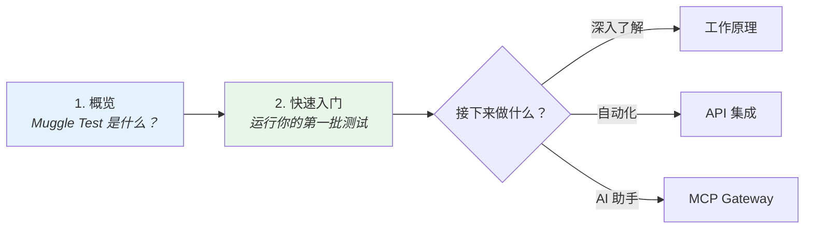

# 欢迎使用 Muggle Test

Muggle Test 是一个 AI 驱动的 Web 测试平台，它能发现贴近真实的用户流程，并用可执行的测试持续覆盖这些流程。

本页帮助你根据想完成的任务，找到合适的文档。

## 从这里开始：选择你的角色

| 你的角色 | 最佳起点 |
| :-------- | :------------------ |
| **开发者** | [开发者快速入门](quickstart-by-role.md#developers)——本地测试、CI/CD 集成 |
| **Vibe Coder** | [Vibe Coder 快速入门](quickstart-by-role.md#vibe-coders)——AI 助手集成、快速验证 |
| **产品团队** | [产品团队快速入门](quickstart-by-role.md#product-team)——PRD 上传、报告审阅 |

## 快速导航

| 如果你想…… | 从这里开始 |
| :---------------- | :--------- |
| 了解 Muggle Test 是什么 | [Muggle Test 概览](overview.md) |
| 运行你的第一批测试 | [快速入门：运行测试](quickstart-running-tests.md) |
| 测试 localhost 应用 | [本地测试安装与配置](local-testing/setup.md) |
| 了解架构 | [Muggle Test 的工作原理](concepts/how-muggle-test-works.md) |
| 通过 API 集成 | [API 概览](api/api-overview.md) |
| 使用 AI 助手（MCP） | [MCP 快速入门](mcp-quickstart.md) |
| 解决问题 | [常见问题](troubleshooting/common-issues.md) |

## 推荐阅读路径

## 文档章节

| 章节 | 内容 |
| :------------------------- | :--------------------------------------------------------- |
| **入门** | 新手上手、快速入门指南 |
| **核心概念** | 架构，以及发现和测试的工作原理 |
| **使用 MCP 进行远程测试** | 通过 AI 助手测试预览、预发布和生产环境 |
| **使用 MCP 进行本地测试** | 直接从你的 AI 助手测试 localhost 应用 |
| **使用 API** | 身份验证、端点、集成示例 |
| **故障排除** | 常见问题与解决方法 |

使用侧边栏搜索直接跳转到主题，或浏览左侧的各个章节。
