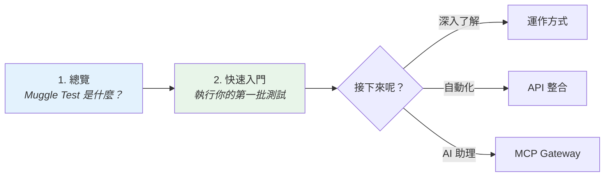

# 歡迎使用 Muggle Test

Muggle Test 是一套 AI 驅動的 Web 測試平台，能找出貼近真實情境的使用者流程，並以可執行的測試持續涵蓋這些流程。

本頁可協助你依照想完成的事，找到合適的文件。

## 從這裡開始：選擇你的角色

| 你的角色 | 最佳起點 |
| :-------- | :------------------ |
| **開發人員** | [開發人員快速入門](quickstart-by-role.md#developers)——本機測試、CI/CD 整合 |
| **Vibe Coder** | [Vibe Coder 快速入門](quickstart-by-role.md#vibe-coders)——AI 助理整合、快速驗證 |
| **產品團隊** | [產品團隊快速入門](quickstart-by-role.md#product-team)——PRD 上傳、報告審閱 |

## 快速導覽

| 如果你想…… | 從這裡開始 |
| :---------------- | :--------- |
| 了解 Muggle Test 是什麼 | [Muggle Test 總覽](overview.md) |
| 執行你的第一批測試 | [快速入門：執行測試](quickstart-running-tests.md) |
| 測試 localhost 應用程式 | [本機測試安裝與設定](local-testing/setup.md) |
| 了解架構 | [Muggle Test 的運作方式](concepts/how-muggle-test-works.md) |
| 透過 API 整合 | [API 總覽](api/api-overview.md) |
| 使用 AI 助理（MCP） | [MCP 快速入門](mcp-quickstart.md) |
| 解決問題 | [常見問題](troubleshooting/common-issues.md) |

## 建議閱讀路徑

## 文件章節

| 章節 | 內容 |
| :------------------------- | :--------------------------------------------------------- |
| **入門** | 新手上路、快速入門指南 |
| **核心概念** | 架構，以及探索與測試的運作方式 |
| **使用 MCP 進行遠端測試** | 透過 AI 助理測試預覽、預備與正式環境 |
| **使用 MCP 進行本機測試** | 直接從你的 AI 助理測試 localhost 應用程式 |
| **使用 API** | 身分驗證、端點、整合範例 |
| **疑難排解** | 常見問題與解決方法 |

使用側邊欄的搜尋功能直接跳到主題，或瀏覽左側的各個章節。
