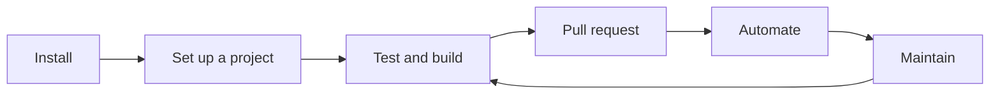

# What You Can Do with Muggle Works

Every task on the path from install to daily use, with the skill or command for each. Where the table says **Ask your agent**, describe the task in plain English and your agent uses the listed Muggle tools.

## Install

| Task | Use |
| :--- | :-- |
| Install Muggle Works | [Claude Code](getting-started/install-claude-code.md), [Codex](getting-started/install-codex.md), [Cursor](getting-started/install-cursor.md), or [other MCP clients](getting-started/install-other-mcp-clients.md) |
| Save your preferences and add the CI check | `/minit` |
| Sign in | `/mlogin`, or sign in when the first protected call opens your browser |
| Confirm the install is healthy | `/mstatus` |

## Project Setup

| Task | Use |
| :--- | :-- |
| Import existing tests, PRDs, or specs | `/mimport` |
| Scan a live site for test cases | **Ask your agent** (`muggle-remote-workflow-start-website-scan`) |
| Store test logins | **Ask your agent** (`muggle-remote-secret-create`); see [Testing Behind a Login Wall](concepts/testing-login-wall.md) |

## Testing and Building

| Task | Use |
| :--- | :-- |
| Start your local services | `/mtestprep` |
| Test your recent changes | `/mtest` |
| Test one flow on localhost | `/mtestlocal` |
| Run the whole suite | **Ask your agent** (`muggle-remote-workflow-start-test-script-replay-bulk`) |
| Build a change and open a pull request | `/mdo` |

## Pull Requests

| Task | Use |
| :--- | :-- |
| Post screenshots and results to a pull request | `/mpr` |
| Have reviews, red CI, and a stale base handled for you | `/mprfollowup` |
| Fail pull requests with a missing or failed walkthrough | `/mci` |

## Automation

| Task | Use |
| :--- | :-- |
| Run tests from your CI pipeline | [MCP CI/CD Integration](mcp/mcp-cicd-integration.md) |
| Plan a test schedule | **Ask your agent** (`muggle-remote-recommend-schedule`) |

## Test Maintenance

| Task | Use |
| :--- | :-- |
| Flag a script or step that did the wrong thing | `/mfeedback` |
| Generate scripts for test cases without one | `/mregen` |
| Edit or delete a test case | **Ask your agent** (`muggle-remote-test-case-update`, `muggle-remote-test-case-delete`) |
| Open the results of a local run | `/mrun` |

## Account and Team

| Task | Use |
| :--- | :-- |
| Add funds to your wallet | **Ask your agent** (`muggle-remote-wallet-topup`) |
| Invite teammates | **Organization → Members**; see [Enterprise Organizations](billing/enterprise-organizations.md) |

## Upkeep

| Task | Use |
| :--- | :-- |
| Change how Muggle behaves | `/mprefs` |
| Fix a broken install | `/mrepair`; see [Common Issues](troubleshooting/common-issues.md) |
| Update to the latest version | `/mupgrade` |
| Remove old runner versions | `/mcleanup` |
| Sign out | `/mlogout` |
| Find any other command | `/muggle` |
