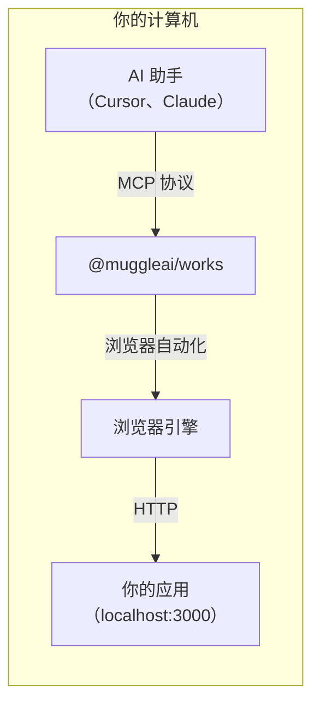
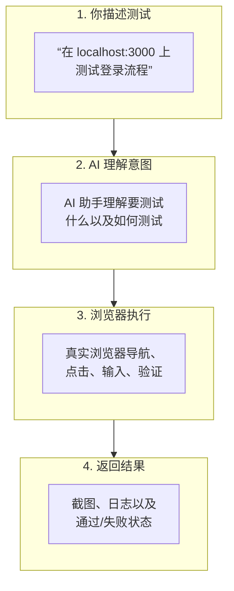
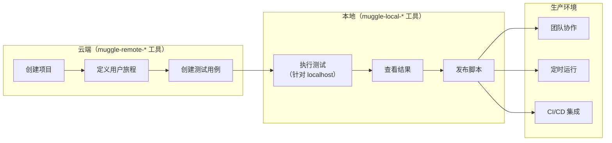

# 本地测试概览

使用 Muggle Test，直接通过你的 AI 助手测试 localhost 应用。

## 本页内容

| 章节 | 说明 |
| :------ | :---------- |
| [什么是本地测试？](#what-is-local-testing) | 概览和支持的环境 |
| [为什么需要本地测试？](#why-local-testing) | 它解决的难题 |
| [主要功能](#key-features) | localhost 访问、AI 驱动的测试、截图等 |
| [四步流程](#the-four-step-flow) | 从描述到结果 |
| [对比：本地测试与云端测试](#comparison-local-vs-cloud-testing) | 功能对比表 |
| [快速示例](#quick-example) | 示例对话 |
| [云端优先的本地测试工作流](#cloud-first-local-testing-workflow) | 架构和工作流步骤 |
| [开始使用](#getting-started) | 安装配置及指南链接 |
| [要求](#requirements) | Node.js、MCP 客户端和操作系统 |

## 什么是本地测试？

本地测试是 `@muggleai/works` 包提供的一项能力，让 AI 编程智能体（Claude Code、Cursor、Antigravity）能够针对你开发机上的 Web 应用运行真实浏览器端到端（E2E）验收测试。真实的 Electron 浏览器会点击按钮、填写表单、浏览页面并截图，以验证用户流程是否正常工作。云端 E2E 测试针对的是可公开访问的网址，而本地测试完全在你的计算机上运行，并且可以访问 `localhost` 网址。

## 何时使用本地测试，何时使用云端测试

| 环境 | 示例 | 选用方式 |
| :---------- | :------ | :----------- |
| 本地开发 | `localhost:3000` | **本地测试** |
| Docker 容器 | `localhost:8080` | **本地测试** |
| 局域网 | `192.168.1.x` | **本地测试** |
| 预览部署 | `pr-123.preview.example.com` | 云端 E2E |
| 预发布环境 | `staging.example.com` | 云端 E2E |
| 生产环境 | `www.example.com` | 云端 E2E |

## 为什么需要本地测试？

| 难题 | 解决方案 |
| :-------- | :------- |
| 云端服务无法访问 localhost | 完全在你的机器上运行 |
| 在 IDE 和浏览器之间来回切换 | 直接在你的编程助手中测试 |
| 手动测试拖慢开发进度 | AI 驱动的测试自动化 |
| 很难向队友描述 bug | 自动捕获截图和测试结果 |

## 主要功能

| 功能 | 说明 |
| :------ | :---------- |
| **localhost 访问** | 测试 `localhost`、`127.0.0.1` 或任何本地开发服务器 |
| **AI 驱动的测试** | 用自然语言描述测试 |
| **云端优先架构** | 在云端管理实体（`muggle-remote-*`），在本地执行（`muggle-local-*`） |
| **测试脚本生成** | AI 根据测试用例生成可重复运行的测试脚本 |
| **浏览器自动化** | 真实的浏览器交互（点击、输入、滚动） |
| **截图捕获** | 以可视化方式记录测试结果 |
| **智能体技能** | 预置工作流，例如“测试我的改动” |
| **将测试发布到云端** | 将本地生成的测试脚本上传到 Muggle Test，用于回放和协作 |

## 四步流程

1. **你用自然语言向 AI 助手描述**要测试的内容
2. **助手将你的请求转换**为浏览器自动化命令
3. **真实浏览器**（Electron/Chromium）在你的 localhost 应用上执行这些操作
4. **结果随即返回**，包括截图、日志和状态——全部呈现在你的 IDE 中

## 对比：本地测试与云端测试

| 方面 | 本地测试 | 云端 E2E |
| :----- | :------------ | :------- |
| **目标网址** | `localhost`、局域网 | 公开网址（预览、预发布、生产环境） |
| **启动方式** | `muggle serve --local` | `muggle serve --e2e` |
| **浏览器运行位置** | 你的机器 | Muggle AI 云端 |
| **测试结果** | 本地文件（`~/.muggle-ai/`） | 云端控制台 |
| **最适合** | 开发、调试 | CI/CD、生产环境测试 |
| **AI 模型用量** | 你的 Token 钱包，或你自己的模型——参见[模型来源](local-testing/model-sources.md) | 你的 Token 钱包 |

## 各自的适用场景

| 场景 | 推荐 |
| :------- | :------------- |
| 在本地开发期间测试 | **本地测试** |
| 在本地调试特定 bug | **本地测试** |
| 在提交代码之前测试 | **本地测试** |
| 测试预览/PR 部署 | 云端 E2E |
| 自动化 CI/CD 测试 | 云端 E2E |
| 测试预发布环境或生产环境 | 云端 E2E |
| 团队协作处理测试结果 | 云端 E2E |

## 快速示例

下面是本地测试的实际效果：

---

**你**：测试我本地应用 localhost:3000/signup 上的注册表单。尝试用无效邮箱提交，并验证是否会出现错误消息。

**助手**：我来测试你本地应用上的注册表单验证。

*[针对 localhost:3000/signup 运行测试]*

测试完成：
- 已导航到 localhost:3000/signup
- 在邮箱字段中输入了“invalid-email”
- 点击了 Submit
- **结果**：出现了错误消息“Please enter a valid email” ✓

截图已保存到 `~/.muggle-ai/sessions/session-xxx/screenshots/step-003.png`

---

## 云端优先的本地测试工作流

本地测试采用**云端优先架构**：

- **`muggle-remote-*` 工具**：所有实体管理（项目、用户旅程、测试用例）都在云端进行
- **`muggle-local-*` 工具**：仅负责本地执行、查看结果和发布

1. **在云端创建**——使用 `muggle-remote-*` 工具创建项目、用户旅程和测试用例
2. **获取详情**——调用 `muggle-remote-test-case-get` 获取测试用例信息
3. **在本地执行**——使用 `muggle-local-execute-test-generation` 并传入 localhost 网址
4. **查看结果**——使用 `muggle-local-run-result-get` 查看截图和状态
5. **发布**——使用 `muggle-local-publish-test-script` 上传生成的脚本（会返回一个用于打开控制台的 `viewUrl`）
6. **扩展**——云端支持团队协作和 CI/CD 集成

## 开始使用

准备好测试你的 localhost 应用了吗？

1. **[本地测试安装与配置](setup.md)**——10 分钟完成安装和配置
2. **[智能体技能](skills.md)**——用于“测试我的改动”和快速单功能测试的预置工作流
3. **[可用工具](tools-reference.md)**——完整的工具文档
4. **[示例工作流](examples.md)**——常见测试场景

## 要求

| 要求 | 版本 |
| :---------- | :------ |
| Node.js | 22 或更高版本 |
| MCP 客户端 | Claude Code、Cursor、Antigravity 或任何兼容 MCP 的客户端 |
| 操作系统 | macOS、Windows 或 Linux |
