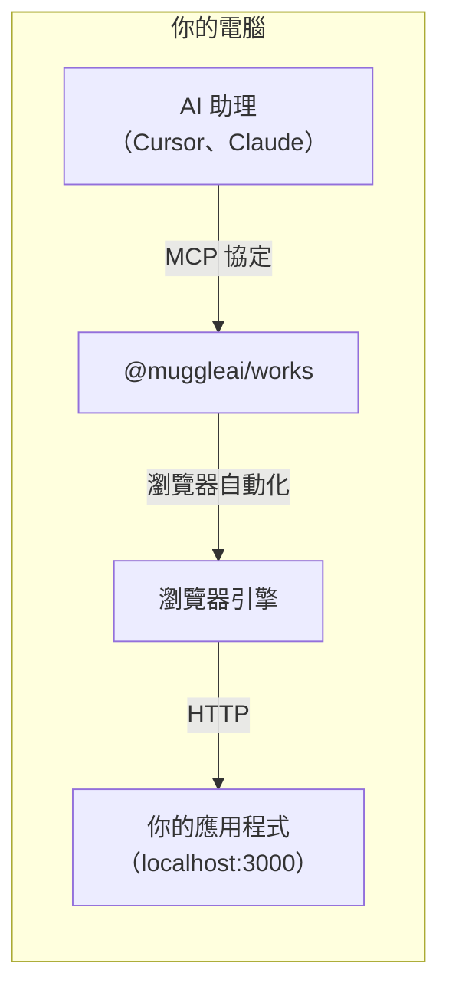
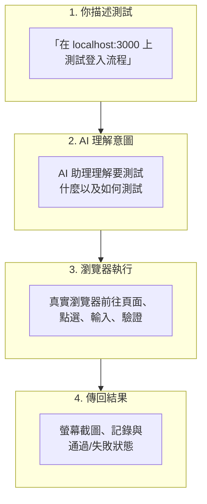
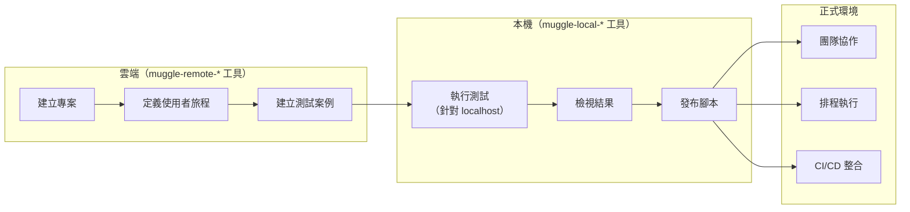

# 本機測試總覽

使用 Muggle Test，直接透過你的 AI 助理測試 localhost 應用程式。

## 本頁內容

| 章節 | 說明 |
| :------ | :---------- |
| [什麼是本機測試？](#what-is-local-testing) | 總覽與支援的環境 |
| [為什麼需要本機測試？](#why-local-testing) | 它能解決的難題 |
| [主要功能](#key-features) | localhost 存取、AI 驅動的測試、螢幕截圖等 |
| [四步驟流程](#the-four-step-flow) | 從描述到結果 |
| [比較：本機測試與雲端測試](#comparison-local-vs-cloud-testing) | 功能比較表 |
| [快速範例](#quick-example) | 對話範例 |
| [雲端優先的本機測試工作流程](#cloud-first-local-testing-workflow) | 架構與工作流程步驟 |
| [開始使用](#getting-started) | 安裝設定與指南連結 |
| [需求](#requirements) | Node.js、MCP 用戶端與作業系統 |

## 什麼是本機測試？

本機測試是 `@muggleai/works` 套件提供的一項功能，讓 AI 程式設計代理程式（Claude Code、Cursor、Antigravity）能針對你開發電腦上的 Web 應用程式執行真實瀏覽器端對端（E2E）驗收測試。真實的 Electron 瀏覽器會點選按鈕、填寫表單、瀏覽頁面並擷取螢幕截圖，以驗證使用者流程是否正常運作。雲端 E2E 測試針對的是可公開存取的網址，而本機測試則完全在你的電腦上執行，並且能存取 `localhost` 網址。

## 何時使用本機測試，何時使用雲端測試

| 環境 | 範例 | 適用方式 |
| :---------- | :------ | :----------- |
| 本機開發 | `localhost:3000` | **本機測試** |
| Docker 容器 | `localhost:8080` | **本機測試** |
| 區域網路 | `192.168.1.x` | **本機測試** |
| 預覽部署 | `pr-123.preview.example.com` | 雲端 E2E |
| 預備環境 | `staging.example.com` | 雲端 E2E |
| 正式環境 | `www.example.com` | 雲端 E2E |

## 為什麼需要本機測試？

| 難題 | 解決方案 |
| :-------- | :------- |
| 雲端服務無法存取 localhost | 完全在你的電腦上執行 |
| 在 IDE 與瀏覽器之間來回切換 | 直接在你的程式設計助理中測試 |
| 手動測試拖慢開發進度 | AI 驅動的測試自動化 |
| 很難向團隊夥伴描述 bug | 自動擷取螢幕截圖與測試結果 |

## 主要功能

| 功能 | 說明 |
| :------ | :---------- |
| **localhost 存取** | 測試 `localhost`、`127.0.0.1` 或任何本機開發伺服器 |
| **AI 驅動的測試** | 以自然語言描述測試 |
| **雲端優先架構** | 在雲端管理實體（`muggle-remote-*`），在本機執行（`muggle-local-*`） |
| **測試腳本產生** | AI 依測試案例產生可重複執行的測試腳本 |
| **瀏覽器自動化** | 真實的瀏覽器互動（點選、輸入、捲動） |
| **螢幕截圖擷取** | 以視覺化方式記錄測試結果 |
| **代理程式技能** | 預建工作流程，例如「測試我的變更」 |
| **將測試發布到雲端** | 將本機產生的測試腳本上傳到 Muggle Test，以便重播與協作 |

## 四步驟流程

1. **你以自然語言向 AI 助理描述**要測試的內容
2. **助理將你的請求轉換**為瀏覽器自動化指令
3. **真實瀏覽器**（Electron/Chromium）在你的 localhost 應用程式上執行這些操作
4. **結果隨即傳回**，包括螢幕截圖、記錄與狀態——全都呈現在你的 IDE 中

## 比較：本機測試與雲端測試

| 面向 | 本機測試 | 雲端 E2E |
| :----- | :------------ | :------- |
| **目標網址** | `localhost`、區域網路 | 公開網址（預覽、預備、正式環境） |
| **啟動方式** | `muggle serve --local` | `muggle serve --e2e` |
| **瀏覽器執行位置** | 你的電腦 | Muggle AI 雲端 |
| **測試結果** | 本機檔案（`~/.muggle-ai/`） | 雲端儀表板 |
| **最適合** | 開發、偵錯 | CI/CD、正式環境測試 |
| **AI 模型用量** | 你的 Token 錢包，或你自己的模型——請參閱[模型來源](local-testing/model-sources.md) | 你的 Token 錢包 |

## 各自的適用時機

| 情境 | 建議 |
| :------- | :------------- |
| 在本機開發期間測試 | **本機測試** |
| 在本機針對特定 bug 偵錯 | **本機測試** |
| 提交程式碼之前進行測試 | **本機測試** |
| 測試預覽/PR 部署 | 雲端 E2E |
| 自動化 CI/CD 測試 | 雲端 E2E |
| 測試預備環境或正式環境 | 雲端 E2E |
| 團隊協作處理測試結果 | 雲端 E2E |

## 快速範例

以下是本機測試的實際樣貌：

---

**你**：測試我本機應用程式 localhost:3000/signup 上的註冊表單。試著用無效的電子郵件提交，並驗證是否會出現錯誤訊息。

**助理**：我來測試你本機應用程式上的註冊表單驗證。

*[針對 localhost:3000/signup 執行測試]*

測試完成：
- 已前往 localhost:3000/signup
- 在電子郵件欄位中輸入「invalid-email」
- 點選 Submit
- **結果**：出現錯誤訊息「Please enter a valid email」 ✓

螢幕截圖已儲存至 `~/.muggle-ai/sessions/session-xxx/screenshots/step-003.png`

---

## 雲端優先的本機測試工作流程

本機測試採用**雲端優先架構**：

- **`muggle-remote-*` 工具**：所有實體管理（專案、使用者旅程、測試案例）都在雲端進行
- **`muggle-local-*` 工具**：僅負責本機執行、檢視結果與發布

1. **在雲端建立**——使用 `muggle-remote-*` 工具建立專案、使用者旅程與測試案例
2. **取得詳細資料**——呼叫 `muggle-remote-test-case-get` 取得測試案例資訊
3. **在本機執行**——使用 `muggle-local-execute-test-generation` 並傳入 localhost 網址
4. **檢視結果**——使用 `muggle-local-run-result-get` 查看螢幕截圖與狀態
5. **發布**——使用 `muggle-local-publish-test-script` 上傳產生的腳本（會傳回一個用來開啟儀表板的 `viewUrl`）
6. **擴展規模**——雲端可支援團隊協作與 CI/CD 整合

## 開始使用

準備好測試你的 localhost 應用程式了嗎？

1. **[本機測試安裝與設定](setup.md)**——10 分鐘完成安裝與設定
2. **[代理程式技能](skills.md)**——適用於「測試我的變更」與快速單一功能測試的預建工作流程
3. **[可用工具](tools-reference.md)**——完整的工具說明文件
4. **[範例工作流程](examples.md)**——常見的測試情境

## 需求

| 需求 | 版本 |
| :---------- | :------ |
| Node.js | 22 以上版本 |
| MCP 用戶端 | Claude Code、Cursor、Antigravity，或任何相容 MCP 的用戶端 |
| 作業系統 | macOS、Windows 或 Linux |
