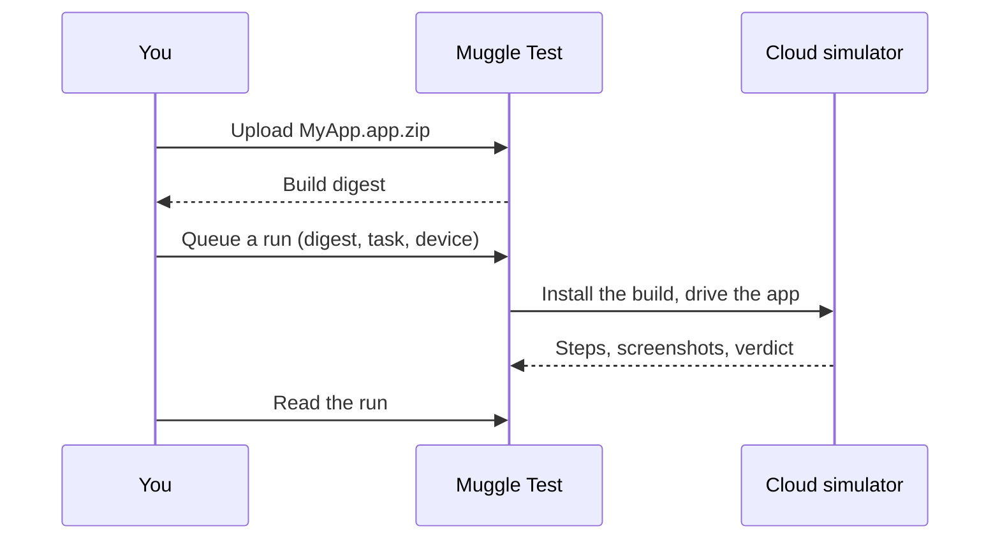
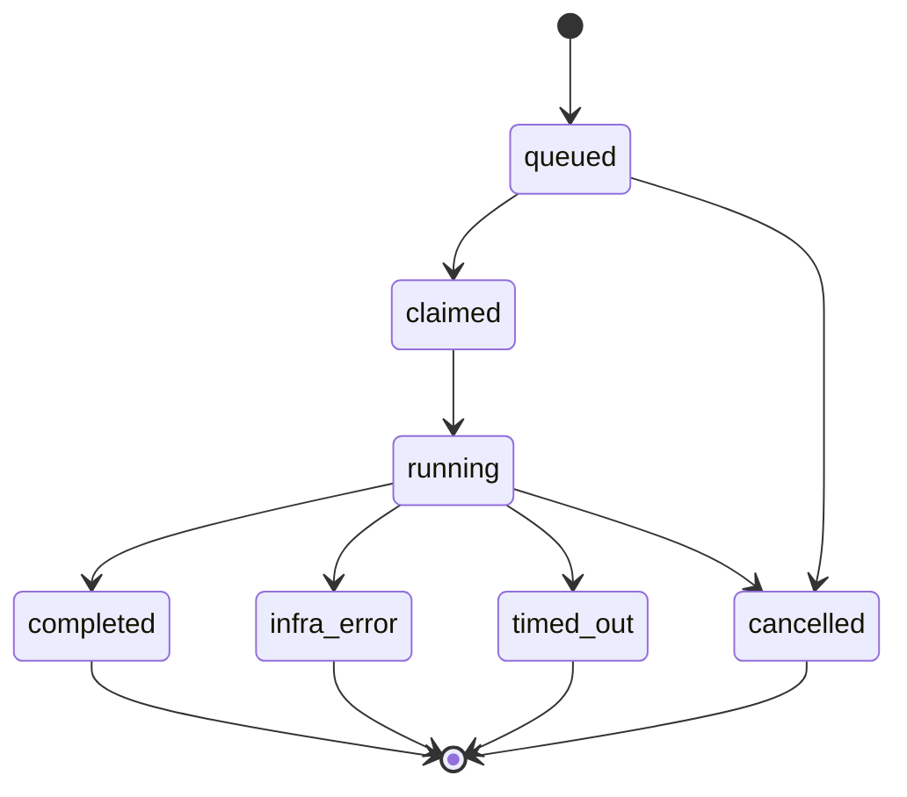

# iOS App Testing

Muggle Test runs acceptance tests against iOS apps on cloud simulators. You upload a simulator build of your app, describe a goal in plain language, and an agent installs the build on a simulator and works through the app toward that goal, recording each step with a screenshot.

## On This Page

| Section | Description |
| :------ | :---------- |
| [Requirements](#requirements) | What a build must be |
| [Run Lifecycle](#run-lifecycle) | Upload, queue, run, verdict |
| [Status and Verdict](#status-and-verdict) | Reading a run's result |
| [From Your AI Assistant](#from-your-ai-assistant) | Testing through the Muggle MCP |
| [From CI](#from-ci) | Gating a pipeline on the verdict |
| [Limitations](#limitations) | What is not supported |

## Requirements

| Requirement | Detail |
| :---------- | :----- |
| Build type | A `.app` bundle built for the iOS Simulator (`-sdk iphonesimulator`), zipped |
| Archive size | At most 512 MB |
| Build machine | macOS with Xcode, to produce the simulator build |
| Project | A Muggle Test project you can edit |

Build and zip the app:

```bash
xcodebuild -scheme MyApp -sdk iphonesimulator -configuration Debug \
  -derivedDataPath build CODE_SIGNING_ALLOWED=NO
ditto -c -k --keepParent build/Build/Products/Debug-iphonesimulator/MyApp.app MyApp.app.zip
```

## Run Lifecycle



- **Builds are content-addressed.** Each upload is identified by the sha256 digest of the zip. Uploading an unchanged build again returns the stored one.
- **A run names one goal.** Give each run one observable behavior, such as "Sign in and add the first product to the cart". Queue several runs to cover several behaviors; they run in parallel.
- **Credentials stay in the secret store.** A run that signs in references project secrets by name, and the simulator host resolves them when it starts the run. Secret values never appear in the task.

## Status and Verdict

A run reports two separate fields. A pipeline gate reads both.

| Field     | Values                                                                                  | Meaning                                      |
| :-------- | :-------------------------------------------------------------------------------------- | :------------------------------------------- |
| `status`  | `queued`, `claimed`, `running`, `completed`, `infra_error`, `timed_out`, `cancelled` | Whether the run finished executing           |
| `verdict` | `passed`, `failed`, `goal_unachievable`                                                 | What the test found; present only once `completed` |



| Outcome | Status | Verdict | Treat as |
| :------ | :----- | :------ | :------- |
| App did what the task asked | `completed` | `passed` | Pass |
| App did something wrong | `completed` | `failed` | Fail |
| The goal cannot be reached in this app | `completed` | `goal_unachievable` | Fail |
| The run itself broke | `infra_error`, `timed_out`, `cancelled` | none | Inconclusive; retry the run |

A run waits in `queued` until a simulator is free; it never fails for lack of capacity.

## From Your AI Assistant

With the Muggle MCP installed, ask your assistant to test the app:

```
Test my iOS app: upload build/MyApp.app.zip and check that adding a note works.
```

The `/muggle:muggle-test` skill recognizes an iOS build and uses the iOS tools. The upload tool reads the zip from disk itself, so the assistant never handles the archive. See [iOS App Tools](mcp/mcp-api-reference.md#ios-app-tools) for each tool's input and output.

## From CI

Upload each build from your pipeline and fail the job unless the verdict is `passed`. See [iOS App Builds](mcp/mcp-cicd-integration.md#ios-app-builds) for a GitHub Actions workflow.

## Limitations

- iOS Simulator builds only; physical devices and App Store or TestFlight builds are not supported.
- One app per run; flows that leave the app under test are out of scope.
- iOS runs do not yet appear in the PR visual walkthrough; read results with the run tools or the API.
