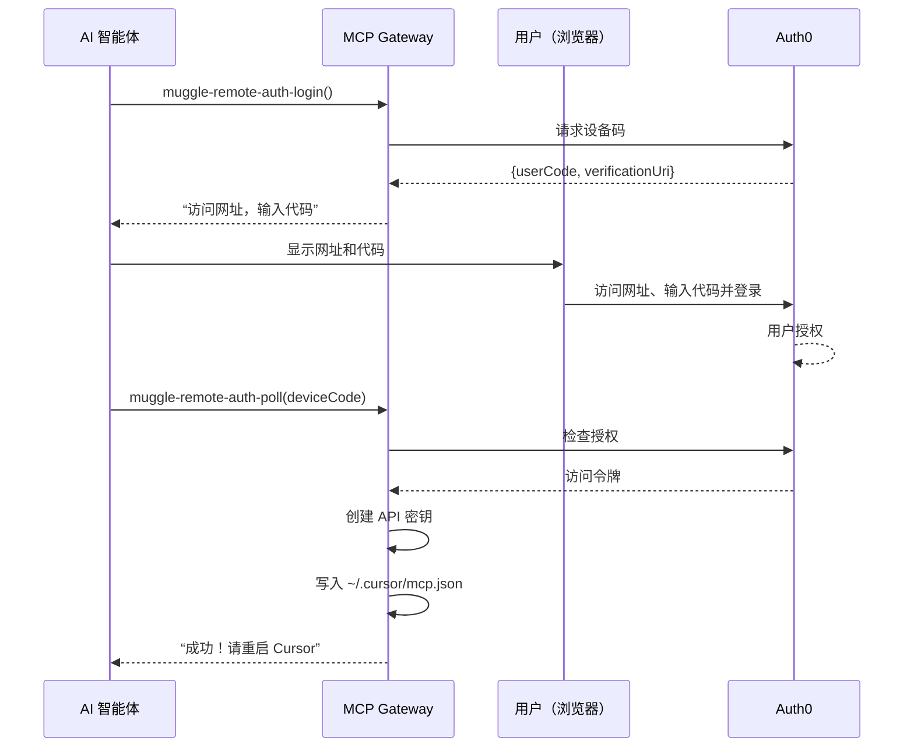
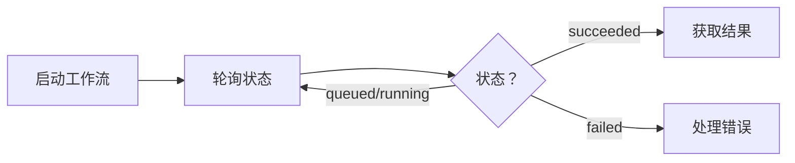

# MCP API 参考

`@muggleai/works` 包中云端 E2E 验收测试工具的完整参考。

> **注意：**本页介绍云端 E2E 验收测试工具（前缀：`muggle-remote-`）。本地测试工具（前缀：`muggle-local-`）请参阅[本地测试工具参考](local-testing/tools-reference.md)。

## 本页内容

| 章节 | 说明 |
| :------ | :---------- |
| [概览](#overview) | 各类工具一览 |
| [身份验证工具](#authentication-tools) | 设备码流程、API 密钥管理 |
| [项目工具](#project-tools) | 创建、更新、列出、删除项目 |
| [PRD 文件工具](#prd-file-tools) | 上传并处理 PRD 文档 |
| [密钥工具](#secret-tools) | 管理加密的测试凭据 |
| [钱包工具](#wallet-tools) | 支付方式与额度 |
| [用户旅程工具](#use-case-tools) | 发现、生成、创建和批准用户旅程 |
| [测试用例工具](#test-case-tools) | 生成、创建和更新测试用例 |
| [工作流工具](#workflow-tools) | 网站扫描、测试生成、回放 |
| [批量预览工具](#bulk-preview-tools) | 用户旅程/测试用例批量预览任务 |
| [测试资产工具](#artifact-tools) | 查看测试用例、脚本和摘要 |
| [报告工具](#report-tools) | 生成并发送报告 |
| [建议工具](#recommendation-tools) | 定时任务与 CI/CD 指导 |
| [反馈工具](#feedback-tools) | 提交和管理脚本反馈 |
| [错误响应](#error-responses) | 错误码与处理方式 |
| [后续步骤](#next-steps) | 延伸阅读 |

## 概览

云端 E2E 验收测试工具分为以下类别：

| 类别 | 数量 | 用途 | 链接 |
| :-------------- | ----: | :--------------------------------- | :---------------------------- |
| 身份验证 | 8 | 完成身份验证并管理 API 密钥 | [跳转](#authentication-tools) |
| 项目 | 5 | 创建和管理测试项目 | [跳转](#project-tools) |
| PRD 文件 | 5 | 上传并处理 PRD 文档 | [跳转](#prd-file-tools) |
| 密钥 | 5 | 管理测试凭据 | [跳转](#secret-tools) |
| 钱包 | 5 | 管理支付方式和充值 | [跳转](#wallet-tools) |
| 用户旅程 | 10 | 发现、生成、创建和更新用户旅程 | [跳转](#use-case-tools) |
| 测试用例 | 7 | 生成、创建和更新测试用例 | [跳转](#test-case-tools) |
| 工作流 | 20 | 扫描、生成、回放、状态 | [跳转](#workflow-tools) |
| 批量预览 | 5 | 用户旅程/测试用例批量预览任务 | [跳转](#bulk-preview-tools) |
| 测试资产 | 6 | 查看测试用例、脚本、摘要 | [跳转](#artifact-tools) |
| 报告 | 4 | 生成并发送报告 | [跳转](#report-tools) |
| 建议 | 2 | 获取定时任务建议 | [跳转](#recommendation-tools) |
| 反馈 | 3 | 提交和管理脚本反馈 | [跳转](#feedback-tools) |

---

## 身份验证工具

这些工具支持**智能体式身份验证**——AI 智能体无需事先拥有 API 密钥，即可帮助用户完成身份验证。

> **安全提示：**通过设备码流程获取的 API 密钥会直接写入用户的本地配置文件。这些密钥**绝不会**通过 MCP 协议返回，以防泄露给 AI 智能体或留在对话历史中。

### MCP 本地身份验证工具（muggle-remote-auth-*）

运行 `muggle serve` 时可使用这些工具，它们用于本地测试的身份验证：

| 工具 | 说明 |
| :--- | :---------- |
| `muggle-remote-auth-status` | 检查当前身份验证状态 |
| `muggle-remote-auth-login` | 启动设备码身份验证流程 |
| `muggle-remote-auth-poll` | 轮询登录是否完成 |
| `muggle-remote-auth-logout` | 清除已存储的凭据 |

完整文档请参阅[本地测试工具参考](local-testing/tools-reference.md#authentication-tools-muggle-remote-auth-)。

### 设备码流程

设备码流程让用户通过浏览器完成身份验证：



### muggle-remote-auth-status

检查当前身份验证状态。

**输入：**无需参数

**输出：**

```json
{
  "authenticated": true,
  "method": "apiKey",
  "apiKeyHint": "mai_sk_abc...xyz",
  "message": "Authenticated via API key"
}
```

| 字段 | 类型 | 说明 |
| :------------- | :------ | :----------------------------------- |
| `authenticated`| boolean | 是否存在凭据 |
| `method` | string | `"apiKey"`、`"bearer"` 或 `"none"` |
| `apiKeyHint` | string | 已脱敏的 API 密钥（使用 API 密钥时） |
| `message` | string | 人类可读的状态消息 |

### muggle-remote-auth-login

启动设备码身份验证流程。返回一个供用户访问的网址。

**输入：**无需参数

**输出：**

```json
{
  "userCode": "ABCD-EFGH",
  "verificationUri": "https://login.muggle-ai.com/activate",
  "verificationUriComplete": "https://login.muggle-ai.com/activate?user_code=ABCD-EFGH",
  "expiresIn": 900,
  "interval": 5,
  "instructions": [
    "1. Open this URL in your browser: https://login.muggle-ai.com/activate",
    "2. Enter this code: ABCD-EFGH",
    "3. Log in with your Muggle Test account",
    "4. Once authorized, call muggle-remote-auth-poll to complete setup"
  ]
}
```

### muggle-remote-auth-poll

轮询设备码授权是否完成。请在用户访问验证网址后调用此工具。

**输入：**

| 字段 | 类型 | 必填 | 说明 |
| :----------- | :----- | :------: | :-------------------------------- |
| `deviceCode` | string | ✓ | 启动响应中返回的设备码 |

**输出（等待中）：**

```json
{
  "status": "authorization_pending",
  "message": "Waiting for user to authorize..."
}
```

**输出（成功）：**

```json
{
  "success": true,
  "status": "authorized",
  "message": "Authentication successful! API key created.",
  "apiKey": {
    "id": "key_abc123",
    "hint": "mai_sk_abc...xyz",
    "expiresAt": "2024-04-15T00:00:00Z"
  },
  "mcpConfigUpdated": true,
  "mcpConfigPath": "C:\\Users\\you\\.cursor\\mcp.json",
  "instructions": [
    "Your Cursor mcp.json has been automatically updated!",
    "NEXT STEP: Restart Cursor to load the new configuration.",
    "SECURITY: The full API key is NOT shown here - it went directly to your config file."
  ]
}
```

### muggle-remote-auth-logout

清除已存储的凭据并退出登录。

**输入：**无需参数

### muggle-remote-auth-api-key-create

为已通过身份验证的用户创建新的 API 密钥。

**输入：**

| 字段 | 类型 | 必填 | 说明 |
| :--------------- | :------ | :------: | :---------------------------------------------------- |
| `name` | string | | API 密钥的名称 |
| `expiry` | string | | `"30d"`、`"90d"`、`"1y"` 或 `"never"`（默认：90d） |
| `updateMcpConfig`| boolean | | 自动更新 mcp.json（默认：true） |

**输出：**

```json
{
  "success": true,
  "apiKey": {
    "id": "key_abc123",
    "hint": "mai_sk_abc...xyz",
    "name": "My Dev Key",
    "expiresAt": "2024-04-15T00:00:00Z"
  },
  "secureFilePath": "C:\\Users\\you\\.muggle-ai-api-key",
  "mcpConfigUpdated": true
}
```

### muggle-remote-auth-api-key-list

列出已通过身份验证的用户的所有 API 密钥。

**输出：**

```json
{
  "count": 2,
  "apiKeys": [
    {
      "id": "key_abc123",
      "hint": "mai_sk_abc...xyz",
      "name": "Production",
      "status": "active",
      "createdAt": "2024-01-15T10:00:00Z"
    }
  ]
}
```

### muggle-remote-auth-api-key-get

按 ID 获取指定 API 密钥的详细信息。

| 字段 | 类型 | 必填 | 说明 |
| :--------- | :----- | :------: | :------------- |
| `apiKeyId` | string | ✓ | API 密钥 ID |

### muggle-remote-auth-api-key-revoke

吊销 API 密钥。该密钥会立即失效。

| 字段 | 类型 | 必填 | 说明 |
| :--------- | :----- | :------: | :---------------- |
| `apiKeyId` | string | ✓ | 要吊销的 API 密钥 |

**输出：**

```json
{
  "success": true,
  "message": "API key revoked successfully"
}
```

---

## 项目工具

### muggle-remote-project-create

创建新的 E2E 验收测试项目。

**输入：**

```json
{
  "projectName": "My Website Tests",
  "description": "End-to-end tests for example.com",
  "url": "https://example.com"
}
```

| 字段 | 类型 | 必填 | 说明 |
| :------------ | :----- | :------: | :---------------------------------- |
| `projectName` | string | ✓ | 项目名称（最多 255 个字符） |
| `description` | string | ✓ | 项目描述 |
| `url` | string | ✓ | 目标网站网址 |

**输出：**

```json
{
  "id": "proj_abc123",
  "name": "My Website Tests",
  "createdAt": "2024-01-15T10:30:00Z"
}
```

### muggle-remote-project-get

按 ID 获取指定项目的详细信息。

| 字段 | 类型 | 必填 | 说明 |
| :---------- | :----- | :------: | :--------------------- |
| `projectId` | string | ✓ | 要获取的项目 ID |

### muggle-remote-project-update

更新现有项目的详细信息。

| 字段 | 类型 | 必填 | 说明 |
| :------------ | :----- | :------: | :------------------- |
| `projectId` | string | ✓ | 要更新的项目 ID |
| `projectName` | string | | 新的项目名称 |
| `description` | string | | 更新后的描述 |
| `url` | string | | 更新后的目标网址 |

### muggle-remote-project-list

分页列出你有权访问的所有项目。

| 字段 | 类型 | 必填 | 默认值 | 说明 |
| :--------- | :----- | :------: | :------ | :----------------------- |
| `page` | number | | 1 | 页码 |
| `pageSize` | number | | 20 | 每页条目数（最多 100） |

### muggle-remote-project-delete

删除项目及其所有关联实体（用户旅程、测试用例、测试脚本）。这是软删除——项目可以恢复。

| 字段 | 类型 | 必填 | 说明 |
| :---------- | :----- | :------: | :------------------- |
| `projectId` | string | ✓ | 要删除的项目 ID |

**输出：**

```json
{
  "id": "proj_abc123",
  "name": "My Website Tests",
  "deletedAt": "2024-01-15T12:00:00Z"
}
```

---

## PRD 文件工具

### muggle-remote-prd-file-upload

上传产品需求文档，帮助 AI 生成准确的用户旅程。

**输入：**

```json
{
  "projectId": "proj_abc123",
  "fileName": "requirements.pdf",
  "contentBase64": "JVBERi0xLjQKJ...",
  "contentType": "application/pdf"
}
```

| 字段 | 类型 | 必填 | 说明 |
| :-------------- | :----- | :------: | :---------------------------------------------- |
| `projectId` | string | ✓ | 要关联此文件的项目 |
| `fileName` | string | ✓ | 文件名 |
| `contentBase64` | string | ✓ | Base64 编码的文件内容 |
| `contentType` | string | | MIME 类型（默认：`application/octet-stream`） |

**支持的格式：**

| 格式 | 扩展名 | MIME 类型 |
| :------- | :-------- | :------------------------------------------------------------------------ |
| PDF | `.pdf` | `application/pdf` |
| Word | `.docx` | `application/vnd.openxmlformats-officedocument.wordprocessingml.document` |
| 纯文本 | `.txt` | `text/plain` |
| Markdown | `.md` | `text/markdown` |

**输出：**

```json
{
  "message": "PRD file uploaded successfully.",
  "prdFilePath": "gs://muggle-ai.appspot.com/muggle-test/user_data/.../prd_file/requirements.pdf"
}
```

### muggle-remote-workflow-start-prd-file-process

开始处理已上传的 PRD 文件，从中提取用户旅程。这是一个异步工作流。

**输入：**

```json
{
  "projectId": "proj_abc123",
  "name": "PRD Processing - Jan 2024",
  "description": "Extract use cases from Q1 requirements",
  "prdFilePath": "gs://muggle-ai.appspot.com/.../requirements.pdf",
  "originalFileName": "requirements.pdf",
  "url": "https://example.com"
}
```

| 字段 | 类型 | 必填 | 说明 |
| :----------------- | :----- | :------: | :------------------------------------- |
| `projectId` | string | ✓ | 目标项目 |
| `name` | string | ✓ | 工作流名称 |
| `description` | string | ✓ | 处理工作流的描述 |
| `prdFilePath` | string | ✓ | 上传响应中返回的存储路径 |
| `originalFileName` | string | ✓ | 原始文件名 |
| `url` | string | ✓ | 用作上下文的目标网站网址 |

**输出：**

```json
{
  "workflowRuntime": {
    "id": "wfrt_prd_123",
    "status": "ACTIVE"
  },
  "prdFile": {
    "id": "prd_456",
    "fileName": "requirements.pdf"
  }
}
```

### muggle-remote-wf-get-prd-process-latest-run

检查 PRD 文件处理工作流的状态。

| 字段 | 类型 | 必填 | 说明 |
| :------------------ | :----- | :------: | :------------------ |
| `workflowRuntimeId` | string | ✓ | 工作流运行时 ID |

**输出：**

```json
{
  "status": "COMPLETED",
  "progress": 100,
  "updatedAt": "2024-01-15T10:35:00Z"
}
```

### muggle-remote-prd-file-list-by-project

列出某个项目的所有 PRD 文件。

### muggle-remote-prd-file-delete

删除 PRD 文件。

---

## 密钥工具

密钥用于存储测试所需的凭据。密钥值经过加密，在响应中**绝不会返回**。

### muggle-remote-secret-create

创建新的密钥。

**输入：**

```json
{
  "projectId": "proj_abc123",
  "name": "TEST_USER_PASSWORD",
  "value": "secretpassword123",
  "description": "Password for test user account"
}
```

| 字段 | 类型 | 必填 | 说明 |
| :------------ | :----- | :------: | :------------------------------- |
| `projectId` | string | ✓ | 要为其创建密钥的项目 |
| `name` | string | ✓ | 密钥名称/键 |
| `value` | string | ✓ | 密钥值（静态加密存储） |
| `description` | string | | 密钥的描述 |

### muggle-remote-secret-list

列出某个项目的所有密钥。

> **注意：**列表响应中绝不会返回密钥值。

### muggle-remote-secret-get

获取密钥元数据（不返回密钥值）。

### muggle-remote-secret-update

更新密钥的名称、值或描述。

### muggle-remote-secret-delete

删除密钥。

---

## 钱包工具

钱包工具用于设置支付方式和充值额度。

### muggle-remote-wallet-pm-create-setup-session

创建 Stripe 设置会话，以添加新的已保存支付方式。

**输入：**

```json
{
  "checkoutSuccessCallback": "https://app.example.com/billing/payment-method/success",
  "checkoutCancelCallback": "https://app.example.com/billing/payment-method/cancel"
}
```

### muggle-remote-wallet-payment-method-list

列出已通过身份验证的用户已保存的支付方式。

**输入：**

```json
{}
```

### muggle-remote-wallet-auto-topup-set-payment-method

设置用于自动充值的已保存支付方式。

**输入：**

```json
{
  "paymentMethodId": "pm_123"
}
```

### muggle-remote-wallet-auto-topup-update

更新自动充值的阈值、充值包和启用状态设置。

**输入：**

```json
{
  "enabled": true,
  "topUpTriggerTokenThreshold": 500,
  "packageId": "starter_pack"
}
```

### muggle-remote-wallet-topup

创建一次性结账会话，用于购买 Token 充值包。

**输入：**

```json
{
  "packageId": "starter_pack",
  "checkoutSuccessCallback": "https://app.example.com/billing/topup/success",
  "checkoutCancelCallback": "https://app.example.com/billing/topup/cancel"
}
```

---

## 用户旅程工具

### muggle-remote-use-case-discovery-memory-get

获取已发现的候选用户旅程及其证据（截图、备注）。

**输出：**

```json
{
  "projectId": "proj_abc123",
  "useCaseCandidates": [
    {
      "id": "cand_001",
      "status": "candidate",
      "useCase": {
        "title": "User Login",
        "description": "Authenticate user with email and password"
      },
      "comments": [
        {
          "pageUrl": "https://example.com/login",
          "screenshotUrl": "https://storage.muggle-ai.com/screenshots/...",
          "notes": "Found login form with email and password fields"
        }
      ]
    }
  ]
}
```

**候选项状态：**

| 状态 | 说明 |
| :---------- | :----------------------------------- |
| `draft` | 初步发现，尚未评估 |
| `candidate` | 已评估，可供审核 |
| `graduated` | 已批准并转为正式用户旅程 |
| `dropped` | 已拒绝并归档 |

### muggle-remote-use-case-candidates-approve

批准（转正）所选候选项，使其成为有效的用户旅程。

**输入：**

```json
{
  "projectId": "proj_abc123",
  "approvedCandidateIds": ["cand_001", "cand_002"]
}
```

| 字段 | 类型 | 必填 | 说明 |
| :--------------------- | :------- | :------: | :--------------------------- |
| `projectId` | string | ✓ | 项目 ID |
| `approvedCandidateIds` | string[] | ✓ | 要批准的候选项 ID |

### muggle-remote-use-case-list

列出某个项目中已转正的用户旅程。

### muggle-remote-use-case-get

获取指定用户旅程的详细信息。

### muggle-remote-use-case-create

手动创建用户旅程。

| 字段 | 类型 | 必填 | 说明 |
| :------------ | :----- | :------: | :------------------------ |
| `projectId` | string | ✓ | 目标项目 |
| `title` | string | ✓ | 用户旅程标题 |
| `description` | string | | 该流程涵盖的内容 |
| `url` | string | | 该流程的起始网址 |

### muggle-remote-use-case-create-from-prompts

根据自然语言提示词生成一个或多个用户旅程。

| 字段 | 类型 | 必填 | 说明 |
| :---------- | :------- | :------: | :---------------------------------- |
| `projectId` | string | ✓ | 目标项目 |
| `prompts` | string[] | ✓ | 用自然语言描述的流程 |

### muggle-remote-use-case-prompt-preview

预览某个提示词将生成的用户旅程，但不保存。

| 字段 | 类型 | 必填 | 说明 |
| :---------- | :----- | :------: | :------------------------ |
| `projectId` | string | ✓ | 目标项目 |
| `prompt` | string | ✓ | 自然语言描述 |

### muggle-remote-use-case-update

更新用户旅程的字段。

| 字段 | 类型 | 必填 | 说明 |
| :---------- | :----- | :------: | :----------------- |
| `useCaseId` | string | ✓ | 要更新的用户旅程 |

### muggle-remote-use-case-update-from-prompt

根据自然语言指令修改现有用户旅程。

| 字段 | 类型 | 必填 | 说明 |
| :---------- | :----- | :------: | :----------------------------- |
| `useCaseId` | string | ✓ | 要修改的用户旅程 |
| `prompt` | string | ✓ | 描述修改内容的指令 |

---

## 测试用例工具

### muggle-remote-test-case-create

在用户旅程下创建测试用例。

| 字段 | 类型 | 必填 | 说明 |
| :---------- | :----- | :------: | :--------------------- |
| `projectId` | string | ✓ | 目标项目 |
| `useCaseId` | string | ✓ | 所属用户旅程 |
| `title` | string | ✓ | 测试用例标题 |
| `goal` | string | | 测试要验证的内容 |

### muggle-remote-test-case-generate-from-prompt

根据自然语言提示词，为某个用户旅程生成一个或多个测试用例。

| 字段 | 类型 | 必填 | 说明 |
| :---------- | :----- | :------: | :---------------------------------- |
| `projectId` | string | ✓ | 目标项目 |
| `useCaseId` | string | ✓ | 要为其生成测试用例的用户旅程 |
| `prompt` | string | ✓ | 要覆盖哪些场景 |

### muggle-remote-test-case-update

更新测试用例的字段。

| 字段 | 类型 | 必填 | 说明 |
| :----------- | :----- | :------: | :------------------ |
| `testCaseId` | string | ✓ | 要更新的测试用例 |

> 只读的测试用例工具（`muggle-remote-test-case-list`、`-get`、`-list-by-use-case`）在[测试资产工具](#artifact-tools)中介绍。

---

## 工作流工具

工作流是长时间运行的操作。启动后，使用 `get_latest_run` 类工具检查状态。



### 网站扫描

#### muggle-remote-workflow-start-website-scan

开始扫描网站以发现用户旅程。

**输入：**

```json
{
  "projectId": "proj_abc123",
  "url": "https://example.com",
  "description": "Discover e-commerce user flows",
  "archiveUnapproved": true
}
```

| 字段 | 类型 | 必填 | 说明 |
| :------------------ | :------ | :------: | :------------------------------------------- |
| `projectId` | string | ✓ | 目标项目 |
| `url` | string | ✓ | 要扫描的网站网址 |
| `description` | string | ✓ | 要查找的内容 |
| `archiveUnapproved` | boolean | | 先归档现有的未批准候选项 |

**输出：**

```json
{
  "workflowRuntimeId": "wfrt_scan_123"
}
```

#### muggle-remote-workflow-get-website-scan-latest-run

检查扫描状态。

**输出：**

```json
{
  "workflowRunId": "wfrun_456",
  "status": "succeeded",
  "updatedAt": "2024-01-15T10:35:00Z"
}
```

**工作流状态：**

| 状态 | 说明 |
| :---------- | :--------------------- |
| `queued` | 等待开始 |
| `running` | 进行中 |
| `succeeded` | 成功完成 |
| `failed` | 已完成但出错 |
| `cancelled` | 已被用户停止 |

#### muggle-remote-workflow-list-website-scan-runtimes

列出所有网站扫描运行时。

### 测试用例检测

#### muggle-remote-workflow-start-test-case-detection

根据已批准的用户旅程生成测试用例。

| 字段 | 类型 | 必填 | 说明 |
| :---------- | :----- | :------: | :------------------------------- |
| `projectId` | string | ✓ | 目标项目 |
| `useCaseId` | string | | 指定用户旅程（省略则处理全部） |

#### muggle-remote-wf-get-tc-detect-latest-run

检查测试用例检测状态。

#### muggle-remote-wf-list-tc-detect-runtimes

列出测试用例检测运行时。

### 测试脚本生成

#### muggle-remote-workflow-start-test-script-generation

根据测试用例生成可执行的测试脚本。

| 字段 | 类型 | 必填 | 说明 |
| :----------- | :----- | :------: | :----------------- |
| `projectId` | string | ✓ | 目标项目 |
| `testCaseId` | string | | 指定测试用例 |
| `useCaseId` | string | | 指定用户旅程 |

#### muggle-remote-wf-get-ts-gen-latest-run

检查脚本生成状态。

#### muggle-remote-workflow-start-test-script-generation-bulk

为项目中尚无有效脚本的测试用例批量生成脚本。

| 字段 | 类型 | 必填 | 说明 |
| :---------- | :----- | :------: | :------------- |
| `projectId` | string | ✓ | 目标项目 |

#### muggle-remote-wf-get-latest-ts-gen-by-tc

获取指定测试用例最新的生成运行时。

### 测试脚本回放

#### muggle-remote-workflow-start-test-script-replay

执行单个测试脚本。

| 字段 | 类型 | 必填 | 说明 |
| :------------- | :----- | :------: | :---------------- |
| `projectId` | string | ✓ | 目标项目 |
| `testScriptId` | string | ✓ | 要执行的脚本 |

#### muggle-remote-workflow-start-test-script-replay-bulk

并行执行多个测试脚本。

**输入：**

```json
{
  "projectId": "proj_abc123",
  "testScriptIds": ["ts_301", "ts_302"],
  "name": "Nightly regression"
}
```

| 字段 | 类型 | 必填 | 说明 |
| :-------------- | :------- | :------: | :------------------------------ |
| `projectId` | string | ✓ | 目标项目 |
| `testScriptIds` | string[] | | 指定脚本（省略则执行全部） |
| `name` | string | | 本次运行批次的名称 |

#### muggle-remote-wf-get-ts-replay-latest-run

检查单个测试脚本回放的状态。

#### muggle-remote-wf-get-ts-replay-bulk-latest-run

检查批量回放状态。

#### muggle-remote-wf-get-replay-bulk-batch-summary

获取批量运行批次的详细摘要。

**输出：**

```json
{
  "runBatchId": "batch_789",
  "totalScripts": 10,
  "passed": 8,
  "failed": 2
}
```

### 工作流管理

#### muggle-remote-workflow-cancel-run

取消指定的工作流运行。

#### muggle-remote-workflow-cancel-runtime

取消工作流运行时及其所有运行。

#### muggle-remote-local-run-upload

将本地执行的运行（及其截图）上传到云端，使其与云端运行一起显示在控制台上。

| 字段 | 类型 | 必填 | 说明 |
| :---------- | :----- | :------: | :------------- |
| `projectId` | string | ✓ | 目标项目 |

---

## 测试资产工具

### 测试用例

#### muggle-remote-test-case-list

列出某个项目的测试用例。

#### muggle-remote-test-case-get

获取测试用例详细信息，包括步骤和预期结果。

#### muggle-remote-test-case-list-by-use-case

列出指定用户旅程下的测试用例。

### 测试脚本

#### muggle-remote-test-script-list

列出某个项目的测试脚本。

#### muggle-remote-test-script-get

获取测试脚本详细信息，包括可执行步骤。

### 摘要

#### muggle-remote-project-test-results-summary-get

获取汇总的测试结果摘要。

**输出：**

```json
{
  "projectId": "proj_abc123",
  "totalTests": 25,
  "passed": 22,
  "failed": 3,
  "passRate": 88.0
}
```

#### muggle-remote-project-test-scripts-summary-get

获取测试脚本摘要。

#### muggle-remote-project-test-runs-summary-get

获取近期测试运行摘要。

---

## 报告工具

### muggle-remote-report-stats-summary-get

获取报告统计数据和健康评分。

### muggle-remote-report-cost-query

查询用量和费用数据。

| 字段 | 类型 | 必填 | 说明 |
| :------------- | :----- | :------: | :-------------------- |
| `projectId` | string | ✓ | 目标项目 |
| `startDateKey` | string | | 开始日期（YYYYMMDD） |
| `endDateKey` | string | | 结束日期（YYYYMMDD） |

### muggle-remote-report-preferences-upsert

配置报告发送偏好设置。

**输入：**

```json
{
  "projectId": "proj_abc123",
  "channels": ["email", "webhook"],
  "emails": ["team@example.com"],
  "webhookUrl": "https://hooks.example.com/muggle"
}
```

| 字段 | 类型 | 必填 | 说明 |
| :----------- | :------- | :------: | :------------------------------------- |
| `projectId` | string | ✓ | 目标项目 |
| `channels` | string[] | ✓ | 发送渠道 |
| `emails` | string[] | | 邮箱地址（用于邮件渠道） |
| `phones` | string[] | | 手机号码（用于短信渠道） |
| `webhookUrl` | string | | Webhook 端点（用于 Webhook 渠道） |

**可用渠道：**

| 渠道 | 说明 |
| :-------- | :------------------------------ |
| `email` | 以 PDF 附件形式发送报告 |
| `sms` | 发送摘要通知 |
| `webhook` | 向端点 POST JSON 负载 |

### muggle-remote-report-final-generate

生成最终测试报告（异步操作）。

---

## 建议工具

这些工具只提供建议，不会做出任何更改。

### muggle-remote-recommend-schedule

获取测试定时任务建议。

**输出：**

```json
{
  "recommendations": [
    {
      "title": "Nightly Regression Tests",
      "rationale": "Running tests every night catches regressions quickly",
      "schedule": "0 2 * * *",
      "tradeoffs": ["Pro: Fresh results every morning", "Con: Delayed feedback"]
    }
  ]
}
```

### muggle-remote-recommend-cicd-setup

获取适用于 GitHub Actions、Azure DevOps、GitLab CI 等平台的 CI/CD 集成模板。

| 字段 | 类型 | 选项 |
| :------------------- | :----- | :----------------------------------------- |
| `repositoryProvider` | string | `github`、`azureDevOps`、`gitlab`、`other` |
| `cadence` | string | `onPullRequest`、`nightly`、`onDemand` |

---

## 批量预览工具

批量预览任务会在一个异步任务中生成大量候选用户旅程或候选测试用例，方便你在保存前审核结果。

### muggle-remote-use-case-bulk-preview-submit

提交一个批量任务，预览某个项目的用户旅程。

### muggle-remote-test-case-bulk-preview-submit

提交一个批量任务，为所选用户旅程预览测试用例。

### muggle-remote-bulk-preview-job-get

获取批量预览任务的状态和结果。

| 字段 | 类型 | 必填 | 说明 |
| :------ | :----- | :------: | :------------------ |
| `jobId` | string | ✓ | 批量预览任务 ID |

### muggle-remote-bulk-preview-job-list

列出某个项目的批量预览任务。

### muggle-remote-bulk-preview-job-cancel

取消运行中的批量预览任务。

---

## 反馈工具

反馈工具让你标记某个生成的脚本——或某个具体步骤——执行了错误的操作，以便 Muggle 分析并重新生成受影响的脚本。

### muggle-remote-user-feedback-create

就某个脚本或某个具体步骤提交反馈。

| 字段 | 类型 | 必填 | 说明 |
| :------------- | :----- | :------: | :--------------------------- |
| `projectId` | string | ✓ | 目标项目 |
| `testScriptId` | string | | 反馈所针对的脚本 |
| `message` | string | ✓ | 出了什么问题 |

### muggle-remote-user-feedback-list

列出你已提交的反馈。

### muggle-remote-user-feedback-delete

删除一条之前提交的反馈。

---

## 错误响应

所有工具都可能返回错误：

```json
{
  "error": "ERROR_CODE",
  "message": "Human-readable description",
  "details": {}
}
```

| 错误码 | HTTP 状态码 | 说明 |
| :----------------- | :---------: | :-------------------------------- |
| `UNAUTHORIZED` | 401 | 缺少身份验证或身份验证无效 |
| `FORBIDDEN` | 403 | 无权访问该资源 |
| `NOT_FOUND` | 404 | 资源不存在 |
| `INVALID_ARGUMENT` | 400 | 输入参数无效 |
| `UPSTREAM_ERROR` | 502 | 后端服务错误 |
| `INTERNAL_ERROR` | 500 | 意外的服务器错误 |

---

## 后续步骤

- **[MCP 快速入门](getting-started/mcp-quickstart.md)**——开始使用
- **[MCP 概念](mcp/mcp-concepts.md)**——了解架构
- **[CI/CD 集成](mcp/mcp-cicd-integration.md)**——在流水线中实现自动化
