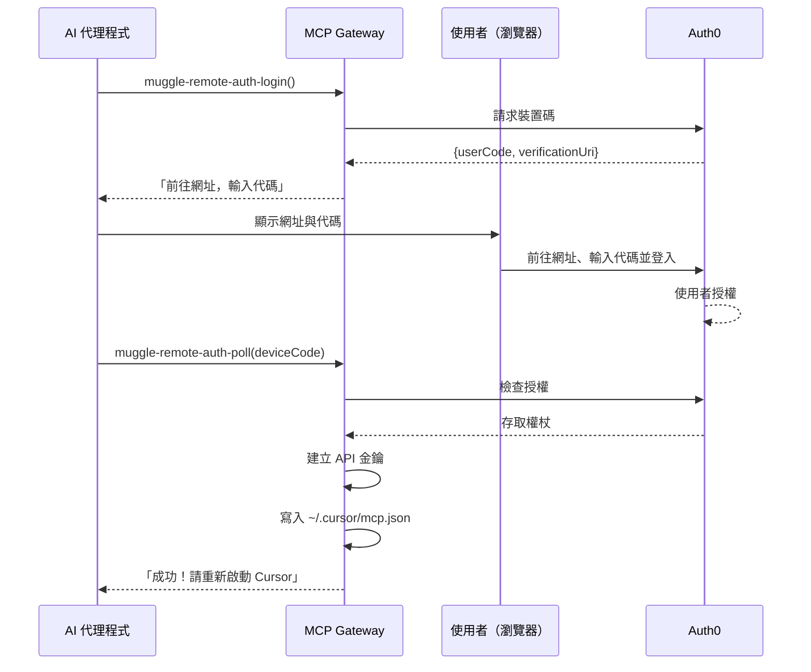
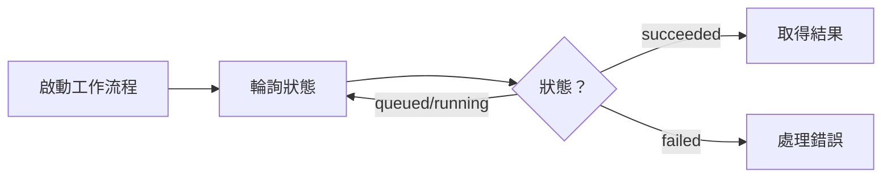

# MCP API 參考

`@muggleai/works` 套件中雲端 E2E 驗收測試工具的完整參考。

> **注意：**本頁說明雲端 E2E 驗收測試工具（前綴：`muggle-remote-`）。本機測試工具（前綴：`muggle-local-`）請參閱[本機測試工具參考](local-testing/tools-reference.md)。

## 本頁內容

| 章節 | 說明 |
| :------ | :---------- |
| [總覽](#overview) | 各類工具一覽 |
| [身分驗證工具](#authentication-tools) | 裝置碼流程、API 金鑰管理 |
| [專案工具](#project-tools) | 建立、更新、列出、刪除專案 |
| [PRD 檔案工具](#prd-file-tools) | 上傳並處理 PRD 文件 |
| [密鑰工具](#secret-tools) | 管理加密的測試憑證 |
| [錢包工具](#wallet-tools) | 付款方式與額度 |
| [使用者旅程工具](#use-case-tools) | 探索、產生、建立及核准使用者旅程 |
| [測試案例工具](#test-case-tools) | 產生、建立及更新測試案例 |
| [工作流程工具](#workflow-tools) | 網站掃描、測試產生、重播 |
| [大量預覽工具](#bulk-preview-tools) | 使用者旅程/測試案例大量預覽作業 |
| [測試資產工具](#artifact-tools) | 檢視測試案例、腳本與摘要 |
| [報告工具](#report-tools) | 產生並傳送報告 |
| [建議工具](#recommendation-tools) | 排程與 CI/CD 指引 |
| [回饋工具](#feedback-tools) | 提交及管理腳本回饋 |
| [錯誤回應](#error-responses) | 錯誤碼與處理方式 |
| [後續步驟](#next-steps) | 延伸閱讀 |

## 總覽

雲端 E2E 驗收測試工具分為以下類別：

| 類別 | 數量 | 用途 | 連結 |
| :-------------- | ----: | :--------------------------------- | :---------------------------- |
| 身分驗證 | 8 | 完成身分驗證並管理 API 金鑰 | [前往](#authentication-tools) |
| 專案 | 5 | 建立及管理測試專案 | [前往](#project-tools) |
| PRD 檔案 | 5 | 上傳並處理 PRD 文件 | [前往](#prd-file-tools) |
| 密鑰 | 5 | 管理測試憑證 | [前往](#secret-tools) |
| 錢包 | 5 | 管理付款方式與加值 | [前往](#wallet-tools) |
| 使用者旅程 | 10 | 探索、產生、建立及更新使用者旅程 | [前往](#use-case-tools) |
| 測試案例 | 7 | 產生、建立及更新測試案例 | [前往](#test-case-tools) |
| 工作流程 | 20 | 掃描、產生、重播、狀態 | [前往](#workflow-tools) |
| 大量預覽 | 5 | 使用者旅程/測試案例大量預覽作業 | [前往](#bulk-preview-tools) |
| 測試資產 | 6 | 檢視測試案例、腳本、摘要 | [前往](#artifact-tools) |
| 報告 | 4 | 產生並傳送報告 | [前往](#report-tools) |
| 建議 | 2 | 取得排程建議 | [前往](#recommendation-tools) |
| 回饋 | 3 | 提交及管理腳本回饋 | [前往](#feedback-tools) |

---

## 身分驗證工具

這些工具支援**代理式身分驗證**——AI 代理程式不需事先擁有 API 金鑰，就能協助使用者完成身分驗證。

> **安全性注意事項：**透過裝置碼流程取得的 API 金鑰會直接寫入使用者的本機設定檔。這些金鑰**絕不會**透過 MCP 通訊協定傳回，以免外洩給 AI 代理程式或留在對話記錄中。

### MCP 本機身分驗證工具（muggle-remote-auth-*）

執行 `muggle serve` 時可使用這些工具，它們用於本機測試的身分驗證：

| 工具 | 說明 |
| :--- | :---------- |
| `muggle-remote-auth-status` | 檢查目前的身分驗證狀態 |
| `muggle-remote-auth-login` | 啟動裝置碼身分驗證流程 |
| `muggle-remote-auth-poll` | 輪詢登入是否完成 |
| `muggle-remote-auth-logout` | 清除已儲存的憑證 |

完整文件請參閱[本機測試工具參考](local-testing/tools-reference.md#authentication-tools-muggle-remote-auth-)。

### 裝置碼流程

裝置碼流程讓使用者透過瀏覽器完成身分驗證：



### muggle-remote-auth-status

檢查目前的身分驗證狀態。

**輸入：**不需參數

**輸出：**

```json
{
  "authenticated": true,
  "method": "apiKey",
  "apiKeyHint": "mai_sk_abc...xyz",
  "message": "Authenticated via API key"
}
```

| 欄位 | 類型 | 說明 |
| :------------- | :------ | :----------------------------------- |
| `authenticated`| boolean | 是否有憑證 |
| `method` | string | `"apiKey"`、`"bearer"` 或 `"none"` |
| `apiKeyHint` | string | 已遮罩的 API 金鑰（使用 API 金鑰時） |
| `message` | string | 人類可讀的狀態訊息 |

### muggle-remote-auth-login

啟動裝置碼身分驗證流程。傳回一個供使用者前往的網址。

**輸入：**不需參數

**輸出：**

```json
{
  "userCode": "ABCD-EFGH",
  "verificationUri": "https://login.muggle-ai.com/activate",
  "verificationUriComplete": "https://login.muggle-ai.com/activate?user_code=ABCD-EFGH",
  "expiresIn": 900,
  "interval": 5,
  "instructions": [
    "1. Open this URL in your browser: https://login.muggle-ai.com/activate",
    "2. Enter this code: ABCD-EFGH",
    "3. Log in with your Muggle Test account",
    "4. Once authorized, call muggle-remote-auth-poll to complete setup"
  ]
}
```

### muggle-remote-auth-poll

輪詢裝置碼授權是否完成。請在使用者前往驗證網址後呼叫此工具。

**輸入：**

| 欄位 | 類型 | 必填 | 說明 |
| :----------- | :----- | :------: | :-------------------------------- |
| `deviceCode` | string | ✓ | 啟動回應中傳回的裝置碼 |

**輸出（等待中）：**

```json
{
  "status": "authorization_pending",
  "message": "Waiting for user to authorize..."
}
```

**輸出（成功）：**

```json
{
  "success": true,
  "status": "authorized",
  "message": "Authentication successful! API key created.",
  "apiKey": {
    "id": "key_abc123",
    "hint": "mai_sk_abc...xyz",
    "expiresAt": "2024-04-15T00:00:00Z"
  },
  "mcpConfigUpdated": true,
  "mcpConfigPath": "C:\\Users\\you\\.cursor\\mcp.json",
  "instructions": [
    "Your Cursor mcp.json has been automatically updated!",
    "NEXT STEP: Restart Cursor to load the new configuration.",
    "SECURITY: The full API key is NOT shown here - it went directly to your config file."
  ]
}
```

### muggle-remote-auth-logout

清除已儲存的憑證並登出。

**輸入：**不需參數

### muggle-remote-auth-api-key-create

為已通過身分驗證的使用者建立新的 API 金鑰。

**輸入：**

| 欄位 | 類型 | 必填 | 說明 |
| :--------------- | :------ | :------: | :---------------------------------------------------- |
| `name` | string | | API 金鑰的名稱 |
| `expiry` | string | | `"30d"`、`"90d"`、`"1y"` 或 `"never"`（預設：90d） |
| `updateMcpConfig`| boolean | | 自動更新 mcp.json（預設：true） |

**輸出：**

```json
{
  "success": true,
  "apiKey": {
    "id": "key_abc123",
    "hint": "mai_sk_abc...xyz",
    "name": "My Dev Key",
    "expiresAt": "2024-04-15T00:00:00Z"
  },
  "secureFilePath": "C:\\Users\\you\\.muggle-ai-api-key",
  "mcpConfigUpdated": true
}
```

### muggle-remote-auth-api-key-list

列出已通過身分驗證的使用者的所有 API 金鑰。

**輸出：**

```json
{
  "count": 2,
  "apiKeys": [
    {
      "id": "key_abc123",
      "hint": "mai_sk_abc...xyz",
      "name": "Production",
      "status": "active",
      "createdAt": "2024-01-15T10:00:00Z"
    }
  ]
}
```

### muggle-remote-auth-api-key-get

依 ID 取得特定 API 金鑰的詳細資料。

| 欄位 | 類型 | 必填 | 說明 |
| :--------- | :----- | :------: | :------------- |
| `apiKeyId` | string | ✓ | API 金鑰 ID |

### muggle-remote-auth-api-key-revoke

撤銷 API 金鑰。該金鑰會立即失效。

| 欄位 | 類型 | 必填 | 說明 |
| :--------- | :----- | :------: | :---------------- |
| `apiKeyId` | string | ✓ | 要撤銷的 API 金鑰 |

**輸出：**

```json
{
  "success": true,
  "message": "API key revoked successfully"
}
```

---

## 專案工具

### muggle-remote-project-create

建立新的 E2E 驗收測試專案。

**輸入：**

```json
{
  "projectName": "My Website Tests",
  "description": "End-to-end tests for example.com",
  "url": "https://example.com"
}
```

| 欄位 | 類型 | 必填 | 說明 |
| :------------ | :----- | :------: | :---------------------------------- |
| `projectName` | string | ✓ | 專案名稱（最多 255 個字元） |
| `description` | string | ✓ | 專案說明 |
| `url` | string | ✓ | 目標網站網址 |

**輸出：**

```json
{
  "id": "proj_abc123",
  "name": "My Website Tests",
  "createdAt": "2024-01-15T10:30:00Z"
}
```

### muggle-remote-project-get

依 ID 取得特定專案的詳細資料。

| 欄位 | 類型 | 必填 | 說明 |
| :---------- | :----- | :------: | :--------------------- |
| `projectId` | string | ✓ | 要取得的專案 ID |

### muggle-remote-project-update

更新現有專案的詳細資料。

| 欄位 | 類型 | 必填 | 說明 |
| :------------ | :----- | :------: | :------------------- |
| `projectId` | string | ✓ | 要更新的專案 ID |
| `projectName` | string | | 新的專案名稱 |
| `description` | string | | 更新後的說明 |
| `url` | string | | 更新後的目標網址 |

### muggle-remote-project-list

以分頁方式列出你有權存取的所有專案。

| 欄位 | 類型 | 必填 | 預設值 | 說明 |
| :--------- | :----- | :------: | :------ | :----------------------- |
| `page` | number | | 1 | 頁碼 |
| `pageSize` | number | | 20 | 每頁項目數（最多 100） |

### muggle-remote-project-delete

刪除專案及其所有相關實體（使用者旅程、測試案例、測試腳本）。這是軟刪除——專案可以恢復。

| 欄位 | 類型 | 必填 | 說明 |
| :---------- | :----- | :------: | :------------------- |
| `projectId` | string | ✓ | 要刪除的專案 ID |

**輸出：**

```json
{
  "id": "proj_abc123",
  "name": "My Website Tests",
  "deletedAt": "2024-01-15T12:00:00Z"
}
```

---

## PRD 檔案工具

### muggle-remote-prd-file-upload

上傳產品需求文件，協助 AI 產生準確的使用者旅程。

**輸入：**

```json
{
  "projectId": "proj_abc123",
  "fileName": "requirements.pdf",
  "contentBase64": "JVBERi0xLjQKJ...",
  "contentType": "application/pdf"
}
```

| 欄位 | 類型 | 必填 | 說明 |
| :-------------- | :----- | :------: | :---------------------------------------------- |
| `projectId` | string | ✓ | 要與此檔案建立關聯的專案 |
| `fileName` | string | ✓ | 檔案名稱 |
| `contentBase64` | string | ✓ | Base64 編碼的檔案內容 |
| `contentType` | string | | MIME 類型（預設：`application/octet-stream`） |

**支援的格式：**

| 格式 | 副檔名 | MIME 類型 |
| :------- | :-------- | :------------------------------------------------------------------------ |
| PDF | `.pdf` | `application/pdf` |
| Word | `.docx` | `application/vnd.openxmlformats-officedocument.wordprocessingml.document` |
| 純文字 | `.txt` | `text/plain` |
| Markdown | `.md` | `text/markdown` |

**輸出：**

```json
{
  "message": "PRD file uploaded successfully.",
  "prdFilePath": "gs://muggle-ai.appspot.com/muggle-test/user_data/.../prd_file/requirements.pdf"
}
```

### muggle-remote-workflow-start-prd-file-process

開始處理已上傳的 PRD 檔案，從中擷取使用者旅程。這是非同步工作流程。

**輸入：**

```json
{
  "projectId": "proj_abc123",
  "name": "PRD Processing - Jan 2024",
  "description": "Extract use cases from Q1 requirements",
  "prdFilePath": "gs://muggle-ai.appspot.com/.../requirements.pdf",
  "originalFileName": "requirements.pdf",
  "url": "https://example.com"
}
```

| 欄位 | 類型 | 必填 | 說明 |
| :----------------- | :----- | :------: | :------------------------------------- |
| `projectId` | string | ✓ | 目標專案 |
| `name` | string | ✓ | 工作流程名稱 |
| `description` | string | ✓ | 處理工作流程的說明 |
| `prdFilePath` | string | ✓ | 上傳回應中傳回的儲存路徑 |
| `originalFileName` | string | ✓ | 原始檔案名稱 |
| `url` | string | ✓ | 作為背景資訊的目標網站網址 |

**輸出：**

```json
{
  "workflowRuntime": {
    "id": "wfrt_prd_123",
    "status": "ACTIVE"
  },
  "prdFile": {
    "id": "prd_456",
    "fileName": "requirements.pdf"
  }
}
```

### muggle-remote-wf-get-prd-process-latest-run

檢查 PRD 檔案處理工作流程的狀態。

| 欄位 | 類型 | 必填 | 說明 |
| :------------------ | :----- | :------: | :------------------ |
| `workflowRuntimeId` | string | ✓ | 工作流程執行階段 ID |

**輸出：**

```json
{
  "status": "COMPLETED",
  "progress": 100,
  "updatedAt": "2024-01-15T10:35:00Z"
}
```

### muggle-remote-prd-file-list-by-project

列出某個專案的所有 PRD 檔案。

### muggle-remote-prd-file-delete

刪除 PRD 檔案。

---

## 密鑰工具

密鑰用來儲存測試所需的憑證。密鑰值經過加密，在回應中**絕不會傳回**。

### muggle-remote-secret-create

建立新的密鑰。

**輸入：**

```json
{
  "projectId": "proj_abc123",
  "name": "TEST_USER_PASSWORD",
  "value": "secretpassword123",
  "description": "Password for test user account"
}
```

| 欄位 | 類型 | 必填 | 說明 |
| :------------ | :----- | :------: | :------------------------------- |
| `projectId` | string | ✓ | 要為其建立密鑰的專案 |
| `name` | string | ✓ | 密鑰名稱/鍵 |
| `value` | string | ✓ | 密鑰值（靜態加密儲存） |
| `description` | string | | 密鑰的說明 |

### muggle-remote-secret-list

列出某個專案的所有密鑰。

> **注意：**清單回應中絕不會傳回密鑰值。

### muggle-remote-secret-get

取得密鑰中繼資料（不會傳回密鑰值）。

### muggle-remote-secret-update

更新密鑰的名稱、值或說明。

### muggle-remote-secret-delete

刪除密鑰。

---

## 錢包工具

錢包工具可用來設定付款方式並加值額度。

### muggle-remote-wallet-pm-create-setup-session

建立 Stripe 設定工作階段，以新增一個已儲存的付款方式。

**輸入：**

```json
{
  "checkoutSuccessCallback": "https://app.example.com/billing/payment-method/success",
  "checkoutCancelCallback": "https://app.example.com/billing/payment-method/cancel"
}
```

### muggle-remote-wallet-payment-method-list

列出已通過身分驗證的使用者已儲存的付款方式。

**輸入：**

```json
{}
```

### muggle-remote-wallet-auto-topup-set-payment-method

設定自動加值所使用的已儲存付款方式。

**輸入：**

```json
{
  "paymentMethodId": "pm_123"
}
```

### muggle-remote-wallet-auto-topup-update

更新自動加值的門檻、加值包與啟用狀態設定。

**輸入：**

```json
{
  "enabled": true,
  "topUpTriggerTokenThreshold": 500,
  "packageId": "starter_pack"
}
```

### muggle-remote-wallet-topup

建立一次性結帳工作階段，用於購買 Token 加值包。

**輸入：**

```json
{
  "packageId": "starter_pack",
  "checkoutSuccessCallback": "https://app.example.com/billing/topup/success",
  "checkoutCancelCallback": "https://app.example.com/billing/topup/cancel"
}
```

---

## 使用者旅程工具

### muggle-remote-use-case-discovery-memory-get

取得已探索到的候選使用者旅程及其證據（螢幕截圖、備註）。

**輸出：**

```json
{
  "projectId": "proj_abc123",
  "useCaseCandidates": [
    {
      "id": "cand_001",
      "status": "candidate",
      "useCase": {
        "title": "User Login",
        "description": "Authenticate user with email and password"
      },
      "comments": [
        {
          "pageUrl": "https://example.com/login",
          "screenshotUrl": "https://storage.muggle-ai.com/screenshots/...",
          "notes": "Found login form with email and password fields"
        }
      ]
    }
  ]
}
```

**候選項目狀態：**

| 狀態 | 說明 |
| :---------- | :----------------------------------- |
| `draft` | 初步探索，尚未評估 |
| `candidate` | 已評估，可供審查 |
| `graduated` | 已核准並轉為正式使用者旅程 |
| `dropped` | 已拒絕並封存 |

### muggle-remote-use-case-candidates-approve

核准（轉正）所選的候選項目，使其成為有效的使用者旅程。

**輸入：**

```json
{
  "projectId": "proj_abc123",
  "approvedCandidateIds": ["cand_001", "cand_002"]
}
```

| 欄位 | 類型 | 必填 | 說明 |
| :--------------------- | :------- | :------: | :--------------------------- |
| `projectId` | string | ✓ | 專案 ID |
| `approvedCandidateIds` | string[] | ✓ | 要核准的候選項目 ID |

### muggle-remote-use-case-list

列出某個專案中已轉正的使用者旅程。

### muggle-remote-use-case-get

取得特定使用者旅程的詳細資料。

### muggle-remote-use-case-create

手動建立使用者旅程。

| 欄位 | 類型 | 必填 | 說明 |
| :------------ | :----- | :------: | :------------------------ |
| `projectId` | string | ✓ | 目標專案 |
| `title` | string | ✓ | 使用者旅程標題 |
| `description` | string | | 此流程涵蓋的內容 |
| `url` | string | | 此流程的起始網址 |

### muggle-remote-use-case-create-from-prompts

根據自然語言提示詞產生一或多個使用者旅程。

| 欄位 | 類型 | 必填 | 說明 |
| :---------- | :------- | :------: | :---------------------------------- |
| `projectId` | string | ✓ | 目標專案 |
| `prompts` | string[] | ✓ | 以日常語言描述的流程 |

### muggle-remote-use-case-prompt-preview

預覽某個提示詞將產生的使用者旅程，但不儲存。

| 欄位 | 類型 | 必填 | 說明 |
| :---------- | :----- | :------: | :------------------------ |
| `projectId` | string | ✓ | 目標專案 |
| `prompt` | string | ✓ | 日常語言描述 |

### muggle-remote-use-case-update

更新使用者旅程的欄位。

| 欄位 | 類型 | 必填 | 說明 |
| :---------- | :----- | :------: | :----------------- |
| `useCaseId` | string | ✓ | 要更新的使用者旅程 |

### muggle-remote-use-case-update-from-prompt

根據自然語言指示修改現有的使用者旅程。

| 欄位 | 類型 | 必填 | 說明 |
| :---------- | :----- | :------: | :----------------------------- |
| `useCaseId` | string | ✓ | 要修改的使用者旅程 |
| `prompt` | string | ✓ | 描述修改內容的指示 |

---

## 測試案例工具

### muggle-remote-test-case-create

在使用者旅程下建立測試案例。

| 欄位 | 類型 | 必填 | 說明 |
| :---------- | :----- | :------: | :--------------------- |
| `projectId` | string | ✓ | 目標專案 |
| `useCaseId` | string | ✓ | 所屬使用者旅程 |
| `title` | string | ✓ | 測試案例標題 |
| `goal` | string | | 測試要驗證的內容 |

### muggle-remote-test-case-generate-from-prompt

根據自然語言提示詞，為某個使用者旅程產生一或多個測試案例。

| 欄位 | 類型 | 必填 | 說明 |
| :---------- | :----- | :------: | :---------------------------------- |
| `projectId` | string | ✓ | 目標專案 |
| `useCaseId` | string | ✓ | 要為其產生測試案例的使用者旅程 |
| `prompt` | string | ✓ | 要涵蓋哪些情境 |

### muggle-remote-test-case-update

更新測試案例的欄位。

| 欄位 | 類型 | 必填 | 說明 |
| :----------- | :----- | :------: | :------------------ |
| `testCaseId` | string | ✓ | 要更新的測試案例 |

> 唯讀的測試案例工具（`muggle-remote-test-case-list`、`-get`、`-list-by-use-case`）的說明請見[測試資產工具](#artifact-tools)。

---

## 工作流程工具

工作流程是長時間執行的作業。啟動後，請使用 `get_latest_run` 類工具檢查狀態。



### 網站掃描

#### muggle-remote-workflow-start-website-scan

開始掃描網站以探索使用者旅程。

**輸入：**

```json
{
  "projectId": "proj_abc123",
  "url": "https://example.com",
  "description": "Discover e-commerce user flows",
  "archiveUnapproved": true
}
```

| 欄位 | 類型 | 必填 | 說明 |
| :------------------ | :------ | :------: | :------------------------------------------- |
| `projectId` | string | ✓ | 目標專案 |
| `url` | string | ✓ | 要掃描的網站網址 |
| `description` | string | ✓ | 要尋找的內容 |
| `archiveUnapproved` | boolean | | 先封存現有未核准的候選項目 |

**輸出：**

```json
{
  "workflowRuntimeId": "wfrt_scan_123"
}
```

#### muggle-remote-workflow-get-website-scan-latest-run

檢查掃描狀態。

**輸出：**

```json
{
  "workflowRunId": "wfrun_456",
  "status": "succeeded",
  "updatedAt": "2024-01-15T10:35:00Z"
}
```

**工作流程狀態：**

| 狀態 | 說明 |
| :---------- | :--------------------- |
| `queued` | 等待開始 |
| `running` | 進行中 |
| `succeeded` | 成功完成 |
| `failed` | 已完成但發生錯誤 |
| `cancelled` | 已由使用者停止 |

#### muggle-remote-workflow-list-website-scan-runtimes

列出所有網站掃描執行階段。

### 測試案例偵測

#### muggle-remote-workflow-start-test-case-detection

根據已核准的使用者旅程產生測試案例。

| 欄位 | 類型 | 必填 | 說明 |
| :---------- | :----- | :------: | :------------------------------- |
| `projectId` | string | ✓ | 目標專案 |
| `useCaseId` | string | | 指定使用者旅程（省略則處理全部） |

#### muggle-remote-wf-get-tc-detect-latest-run

檢查測試案例偵測狀態。

#### muggle-remote-wf-list-tc-detect-runtimes

列出測試案例偵測執行階段。

### 測試腳本產生

#### muggle-remote-workflow-start-test-script-generation

根據測試案例產生可執行的測試腳本。

| 欄位 | 類型 | 必填 | 說明 |
| :----------- | :----- | :------: | :----------------- |
| `projectId` | string | ✓ | 目標專案 |
| `testCaseId` | string | | 指定測試案例 |
| `useCaseId` | string | | 指定使用者旅程 |

#### muggle-remote-wf-get-ts-gen-latest-run

檢查腳本產生狀態。

#### muggle-remote-workflow-start-test-script-generation-bulk

為專案中尚無有效腳本的測試案例大量產生腳本。

| 欄位 | 類型 | 必填 | 說明 |
| :---------- | :----- | :------: | :------------- |
| `projectId` | string | ✓ | 目標專案 |

#### muggle-remote-wf-get-latest-ts-gen-by-tc

取得特定測試案例最新的產生執行階段。

### 測試腳本重播

#### muggle-remote-workflow-start-test-script-replay

執行單一測試腳本。

| 欄位 | 類型 | 必填 | 說明 |
| :------------- | :----- | :------: | :---------------- |
| `projectId` | string | ✓ | 目標專案 |
| `testScriptId` | string | ✓ | 要執行的腳本 |

#### muggle-remote-workflow-start-test-script-replay-bulk

平行執行多個測試腳本。

**輸入：**

```json
{
  "projectId": "proj_abc123",
  "testScriptIds": ["ts_301", "ts_302"],
  "name": "Nightly regression"
}
```

| 欄位 | 類型 | 必填 | 說明 |
| :-------------- | :------- | :------: | :------------------------------ |
| `projectId` | string | ✓ | 目標專案 |
| `testScriptIds` | string[] | | 指定腳本（省略則執行全部） |
| `name` | string | | 此執行批次的名稱 |

#### muggle-remote-wf-get-ts-replay-latest-run

檢查單一測試腳本重播的狀態。

#### muggle-remote-wf-get-ts-replay-bulk-latest-run

檢查大量重播狀態。

#### muggle-remote-wf-get-replay-bulk-batch-summary

取得大量執行批次的詳細摘要。

**輸出：**

```json
{
  "runBatchId": "batch_789",
  "totalScripts": 10,
  "passed": 8,
  "failed": 2
}
```

### 工作流程管理

#### muggle-remote-workflow-cancel-run

取消特定的工作流程執行。

#### muggle-remote-workflow-cancel-runtime

取消工作流程執行階段及其所有執行。

#### muggle-remote-local-run-upload

將在本機完成的一次執行（及其螢幕截圖）上傳到雲端，讓它與雲端執行一起顯示在儀表板上。

| 欄位 | 類型 | 必填 | 說明 |
| :---------- | :----- | :------: | :------------- |
| `projectId` | string | ✓ | 目標專案 |

---

## 測試資產工具

### 測試案例

#### muggle-remote-test-case-list

列出某個專案的測試案例。

#### muggle-remote-test-case-get

取得測試案例的詳細資料，包括步驟與預期結果。

#### muggle-remote-test-case-list-by-use-case

列出特定使用者旅程下的測試案例。

### 測試腳本

#### muggle-remote-test-script-list

列出某個專案的測試腳本。

#### muggle-remote-test-script-get

取得測試腳本的詳細資料，包括可執行的步驟。

### 摘要

#### muggle-remote-project-test-results-summary-get

取得彙總的測試結果摘要。

**輸出：**

```json
{
  "projectId": "proj_abc123",
  "totalTests": 25,
  "passed": 22,
  "failed": 3,
  "passRate": 88.0
}
```

#### muggle-remote-project-test-scripts-summary-get

取得測試腳本摘要。

#### muggle-remote-project-test-runs-summary-get

取得近期測試執行摘要。

---

## 報告工具

### muggle-remote-report-stats-summary-get

取得報告統計資料與健康分數。

### muggle-remote-report-cost-query

查詢用量與費用資料。

| 欄位 | 類型 | 必填 | 說明 |
| :------------- | :----- | :------: | :-------------------- |
| `projectId` | string | ✓ | 目標專案 |
| `startDateKey` | string | | 開始日期（YYYYMMDD） |
| `endDateKey` | string | | 結束日期（YYYYMMDD） |

### muggle-remote-report-preferences-upsert

設定報告傳送的偏好設定。

**輸入：**

```json
{
  "projectId": "proj_abc123",
  "channels": ["email", "webhook"],
  "emails": ["team@example.com"],
  "webhookUrl": "https://hooks.example.com/muggle"
}
```

| 欄位 | 類型 | 必填 | 說明 |
| :----------- | :------- | :------: | :------------------------------------- |
| `projectId` | string | ✓ | 目標專案 |
| `channels` | string[] | ✓ | 傳送管道 |
| `emails` | string[] | | 電子郵件地址（用於電子郵件管道） |
| `phones` | string[] | | 電話號碼（用於簡訊管道） |
| `webhookUrl` | string | | Webhook 端點（用於 Webhook 管道） |

**可用管道：**

| 管道 | 說明 |
| :-------- | :------------------------------ |
| `email` | 以 PDF 附件傳送報告 |
| `sms` | 傳送摘要通知 |
| `webhook` | 以 POST 將 JSON 酬載傳送到端點 |

### muggle-remote-report-final-generate

產生最終測試報告（非同步作業）。

---

## 建議工具

這些工具只提供建議，不會進行任何變更。

### muggle-remote-recommend-schedule

取得測試排程建議。

**輸出：**

```json
{
  "recommendations": [
    {
      "title": "Nightly Regression Tests",
      "rationale": "Running tests every night catches regressions quickly",
      "schedule": "0 2 * * *",
      "tradeoffs": ["Pro: Fresh results every morning", "Con: Delayed feedback"]
    }
  ]
}
```

### muggle-remote-recommend-cicd-setup

取得適用於 GitHub Actions、Azure DevOps、GitLab CI 等平台的 CI/CD 整合範本。

| 欄位 | 類型 | 選項 |
| :------------------- | :----- | :----------------------------------------- |
| `repositoryProvider` | string | `github`、`azureDevOps`、`gitlab`、`other` |
| `cadence` | string | `onPullRequest`、`nightly`、`onDemand` |

---

## 大量預覽工具

大量預覽作業會在單一非同步作業中一次產生許多候選使用者旅程或測試案例，讓你在儲存前先檢閱結果。

### muggle-remote-use-case-bulk-preview-submit

提交一個大量作業，預覽某個專案的使用者旅程。

### muggle-remote-test-case-bulk-preview-submit

提交一個大量作業，為所選的使用者旅程預覽測試案例。

### muggle-remote-bulk-preview-job-get

取得大量預覽作業的狀態與結果。

| 欄位 | 類型 | 必填 | 說明 |
| :------ | :----- | :------: | :------------------ |
| `jobId` | string | ✓ | 大量預覽作業 ID |

### muggle-remote-bulk-preview-job-list

列出某個專案的大量預覽作業。

### muggle-remote-bulk-preview-job-cancel

取消執行中的大量預覽作業。

---

## 回饋工具

回饋工具讓你標記某個產生的腳本——或某個特定步驟——執行了錯誤的動作，讓 Muggle 能分析並重新產生受影響的腳本。

### muggle-remote-user-feedback-create

針對某個腳本或特定步驟提交回饋。

| 欄位 | 類型 | 必填 | 說明 |
| :------------- | :----- | :------: | :--------------------------- |
| `projectId` | string | ✓ | 目標專案 |
| `testScriptId` | string | | 回饋所針對的腳本 |
| `message` | string | ✓ | 哪裡出了問題 |

### muggle-remote-user-feedback-list

列出你已提交的回饋。

### muggle-remote-user-feedback-delete

刪除一則先前提交的回饋。

---

## 錯誤回應

所有工具都可能傳回錯誤：

```json
{
  "error": "ERROR_CODE",
  "message": "Human-readable description",
  "details": {}
}
```

| 錯誤碼 | HTTP 狀態碼 | 說明 |
| :----------------- | :---------: | :-------------------------------- |
| `UNAUTHORIZED` | 401 | 缺少身分驗證或身分驗證無效 |
| `FORBIDDEN` | 403 | 無權存取該資源 |
| `NOT_FOUND` | 404 | 資源不存在 |
| `INVALID_ARGUMENT` | 400 | 輸入參數無效 |
| `UPSTREAM_ERROR` | 502 | 後端服務錯誤 |
| `INTERNAL_ERROR` | 500 | 非預期的伺服器錯誤 |

---

## 後續步驟

- **[MCP 快速入門](getting-started/mcp-quickstart.md)**——開始使用
- **[MCP 概念](mcp/mcp-concepts.md)**——了解架構
- **[CI/CD 整合](mcp/mcp-cicd-integration.md)**——在管線中自動化
