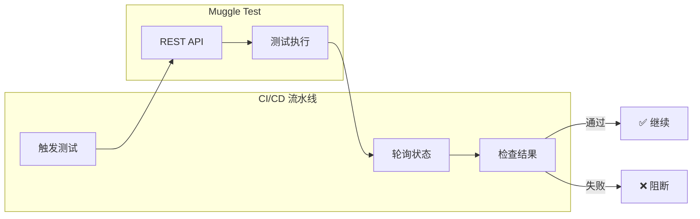

# MCP CI/CD 集成

将 Muggle Test 集成到你的持续集成和持续部署流水线中。

## 概览

虽然 MCP Gateway 是为交互式 AI 助手使用场景设计的，但你也可以直接使用 REST API，在 CI/CD 流水线中以编程方式触发测试。



## 前提条件

| 要求 | 说明 |
| :------------------ | :----------------------------------------- |
| Muggle Test 项目 | 包含可运行的测试脚本 |
| 项目 ID | 可在控制台网址或项目设置中找到 |
| API 密钥 | 具有相应的权限 |

## 支持的平台

| 平台 | 触发 | 定时任务 | 状态检查 |
| :------------- | :-----: | :------: | :-----------: |
| GitHub Actions | ✅ | ✅ | ✅ |
| Azure DevOps | ✅ | ✅ | ✅ |
| GitLab CI | ✅ | ✅ | ✅ |
| Jenkins | ✅ | ✅ | ✅ |
| CircleCI | ✅ | ✅ | ✅ |

## GitHub Actions

### 基础集成

该流程分为三个阶段：

1. **触发**：向批量回放端点发送 POST 请求，创建一个工作流运行时。响应会返回该运行时的 `id`。
2. **等待运行批次**：轮询 `.../bulk/{id}/run/latest`，直到该运行在其 `result` 负载中提供 `runBatchId`。
3. **等待摘要**：轮询 `.../bulk/run-batch/{runBatchId}/summary`，直到没有运行中或待处理的项，然后根据已执行的运行计算通过率（成功 + 失败 + 已取消；已跳过的不计入）。

创建 `.github/workflows/muggle-e2e.yml`：

```yaml
name: Muggle Test E2E acceptance

on:
  pull_request:
    branches: [main, master]
  workflow_dispatch:

env:
  MUGGLE_AI_API_BASE_URL: "https://promptservice.muggle-ai.com"
  PASS_RATE_THRESHOLD: "100"
  POLL_INTERVAL_SECONDS: "20"
  TIMEOUT_MINUTES: "45"

jobs:
  test:
    runs-on: ubuntu-latest
    steps:
      - name: Trigger Muggle Test bulk replay
        id: trigger
        env:
          MUGGLE_AI_API_KEY: ${{ secrets.MUGGLE_AI_API_KEY }}
          PROJECT_ID: ${{ vars.MUGGLE_PROJECT_ID }}
        run: |
          set -euo pipefail
          RESPONSE=$(curl -sS -X POST \
            "${MUGGLE_AI_API_BASE_URL}/v1/protected/muggle-test/workflow/test-script/test-script-replay/bulk/workflowRuntimes" \
            -H "Content-Type: application/json" \
            -H "x-api-key: ${MUGGLE_AI_API_KEY}" \
            -d "{\"projectId\": \"${PROJECT_ID}\", \"namePrefix\": \"ci\"}")

          RUNTIME_ID=$(echo "${RESPONSE}" | jq -r '.id // empty')
          if [[ -z "${RUNTIME_ID}" ]]; then
            echo "::error::Missing workflow runtime id in response: ${RESPONSE}"
            exit 1
          fi
          echo "runtime_id=${RUNTIME_ID}" >> "$GITHUB_OUTPUT"

      - name: Wait for run batch and summary
        env:
          MUGGLE_AI_API_KEY: ${{ secrets.MUGGLE_AI_API_KEY }}
          WORKFLOW_RUNTIME_ID: ${{ steps.trigger.outputs.runtime_id }}
        run: |
          set -euo pipefail
          MAX_WAIT_SECONDS=$((TIMEOUT_MINUTES * 60))
          START_TIME="$(date +%s)"
          RUN_BATCH_ID=""

          while true; do
            NOW="$(date +%s)"
            if (( NOW - START_TIME >= MAX_WAIT_SECONDS )); then
              echo "::error::Timed out after ${TIMEOUT_MINUTES} minutes"
              exit 1
            fi

            RUN_FILE="$(mktemp)"
            curl -sS -o "${RUN_FILE}" \
              "${MUGGLE_AI_API_BASE_URL}/v1/protected/muggle-test/workflow/test-script/test-script-replay/bulk/${WORKFLOW_RUNTIME_ID}/run/latest" \
              -H "x-api-key: ${MUGGLE_AI_API_KEY}"

            RUN_STATUS="$(jq -r '.status // empty' "${RUN_FILE}")"
            RUN_BATCH_ID="$(jq -r '
              if (.result|type) == "string"
                then ((.result|fromjson? // {}) | .runBatchId // empty)
                else (.result.runBatchId // empty)
              end' "${RUN_FILE}")"

            if [[ -z "${RUN_BATCH_ID}" ]]; then
              sleep "${POLL_INTERVAL_SECONDS}"
              continue
            fi

            SUMMARY_FILE="$(mktemp)"
            SUMMARY_HTTP=$(curl -sS -o "${SUMMARY_FILE}" -w "%{http_code}" \
              "${MUGGLE_AI_API_BASE_URL}/v1/protected/muggle-test/workflow/test-script/test-script-replay/bulk/run-batch/${RUN_BATCH_ID}/summary" \
              -H "x-api-key: ${MUGGLE_AI_API_KEY}")
            if [[ "${SUMMARY_HTTP}" == "404" ]]; then
              sleep "${POLL_INTERVAL_SECONDS}"
              continue
            fi
            if [[ "${SUMMARY_HTTP}" != "200" ]]; then
              echo "::error::Summary fetch failed (HTTP ${SUMMARY_HTTP})"
              cat "${SUMMARY_FILE}"
              exit 1
            fi

            SUCCESS=$(jq -r '.successCount'  "${SUMMARY_FILE}")
            FAILED=$(jq  -r '.failedCount'   "${SUMMARY_FILE}")
            CANCELED=$(jq -r '.canceledCount' "${SUMMARY_FILE}")
            RUNNING=$(jq  -r '.runningCount'  "${SUMMARY_FILE}")
            PENDING=$(jq  -r '.pendingCount'  "${SUMMARY_FILE}")

            # Consider finished when nothing is running AND (nothing pending OR run COMPLETED)
            if [[ "${RUNNING}" -eq 0 ]] && { [[ "${PENDING}" -eq 0 ]] || [[ "${RUN_STATUS}" == "COMPLETED" ]]; }; then
              ACTUAL=$((SUCCESS + FAILED + CANCELED))
              if [[ "${ACTUAL}" -eq 0 ]]; then
                PASS_RATE="100.00"
              else
                PASS_RATE=$(awk "BEGIN { printf \"%.2f\", (${SUCCESS} * 100) / ${ACTUAL} }")
              fi
              echo "Pass rate: ${PASS_RATE}% (success=${SUCCESS} failed=${FAILED} canceled=${CANCELED})"
              if awk "BEGIN { exit !(${PASS_RATE} >= ${PASS_RATE_THRESHOLD}) }"; then
                exit 0
              fi
              echo "::error::Pass rate ${PASS_RATE}% below threshold ${PASS_RATE_THRESHOLD}%"
              exit 1
            fi

            sleep "${POLL_INTERVAL_SECONDS}"
          done
```

### 设置步骤

| 步骤 | 操作 |
| :--- | :-------------------------------------------------- |
| 1 | 将 `MUGGLE_AI_API_KEY` 添加到仓库的 **Secrets** |
| 2 | 将 `MUGGLE_PROJECT_ID` 添加到仓库的 **Variables** |
| 3 | 提交该工作流文件 |

### 可选：回放完成后触发报告

摘要报告成功后，你可以生成并发送项目报告（发送渠道取决于项目的报告偏好设置）：

```yaml
      - name: Generate project report
        if: success()
        env:
          MUGGLE_AI_API_KEY: ${{ secrets.MUGGLE_AI_API_KEY }}
          PROJECT_ID: ${{ vars.MUGGLE_PROJECT_ID }}
        run: |
          curl -sS -X POST \
            "${MUGGLE_AI_API_BASE_URL}/v1/protected/muggle-test/report/final/generate" \
            -H "Content-Type: application/json" \
            -H "x-api-key: ${MUGGLE_AI_API_KEY}" \
            -d "{\"projectId\": \"${PROJECT_ID}\", \"exportFormat\": \"html\", \"channels\": []}"
```

## Azure DevOps 和 GitLab CI

这两个平台都遵循上文所示的三阶段模式：**触发 → 等待 `runBatchId` → 轮询 `/run-batch/{id}/summary` → 计算通过率**。

区别仅在于平台提供密钥和变量的方式：

| 平台 | 密钥语法 | 变量语法 |
| :----------- | :------------------- | :------------------- |
| Azure DevOps | `$(MUGGLE_AI_API_KEY)` | `$(MUGGLE_PROJECT_ID)` |
| GitLab CI | `$MUGGLE_AI_API_KEY` | `$MUGGLE_PROJECT_ID` |

从上面的 GitHub Actions 示例中复制 bash 逻辑，并替换为对应平台的变量语法。**不要**依赖 `.status == "succeeded"`——该字段永远不会取这些值；请始终通过 `run-batch/{id}/summary` 端点，并根据 `successCount / (successCount + failedCount + canceledCount)` 计算通过率。

## Webhook 通知

配置 Webhook，在你自己的系统中接收测试结果：

**配置：**

```json
{
  "projectId": "proj_abc123",
  "channels": ["webhook"],
  "webhookUrl": "https://your-server.com/webhooks/muggle"
}
```

**收到的负载：**

```json
{
  "event": "test_run_completed",
  "projectId": "proj_abc123",
  "timestamp": "2024-01-15T10:35:00Z",
  "results": {
    "total": 10,
    "passed": 8,
    "failed": 2
  }
}
```

## 最佳实践

### 使用专用 API 密钥

| 实践 | 好处 |
| :---------------------------- | :----------------------------- |
| 为每个环境使用单独的密钥 | 更好地控制访问权限 |
| 定期轮换 | 在密钥泄露时限制暴露范围 |
| 使用描述性名称 | 便于审计追踪 |

### 设置合适的超时时间

| 测试类型 | 建议超时时间 |
| :-------------- | ------------------: |
| 冒烟测试 | 5-10 分钟 |
| 功能测试 | 15-30 分钟 |
| 完整回归测试 | 30-60 分钟 |

### 在 PR 上运行部分测试

为了更快获得 PR 反馈，只运行关键的冒烟测试：

```bash
-d '{"projectId": "...", "testScriptIds": ["ts_smoke_1", "ts_smoke_2"]}'
```

### 定时运行完整回归测试

在非工作时间运行全面的测试：

```yaml
schedules:
  - cron: '0 2 * * *'  # 2 AM daily
```

## 故障排除

| 问题 | 可能原因 | 解决方法 |
| :-------------------- | :-------------------- | :---------------------- |
| 测试未启动 | API 密钥无效 | 在控制台中核实密钥 |
| 测试未启动 | 项目 ID 无效 | 检查 ID 格式 |
| 超时错误 | 测试耗时过长 | 增加轮询超时时间 |
| 超时错误 | 测试数量过多 | 在 PR 上只运行部分测试 |
| 身份验证错误 | API 密钥已过期 | 重新生成密钥 |
| 身份验证错误 | 环境不对 | 检查密钥与环境是否匹配 |

## 后续步骤

- **[MCP 快速入门](getting-started/mcp-quickstart.md)**——交互式设置
- **[MCP API 参考](mcp/mcp-api-reference.md)**——完整文档
