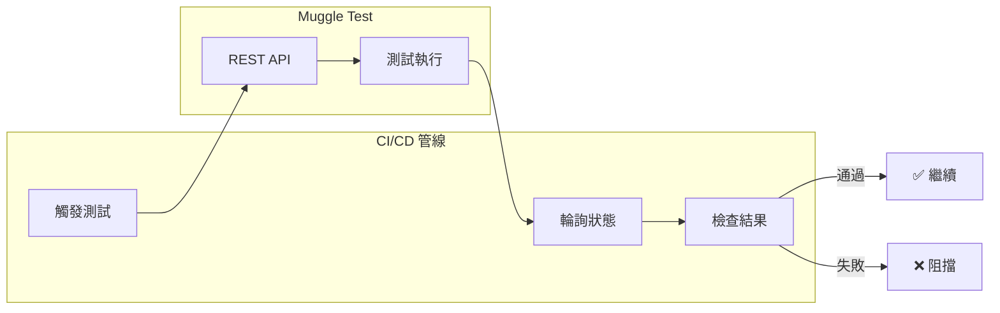

# MCP CI/CD 整合

將 Muggle Test 整合到你的持續整合與持續部署管線中。

## 總覽

雖然 MCP Gateway 是為互動式 AI 助理使用情境而設計，但你也可以直接使用 REST API，在 CI/CD 管線中以程式方式觸發測試。



## 必要條件

| 需求 | 說明 |
| :------------------ | :----------------------------------------- |
| Muggle Test 專案 | 包含可執行的測試腳本 |
| 專案 ID | 可在儀表板網址或專案設定中找到 |
| API 金鑰 | 具備適當的權限 |

## 支援的平台

| 平台 | 觸發 | 排程 | 狀態檢查 |
| :------------- | :-----: | :------: | :-----------: |
| GitHub Actions | ✅ | ✅ | ✅ |
| Azure DevOps | ✅ | ✅ | ✅ |
| GitLab CI | ✅ | ✅ | ✅ |
| Jenkins | ✅ | ✅ | ✅ |
| CircleCI | ✅ | ✅ | ✅ |

## GitHub Actions

### 基本整合

此流程分為三個階段：

1. **觸發**：對批次重播端點發送 POST 請求，以建立工作流程執行階段。回應會傳回該執行階段的 `id`。
2. **等待執行批次**：輪詢 `.../bulk/{id}/run/latest`，直到該次執行在其 `result` 承載資料中提供 `runBatchId`。
3. **等待摘要**：輪詢 `.../bulk/run-batch/{runBatchId}/summary`，直到沒有執行中或待處理的項目，再根據實際執行的次數計算通過率（成功 + 失敗 + 已取消；已略過的不計入）。

建立 `.github/workflows/muggle-e2e.yml`：

```yaml
name: Muggle Test E2E acceptance

on:
  pull_request:
    branches: [main, master]
  workflow_dispatch:

env:
  MUGGLE_AI_API_BASE_URL: "https://promptservice.muggle-ai.com"
  PASS_RATE_THRESHOLD: "100"
  POLL_INTERVAL_SECONDS: "20"
  TIMEOUT_MINUTES: "45"

jobs:
  test:
    runs-on: ubuntu-latest
    steps:
      - name: Trigger Muggle Test bulk replay
        id: trigger
        env:
          MUGGLE_AI_API_KEY: ${{ secrets.MUGGLE_AI_API_KEY }}
          PROJECT_ID: ${{ vars.MUGGLE_PROJECT_ID }}
        run: |
          set -euo pipefail
          RESPONSE=$(curl -sS -X POST \
            "${MUGGLE_AI_API_BASE_URL}/v1/protected/muggle-test/workflow/test-script/test-script-replay/bulk/workflowRuntimes" \
            -H "Content-Type: application/json" \
            -H "x-api-key: ${MUGGLE_AI_API_KEY}" \
            -d "{\"projectId\": \"${PROJECT_ID}\", \"namePrefix\": \"ci\"}")

          RUNTIME_ID=$(echo "${RESPONSE}" | jq -r '.id // empty')
          if [[ -z "${RUNTIME_ID}" ]]; then
            echo "::error::Missing workflow runtime id in response: ${RESPONSE}"
            exit 1
          fi
          echo "runtime_id=${RUNTIME_ID}" >> "$GITHUB_OUTPUT"

      - name: Wait for run batch and summary
        env:
          MUGGLE_AI_API_KEY: ${{ secrets.MUGGLE_AI_API_KEY }}
          WORKFLOW_RUNTIME_ID: ${{ steps.trigger.outputs.runtime_id }}
        run: |
          set -euo pipefail
          MAX_WAIT_SECONDS=$((TIMEOUT_MINUTES * 60))
          START_TIME="$(date +%s)"
          RUN_BATCH_ID=""

          while true; do
            NOW="$(date +%s)"
            if (( NOW - START_TIME >= MAX_WAIT_SECONDS )); then
              echo "::error::Timed out after ${TIMEOUT_MINUTES} minutes"
              exit 1
            fi

            RUN_FILE="$(mktemp)"
            curl -sS -o "${RUN_FILE}" \
              "${MUGGLE_AI_API_BASE_URL}/v1/protected/muggle-test/workflow/test-script/test-script-replay/bulk/${WORKFLOW_RUNTIME_ID}/run/latest" \
              -H "x-api-key: ${MUGGLE_AI_API_KEY}"

            RUN_STATUS="$(jq -r '.status // empty' "${RUN_FILE}")"
            RUN_BATCH_ID="$(jq -r '
              if (.result|type) == "string"
                then ((.result|fromjson? // {}) | .runBatchId // empty)
                else (.result.runBatchId // empty)
              end' "${RUN_FILE}")"

            if [[ -z "${RUN_BATCH_ID}" ]]; then
              sleep "${POLL_INTERVAL_SECONDS}"
              continue
            fi

            SUMMARY_FILE="$(mktemp)"
            SUMMARY_HTTP=$(curl -sS -o "${SUMMARY_FILE}" -w "%{http_code}" \
              "${MUGGLE_AI_API_BASE_URL}/v1/protected/muggle-test/workflow/test-script/test-script-replay/bulk/run-batch/${RUN_BATCH_ID}/summary" \
              -H "x-api-key: ${MUGGLE_AI_API_KEY}")
            if [[ "${SUMMARY_HTTP}" == "404" ]]; then
              sleep "${POLL_INTERVAL_SECONDS}"
              continue
            fi
            if [[ "${SUMMARY_HTTP}" != "200" ]]; then
              echo "::error::Summary fetch failed (HTTP ${SUMMARY_HTTP})"
              cat "${SUMMARY_FILE}"
              exit 1
            fi

            SUCCESS=$(jq -r '.successCount'  "${SUMMARY_FILE}")
            FAILED=$(jq  -r '.failedCount'   "${SUMMARY_FILE}")
            CANCELED=$(jq -r '.canceledCount' "${SUMMARY_FILE}")
            RUNNING=$(jq  -r '.runningCount'  "${SUMMARY_FILE}")
            PENDING=$(jq  -r '.pendingCount'  "${SUMMARY_FILE}")

            # Consider finished when nothing is running AND (nothing pending OR run COMPLETED)
            if [[ "${RUNNING}" -eq 0 ]] && { [[ "${PENDING}" -eq 0 ]] || [[ "${RUN_STATUS}" == "COMPLETED" ]]; }; then
              ACTUAL=$((SUCCESS + FAILED + CANCELED))
              if [[ "${ACTUAL}" -eq 0 ]]; then
                PASS_RATE="100.00"
              else
                PASS_RATE=$(awk "BEGIN { printf \"%.2f\", (${SUCCESS} * 100) / ${ACTUAL} }")
              fi
              echo "Pass rate: ${PASS_RATE}% (success=${SUCCESS} failed=${FAILED} canceled=${CANCELED})"
              if awk "BEGIN { exit !(${PASS_RATE} >= ${PASS_RATE_THRESHOLD}) }"; then
                exit 0
              fi
              echo "::error::Pass rate ${PASS_RATE}% below threshold ${PASS_RATE_THRESHOLD}%"
              exit 1
            fi

            sleep "${POLL_INTERVAL_SECONDS}"
          done
```

### 設定步驟

| 步驟 | 動作 |
| :--- | :-------------------------------------------------- |
| 1 | 將 `MUGGLE_AI_API_KEY` 新增至儲存庫的 **Secrets** |
| 2 | 將 `MUGGLE_PROJECT_ID` 新增至儲存庫的 **Variables** |
| 3 | 提交此工作流程檔案 |

### 選填：重播完成後觸發報告

摘要回報成功後，你可以產生並傳送專案報告（傳送管道取決於專案的報告偏好設定）：

```yaml
      - name: Generate project report
        if: success()
        env:
          MUGGLE_AI_API_KEY: ${{ secrets.MUGGLE_AI_API_KEY }}
          PROJECT_ID: ${{ vars.MUGGLE_PROJECT_ID }}
        run: |
          curl -sS -X POST \
            "${MUGGLE_AI_API_BASE_URL}/v1/protected/muggle-test/report/final/generate" \
            -H "Content-Type: application/json" \
            -H "x-api-key: ${MUGGLE_AI_API_KEY}" \
            -d "{\"projectId\": \"${PROJECT_ID}\", \"exportFormat\": \"html\", \"channels\": []}"
```

## Azure DevOps 與 GitLab CI

這兩個平台都遵循上方所示的三階段模式：**觸發 → 等待 `runBatchId` → 輪詢 `/run-batch/{id}/summary` → 計算通過率**。

差異僅在於平台提供密鑰與變數的方式：

| 平台 | 密鑰語法 | 變數語法 |
| :----------- | :------------------- | :------------------- |
| Azure DevOps | `$(MUGGLE_AI_API_KEY)` | `$(MUGGLE_PROJECT_ID)` |
| GitLab CI | `$MUGGLE_AI_API_KEY` | `$MUGGLE_PROJECT_ID` |

從上方的 GitHub Actions 範例複製 bash 邏輯，並換成該平台專屬的變數語法。**不要**依賴 `.status == "succeeded"`——該欄位永遠不會出現這些值；請一律透過 `run-batch/{id}/summary` 端點，並依 `successCount / (successCount + failedCount + canceledCount)` 計算通過率。

## Webhook 通知

設定 Webhook，在你的系統中接收測試結果：

**設定：**

```json
{
  "projectId": "proj_abc123",
  "channels": ["webhook"],
  "webhookUrl": "https://your-server.com/webhooks/muggle"
}
```

**收到的承載資料：**

```json
{
  "event": "test_run_completed",
  "projectId": "proj_abc123",
  "timestamp": "2024-01-15T10:35:00Z",
  "results": {
    "total": 10,
    "passed": 8,
    "failed": 2
  }
}
```

## 最佳做法

### 使用專用的 API 金鑰

| 做法 | 好處 |
| :---------------------------- | :----------------------------- |
| 每個環境使用不同的金鑰 | 更好的存取控制 |
| 定期輪替 | 金鑰外洩時可限制暴露範圍 |
| 使用描述性名稱 | 更容易進行稽核追蹤 |

### 設定適當的逾時時間

| 測試類型 | 建議逾時時間 |
| :-------------- | ------------------: |
| 冒煙測試 | 5-10 分鐘 |
| 功能測試 | 15-30 分鐘 |
| 完整迴歸測試 | 30-60 分鐘 |

### 在 PR 上執行部分測試

為了更快取得 PR 回饋，只執行關鍵的冒煙測試：

```bash
-d '{"projectId": "...", "testScriptIds": ["ts_smoke_1", "ts_smoke_2"]}'
```

### 排程完整迴歸測試

在離峰時段執行全面的測試：

```yaml
schedules:
  - cron: '0 2 * * *'  # 2 AM daily
```

## 疑難排解

| 問題 | 可能原因 | 解決方法 |
| :-------------------- | :-------------------- | :---------------------- |
| 測試未啟動 | API 金鑰無效 | 在儀表板中確認金鑰 |
| 測試未啟動 | 專案 ID 無效 | 檢查 ID 格式 |
| 逾時錯誤 | 測試耗時過長 | 增加輪詢逾時時間 |
| 逾時錯誤 | 測試數量過多 | 在 PR 上只執行部分測試 |
| 身分驗證錯誤 | API 金鑰已過期 | 重新產生金鑰 |
| 身分驗證錯誤 | 環境不符 | 確認金鑰與環境相符 |

## 後續步驟

- **[MCP 快速入門](getting-started/mcp-quickstart.md)**——互動式設定
- **[MCP API 參考](mcp/mcp-api-reference.md)**——完整文件
