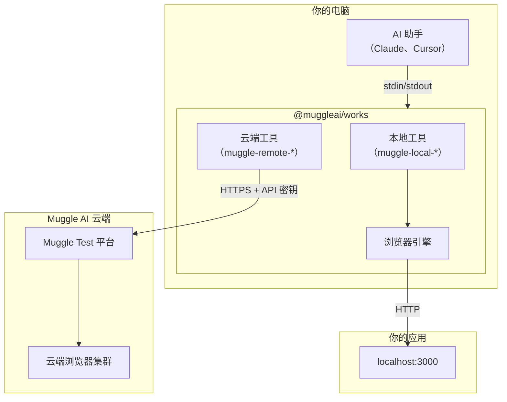
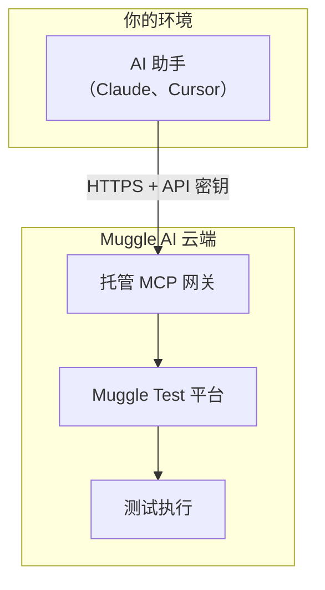
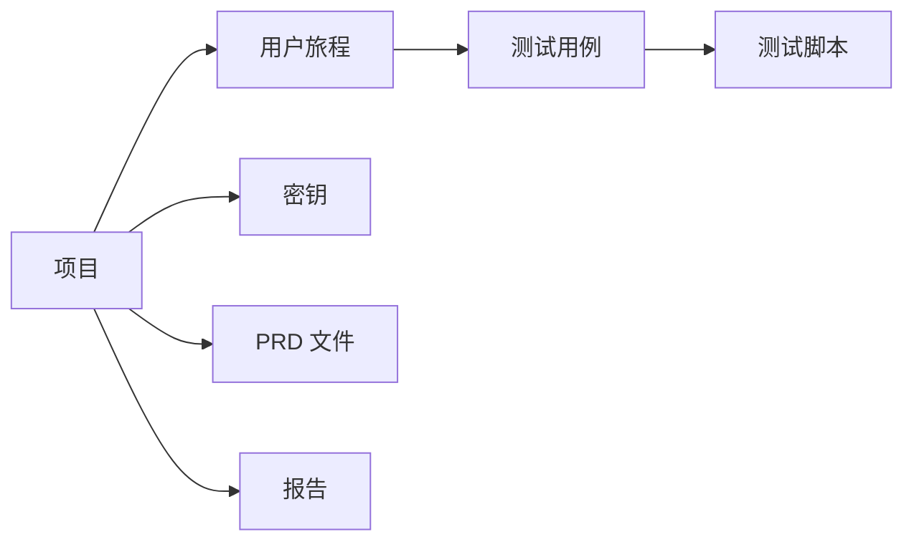
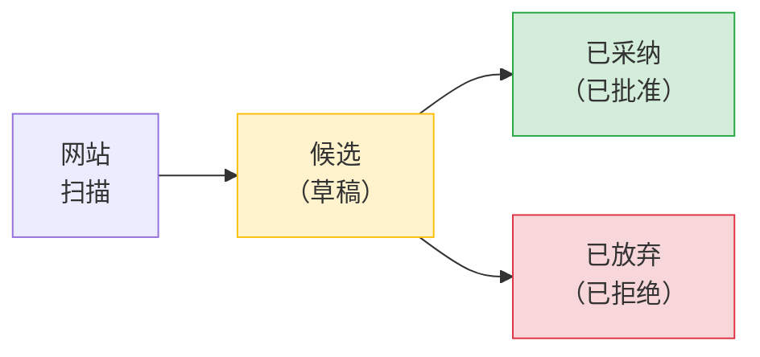
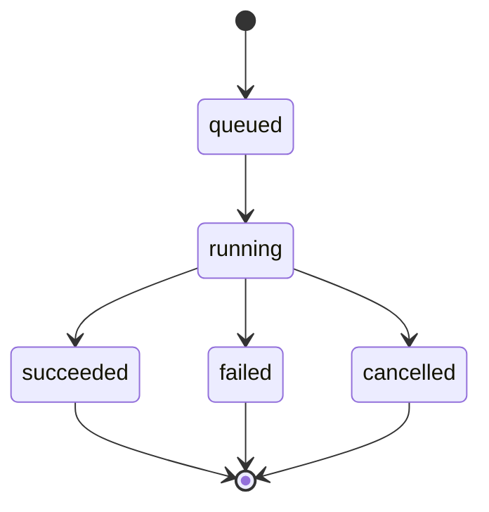
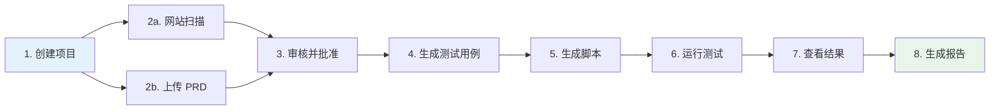
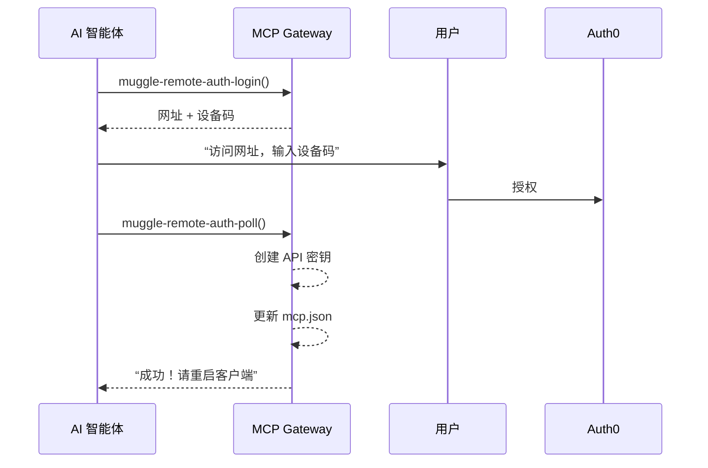

# MCP 概念与架构

了解 `@muggleai/works` 包如何与 Muggle Test 协同工作。

## 本页内容

| 章节 | 说明 |
| :------ | :---------- |
| [系统架构](#system-architecture) | 统一包、托管网关及模式对比 |
| [什么是 MCP？](#what-is-mcp) | 模型上下文协议概览 |
| [核心概念](#core-concepts) | 项目、用户旅程、测试用例、测试脚本和工作流 |
| [测试流程](#testing-flow) | 端到端测试流水线 |
| [身份验证](#authentication) | 设备码流程和 API 密钥 |
| [速率限制](#rate-limits) | 各档位的请求数和并发上限 |
| [可用工具](#available-tools) | 本地和云端工具类别 |
| [MCP 资源](#mcp-resources) | 面向 AI 智能体的动态文档 |
| [后续步骤](#next-steps) | 延伸阅读 |

## 系统架构

统一的 MCP 包支持多种模式：**云端端到端（E2E）测试**（远程网址）、**本地 E2E 测试**（localhost），或**两者结合**。

### 统一包（推荐）



统一包同时提供本地测试和云端测试：
- **本地工具**（`muggle-local-*`）：使用内置的浏览器引擎测试 localhost
- **云端工具**（`muggle-remote-*`）：使用 Muggle AI 的云端基础设施测试远程网址

### 托管网关（仅云端）

如果想无需本地安装即可快速完成配置，可以使用托管网关：



### 模式对比

| 方面 | 统一包 | 托管网关 |
| :----- | :-------------- | :------------- |
| **本地测试** | 是 | 否 |
| **云端测试** | 是 | 是 |
| **配置** | `npm install -g @muggleai/works@latest` | 只需配置网址 |
| **延迟** | 最低（无需经过网关） | 需经网络到达网关 |
| **凭据** | 环境变量 | 每个请求的请求头 |
| **适用场景** | 完整功能 | 快速上手、仅云端 |

有关详细的配置说明，请参阅 [MCP 安装](mcp-installation.md)。

## 什么是 MCP？

[模型上下文协议（Model Context Protocol，MCP）](https://modelcontextprotocol.io/)是一项开放标准，用于将 AI 助手连接到外部工具和数据源。

| 功能 | 说明 |
| :------------------------- | :----------------------------------------------------------------- |
| **标准化接口** | 在不同 AI 助手之间调用工具的通用协议 |
| **流式支持** | 为长时间运行的操作提供实时更新 |
| **工具发现** | AI 助手会自动发现可用的功能 |

## 核心概念

### 项目

**项目**是所有测试资产的顶层容器。每个项目通常对应一个网站或应用。



### 用户旅程

**用户旅程**代表要测试的用户流程或功能（例如“用户登录”“结账流程”）。

**生命周期：**



| 阶段 | 说明 |
| :------------ | :-------------------------------------------- |
| **发现** | 网站扫描识别出潜在的用户旅程 |
| **候选** | 提议的用户旅程等待你审核 |
| **已采纳** | 获批的用户旅程成为有效的测试目标 |
| **已放弃** | 被拒绝的候选项会被归档 |

### 测试用例

**测试用例**是从用户旅程派生出的具体场景。每个用户旅程可以有多个测试用例：

| 用户旅程 | 测试用例 |
| :--------- | :----------------------------------- |
| 用户登录 | 有效凭据 → 登录成功 |
| | 无效密码 → 错误消息 |
| | 字段为空 → 验证错误 |
| | 账户被锁定 → 锁定提示消息 |

### 测试脚本

**测试脚本**是根据测试用例生成的可执行自动化脚本。脚本包含：

| 组成部分 | 说明 |
| :------------------ | :------------------------------------------ |
| **浏览器操作** | 逐步导航、点击、表单填写 |
| **断言** | 校验项和预期结果 |
| **截图** | 每个步骤的可视化截图 |

### 工作流

**工作流**是长时间运行的操作：

| 工作流 | 用途 | 输出 |
| :--------------------- | :------------------------- | :------------------ |
| PRD 文件处理 | 从 PRD 中提取用户旅程 | 用户旅程候选项 |
| 网站扫描 | 发现用户旅程 | 用户旅程候选项 |
| 测试用例检测 | 生成测试用例 | 测试用例 |
| 测试脚本生成 | 创建自动化 | 测试脚本 |
| 测试脚本回放 | 执行测试 | 测试结果 |
| 报告生成 | 创建报告 | PDF/HTML 报告 |

**工作流状态：**



## 测试流程



你可以通过网站扫描、PRD 文件处理或两者结合来发现用户旅程。

## 身份验证

### 智能体辅助身份验证（设备码流程）

AI 智能体可以通过**设备码流程**帮助用户完成身份验证，无需事先拥有 API 密钥：



**安全性**：API 密钥会直接写入用户的本地配置文件，**绝不会**返回给 AI 智能体。

### API 密钥

API 密钥用于编程访问：

```
mai_sk_xxxxxxxxxxxxxxxxxxxxxxxxxxxxxxxx
│     │
│     └── Secret portion (keep private)
└── Prefix identifying key type
```

**最佳实践：**

| 实践 | 原因 |
| :-------------------------------- | :----------------------------- |
| 定期轮换密钥 | 在密钥泄露时限制暴露范围 |
| 为每个环境使用单独的密钥 | 更好地控制访问权限 |
| 切勿在客户端代码中暴露 | 防止未经授权的访问 |
| 存储在密钥管理器中 | 安全存储 |

### 授权

所有 API 调用的范围都限定在你的账户内：

| 范围 | 说明 |
| :------------- | :---------------------------------------------------------- |
| **项目** | 只能访问你拥有或已被授予访问权限的项目 |
| **团队角色** | 成员在每个项目中可担任查看者、编辑者、维护者或所有者角色 |
| **API 密钥** | 继承创建者的权限 |

## 速率限制

网关会实施速率限制，以确保公平使用：

| 档位 | 请求数/分钟 | 并发工作流 |
| :--------- | -----------: | -------------------: |
| 免费版 | 20 | 3 |
| 入门版 | 40 | 10 |
| 专业版 | 60 | 20 |
| 企业版 | 300 | 20+ |

**速率限制响应头：**

| 响应头 | 说明 |
| :---------------------- | :-------------------------------------- |
| `X-RateLimit-Limit` | 允许的最大请求数 |
| `X-RateLimit-Remaining` | 当前窗口内剩余的请求数 |
| `X-RateLimit-Reset` | 限制重置的时间（Unix 时间戳） |

## 可用工具

统一包提供 **100 多个工具**，按模式分类：

### 本地测试工具（前缀：`muggle-local-`）

| 类别 | 数量 | 用途 |
| :------- | ----: | :------ |
| 状态 | 2 | 检查本地服务并列出会话 |
| 执行 | 3 | 在本地生成、回放和取消运行 |
| 结果 | 2 | 查看本地执行结果 |
| 脚本 | 2 | 查看本地生成的脚本 |
| 发布 | 1 | 将本地脚本发布到云端 |

> 本地测试以云端为先：项目、用户旅程、测试用例和身份验证都通过 `muggle-remote-*` 工具管理。`muggle-local-*` 工具只负责本地执行、结果和发布。

### 云端 E2E 工具（前缀：`muggle-remote-`）

| 类别 | 数量 | 用途 |
| :------- | ----: | :------ |
| 身份验证 | 8 | 进行身份验证并管理 API 密钥 |
| 项目 | 5 | 创建和管理项目 |
| PRD 文件 | 5 | 上传和处理 PRD 文件 |
| 密钥 | 5 | 管理测试凭据 |
| 钱包 | 5 | 管理支付方式和充值 |
| 用户旅程 | 10 | 发现、生成、创建和更新用户旅程 |
| 测试用例 | 7 | 生成、创建和更新测试用例 |
| 工作流 | 20 | 扫描、生成、回放（单个和批量）、状态 |
| 批量预览 | 5 | 提交并跟踪用户旅程/测试用例的批量预览 |
| 资产 | 6 | 查看测试用例、脚本和摘要 |
| 报告 | 4 | 生成和发送报告 |
| 建议 | 2 | 获取定时任务和 CI/CD 方面的指导 |
| 反馈 | 3 | 提交和管理脚本反馈 |

## MCP 资源

网关还提供 **MCP 资源**——AI 智能体可以动态读取的文档：

| 资源 URI | 说明 |
| :--------------------------------- | :----------------------------- |
| `muggle-e2e://docs/usage-guide` | 完整的工作流指南 |
| `muggle-e2e://docs/quick-reference` | 工具调用速查 |
| `muggle-e2e://docs/wallet-quickstart` | 钱包设置与充值快速入门 |

AI 助手可以调用 `resources/list` 发现可用的文档，再调用 `resources/read` 获取内容。这样，智能体无需你额外解释，就能了解如何有效使用这些工具。

## 后续步骤

- **[MCP 快速入门](getting-started/mcp-quickstart.md)**——5 分钟快速上手
- **[MCP API 参考](mcp/mcp-api-reference.md)**——完整的工具文档
- **[CI/CD 集成](mcp/mcp-cicd-integration.md)**——在流水线中实现自动化
