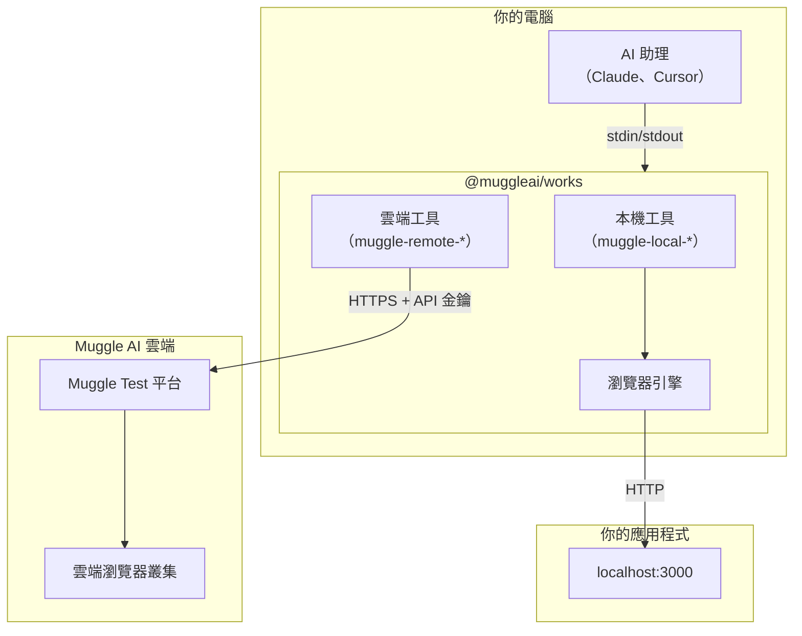
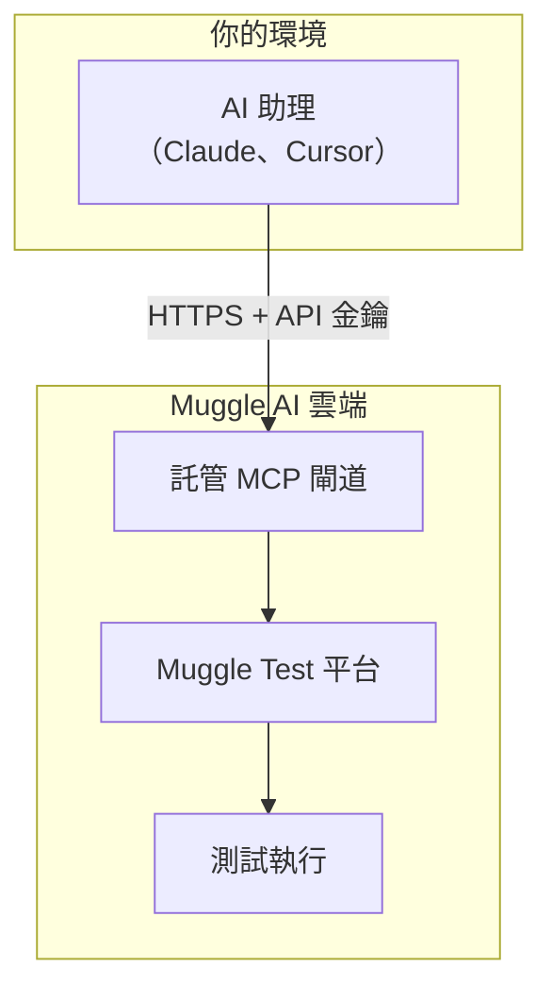
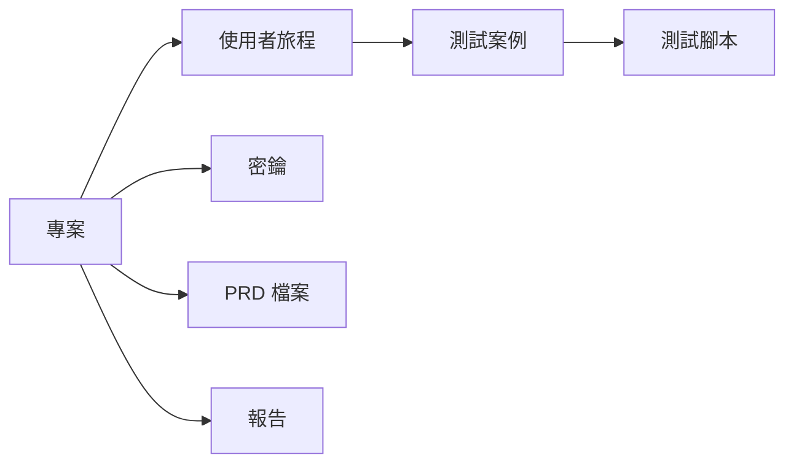
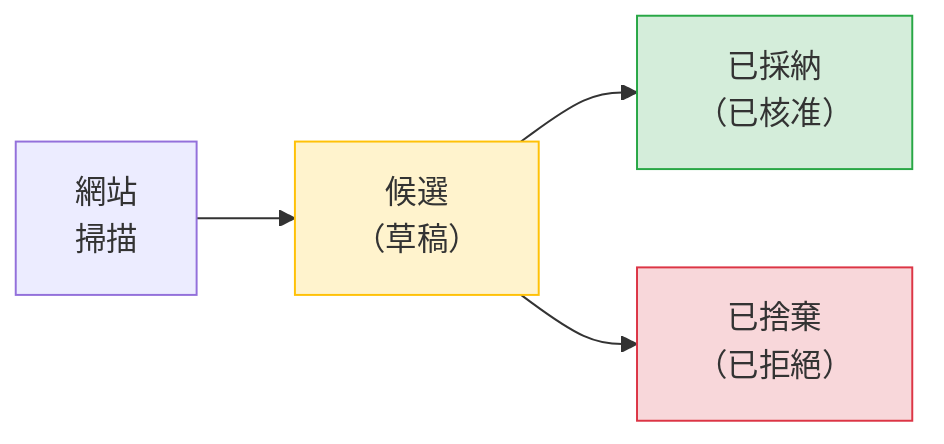
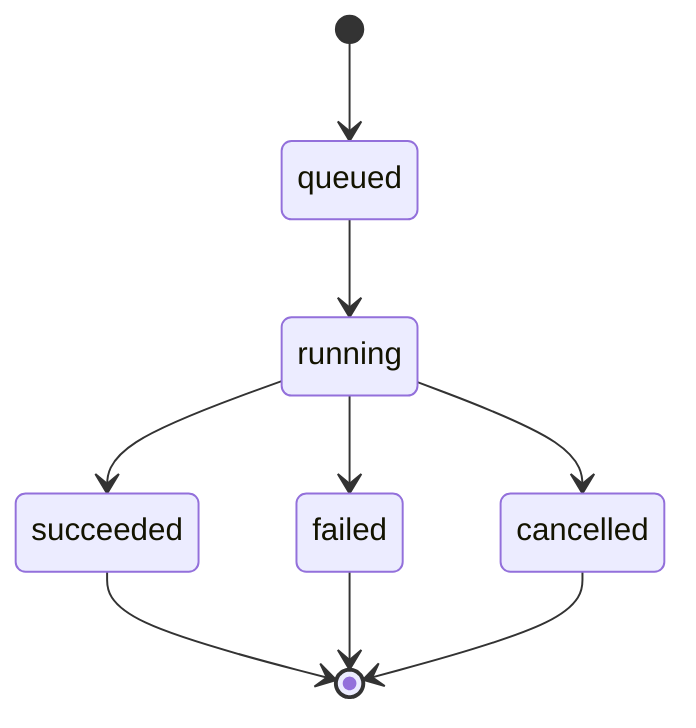
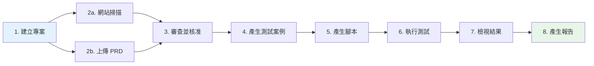
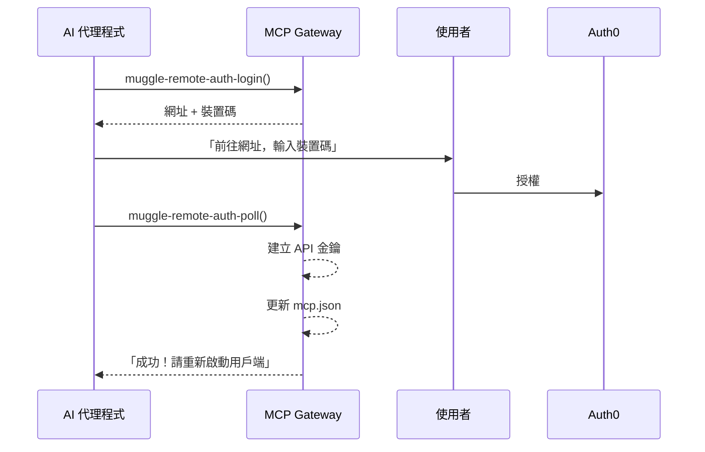

# MCP 概念與架構

了解 `@muggleai/works` 套件如何與 Muggle Test 搭配運作。

## 本頁內容

| 章節 | 說明 |
| :------ | :---------- |
| [系統架構](#system-architecture) | 整合式套件、託管閘道與模式比較 |
| [什麼是 MCP？](#what-is-mcp) | 模型上下文協定總覽 |
| [核心概念](#core-concepts) | 專案、使用者旅程、測試案例、測試腳本與工作流程 |
| [測試流程](#testing-flow) | 端對端測試管線 |
| [身分驗證](#authentication) | 裝置碼流程與 API 金鑰 |
| [速率限制](#rate-limits) | 各等級的請求數與同時執行上限 |
| [可用工具](#available-tools) | 本機與雲端工具類別 |
| [MCP 資源](#mcp-resources) | 供 AI 代理程式使用的動態文件 |
| [後續步驟](#next-steps) | 延伸閱讀 |

## 系統架構

整合式 MCP 套件支援多種模式：**雲端端對端（E2E）測試**（遠端網址）、**本機 E2E 測試**（localhost），或**兩者並用**。

### 整合式套件（建議）



整合式套件同時提供本機與雲端測試：
- **本機工具**（`muggle-local-*`）：使用內建的瀏覽器引擎測試 localhost
- **雲端工具**（`muggle-remote-*`）：使用 Muggle AI 的雲端基礎架構測試遠端網址

### 託管閘道（僅限雲端）

若想在不進行本機安裝的情況下快速完成設定，可以使用託管閘道：



### 模式比較

| 面向 | 整合式套件 | 託管閘道 |
| :----- | :-------------- | :------------- |
| **本機測試** | 是 | 否 |
| **雲端測試** | 是 | 是 |
| **設定** | `npm install -g @muggleai/works@latest` | 只需設定網址 |
| **延遲** | 最低（不經過閘道） | 需透過網路連到閘道 |
| **憑證** | 環境變數 | 每個請求的標頭 |
| **適用情境** | 完整功能 | 快速上手、僅限雲端 |

如需詳細的設定說明，請參閱 [MCP 安裝](mcp-installation.md)。

## 什麼是 MCP？

[模型上下文協定（Model Context Protocol，MCP）](https://modelcontextprotocol.io/)是一項開放標準，用於將 AI 助理連接到外部工具與資料來源。

| 功能 | 說明 |
| :------------------------- | :----------------------------------------------------------------- |
| **標準化介面** | 跨不同 AI 助理呼叫工具的通用協定 |
| **串流支援** | 為長時間執行的作業提供即時更新 |
| **工具探索** | AI 助理會自動探索可用的功能 |

## 核心概念

### 專案

**專案**是所有測試資產的最上層容器。每個專案通常對應一個網站或應用程式。



### 使用者旅程

**使用者旅程**代表要測試的使用者流程或功能（例如「使用者登入」、「結帳流程」）。

**生命週期：**



| 階段 | 說明 |
| :------------ | :-------------------------------------------- |
| **探索** | 網站掃描找出潛在的使用者旅程 |
| **候選** | 提議的使用者旅程等待你審查 |
| **已採納** | 核准的使用者旅程會成為有效的測試目標 |
| **已捨棄** | 遭拒的候選項目會被封存 |

### 測試案例

**測試案例**是從使用者旅程衍生出的特定情境。每個使用者旅程可以有多個測試案例：

| 使用者旅程 | 測試案例 |
| :--------- | :----------------------------------- |
| 使用者登入 | 有效的憑證 → 登入成功 |
| | 密碼錯誤 → 錯誤訊息 |
| | 欄位空白 → 驗證錯誤 |
| | 帳戶遭鎖定 → 鎖定訊息 |

### 測試腳本

**測試腳本**是根據測試案例產生的可執行自動化腳本。腳本包含：

| 組成部分 | 說明 |
| :------------------ | :------------------------------------------ |
| **瀏覽器操作** | 逐步導覽、點選、填寫表單 |
| **斷言** | 驗證項目與預期結果 |
| **螢幕截圖** | 每個步驟的畫面擷取 |

### 工作流程

**工作流程**是長時間執行的作業：

| 工作流程 | 用途 | 輸出 |
| :--------------------- | :------------------------- | :------------------ |
| PRD 檔案處理 | 從 PRD 擷取使用者旅程 | 使用者旅程候選項目 |
| 網站掃描 | 探索使用者旅程 | 使用者旅程候選項目 |
| 測試案例偵測 | 產生測試案例 | 測試案例 |
| 測試腳本產生 | 建立自動化 | 測試腳本 |
| 測試腳本重播 | 執行測試 | 測試結果 |
| 報告產生 | 建立報告 | PDF/HTML 報告 |

**工作流程狀態：**



## 測試流程



你可以透過網站掃描、PRD 檔案處理或兩者並用來探索使用者旅程。

## 身分驗證

### 代理程式輔助身分驗證（裝置碼流程）

AI 代理程式可以透過**裝置碼流程**協助使用者完成身分驗證，不需要事先擁有 API 金鑰：



**安全性**：API 金鑰會直接寫入使用者的本機設定檔，**絕不會**傳回給 AI 代理程式。

### API 金鑰

API 金鑰可用於以程式方式存取：

```
mai_sk_xxxxxxxxxxxxxxxxxxxxxxxxxxxxxxxx
│     │
│     └── Secret portion (keep private)
└── Prefix identifying key type
```

**最佳做法：**

| 做法 | 原因 |
| :-------------------------------- | :----------------------------- |
| 定期輪替金鑰 | 金鑰外洩時可限制暴露範圍 |
| 每個環境使用不同的金鑰 | 更好的存取控制 |
| 切勿在用戶端程式碼中公開 | 防止未經授權的存取 |
| 存放在密鑰管理工具中 | 安全儲存 |

### 授權

所有 API 呼叫的範圍都限定在你的帳戶內：

| 範圍 | 說明 |
| :------------- | :---------------------------------------------------------- |
| **專案** | 只能存取你擁有或已獲授予存取權限的專案 |
| **團隊角色** | 成員在每個專案中可擔任檢視者、編輯者、維護者或擁有者角色 |
| **API 金鑰** | 繼承建立者的權限 |

## 速率限制

閘道會實施速率限制，以確保公平使用：

| 等級 | 每分鐘請求數 | 同時執行的工作流程 |
| :--------- | -----------: | -------------------: |
| 免費版 | 20 | 3 |
| 入門版 | 40 | 10 |
| 專業版 | 60 | 20 |
| 企業版 | 300 | 20+ |

**速率限制標頭：**

| 標頭 | 說明 |
| :---------------------- | :-------------------------------------- |
| `X-RateLimit-Limit` | 允許的最大請求數 |
| `X-RateLimit-Remaining` | 目前時段內剩餘的請求數 |
| `X-RateLimit-Reset` | 限制重設的時間（Unix 時間戳記） |

## 可用工具

整合式套件提供 **100 多個工具**，依模式分類：

### 本機測試工具（前綴：`muggle-local-`）

| 類別 | 數量 | 用途 |
| :------- | ----: | :------ |
| 狀態 | 2 | 檢查本機服務並列出工作階段 |
| 執行 | 3 | 在本機產生、重播與取消執行 |
| 結果 | 2 | 檢視本機執行結果 |
| 腳本 | 2 | 檢視本機產生的腳本 |
| 發布 | 1 | 將本機腳本發布到雲端 |

> 本機測試採雲端優先：專案、使用者旅程、測試案例與身分驗證都透過 `muggle-remote-*` 工具管理。`muggle-local-*` 工具僅負責本機執行、結果與發布。

### 雲端 E2E 工具（前綴：`muggle-remote-`）

| 類別 | 數量 | 用途 |
| :------- | ----: | :------ |
| 身分驗證 | 8 | 進行身分驗證並管理 API 金鑰 |
| 專案 | 5 | 建立與管理專案 |
| PRD 檔案 | 5 | 上傳與處理 PRD 檔案 |
| 密鑰 | 5 | 管理測試憑證 |
| 錢包 | 5 | 管理付款方式與加值 |
| 使用者旅程 | 10 | 探索、產生、建立與更新使用者旅程 |
| 測試案例 | 7 | 產生、建立與更新測試案例 |
| 工作流程 | 20 | 掃描、產生、重播（單一與批次）、狀態 |
| 批次預覽 | 5 | 提交並追蹤使用者旅程/測試案例的批次預覽 |
| 資產 | 6 | 檢視測試案例、腳本與摘要 |
| 報告 | 4 | 產生與傳送報告 |
| 建議 | 2 | 取得排程與 CI/CD 方面的指引 |
| 意見回饋 | 3 | 提交與管理腳本意見回饋 |

## MCP 資源

閘道也提供 **MCP 資源**——AI 代理程式可以動態讀取的文件：

| 資源 URI | 說明 |
| :--------------------------------- | :----------------------------- |
| `muggle-e2e://docs/usage-guide` | 完整的工作流程指南 |
| `muggle-e2e://docs/quick-reference` | 工具呼叫快速參考 |
| `muggle-e2e://docs/wallet-quickstart` | 錢包設定與加值快速入門 |

AI 助理可以呼叫 `resources/list` 探索可用的文件，再呼叫 `resources/read` 取得內容。如此一來，代理程式不需要你額外說明，就能了解如何有效使用這些工具。

## 後續步驟

- **[MCP 快速入門](getting-started/mcp-quickstart.md)**——5 分鐘快速上手
- **[MCP API 參考](mcp/mcp-api-reference.md)**——完整的工具文件
- **[CI/CD 整合](mcp/mcp-cicd-integration.md)**——在管線中自動化
