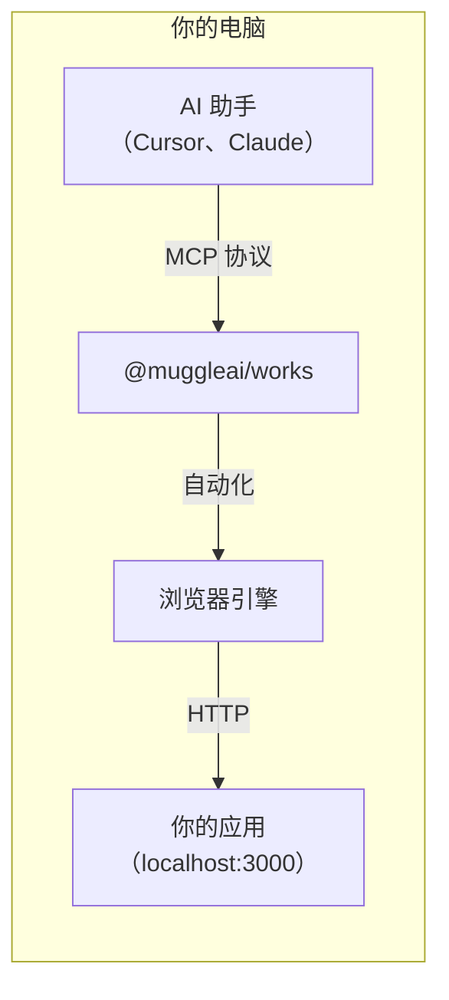
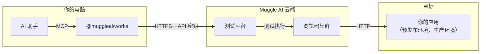

# MCP 概览

交付高质量的产品，而不只是代码。Muggle Test MCP 包提供 AI 驱动的端到端（E2E）验收测试，通过使用[模型上下文协议（Model Context Protocol，MCP）](https://modelcontextprotocol.io/)的 AI 助手，像真实用户一样验证你的 Web 应用。

## 本页内容

| 章节 | 说明 |
| :------ | :---------- |
| [什么是 MCP 包？](#what-is-the-mcp-package) | 包的功能和支持的平台 |
| [快速安装](#quick-install) | 各平台的一行安装命令 |
| [各模式的适用场景](#when-to-use-each-mode) | 本地、云端与统一模式对比 |
| [架构](#architecture) | 本地、云端和统一模式的工作方式 |
| [主要优势](#key-benefits) | 一次安装、自然语言测试、从本地到云端的工作流 |
| [工具类别](#tool-categories) | 本地和云端工具一览 |
| [开始使用](#getting-started) | 快速入门和指南链接 |
| [系统要求](#requirements) | Node.js、MCP 客户端和操作系统 |

## 什么是 MCP 包？

`@muggleai/works` 包是一个**统一的 MCP 服务器**，让 AI 编程智能体在真实浏览器中对你的 Web 应用运行 E2E 验收测试——用自然语言生成测试脚本、在 localhost 上回放、捕获截图，并验证注册、结账、控制台等用户流程。

| 功能 | 说明 |
| :------ | :---------- |
| **本地测试** | 使用真实的 Electron 浏览器测试 localhost 和局域网中的应用 |
| **云端 E2E** | 测试预览、预发布和生产环境 |
| **AI 驱动的自动化** | 用自然语言描述要测试的内容——其余的交给 AI |
| **一次安装** | 一个包满足所有测试需求，适用于 Claude Code、Cursor、Antigravity 及其他兼容 MCP 的客户端 |

## 快速安装

**Claude Code：**

```
/plugin marketplace add https://github.com/multiplex-ai/muggle-ai-works
/plugin install muggleai@muggle-works
```

**Cursor、Antigravity 或其他 MCP 客户端：**

```bash
npm install -g @muggleai/works@latest
```

一条命令即可安装 MCP 服务器、下载浏览器引擎，并自动配置 Cursor（`~/.cursor/mcp.json`）。安装后重启 Cursor 即可。

## 各模式的适用场景

| 环境 | 示例网址 | 模式 |
| :---------- | :----------- | :--- |
| 本地开发 | `localhost:3000` | 本地（`--local`） |
| Docker | `localhost:8080` | 本地（`--local`） |
| 局域网 | `192.168.1.x` | 本地（`--local`） |
| 预览 | `pr-123.preview.example.com` | 云端（`--e2e`） |
| 预发布环境 | `staging.example.com` | 云端（`--e2e`） |
| 生产环境 | `www.example.com` | 云端（`--e2e`） |
| 两者兼有 | 任意组合 | 默认（不带参数） |

## 架构

### 本地测试模式



本地测试在你的机器上运行浏览器，针对你的 localhost 应用进行测试：
- 浏览器自动化引擎在本地执行测试
- 结果存储在本地的 `~/.muggle-ai/` 中，并可发布到云端
- 需要登录——测试使用你 Muggle Test 账户中的测试用例

### 云端 E2E 模式



云端 E2E 测试使用 Muggle AI 的基础设施：
- 测试在云端浏览器集群上运行
- 结果存储在云端控制台中
- 支持 CI/CD 集成

### 统一模式（默认）

不带参数运行 `muggle serve` 时，**两种模式同时启用**：
- 使用 `muggle-local-*` 工具进行本地测试
- 使用 `muggle-remote-*` 工具进行云端 E2E 测试
- 将本地项目无缝发布到云端

## 主要优势

### 一次安装

无需管理多个包。统一的 `@muggleai/works` 包取代了之前的所有包：

| 旧版（已弃用） | 当前 |
| :-------------------- | :------ |
| 旧版云端 E2E MCP 包（统一前） | `@muggleai/works` |
| `@muggle-ai/local-mcp` | `@muggleai/works` |
| 两套配置 | 一套配置 |

**注意：** 之前的包已停用，不再维护。所有新安装请使用 `@muggleai/works`。

### 自然语言测试

不必在控制台中逐页操作，也不必编写脚本：

> “为我的电商网站创建一个项目，并测试结账流程”

### 从本地到云端的无缝工作流

1. **本地开发**——在 localhost 上测试
2. **生成脚本**——由 AI 创建自动化流程
3. **发布到云端**——一条命令即可部署
4. **扩展测试规模**——在 CI/CD 中运行

## 工具类别

| 类别 | 数量 | 说明 |
| :------- | ----: | :---------- |
| **本地测试** | ~20 | 本地执行、结果、发布 |
| **云端 E2E** | ~80 | 项目、用户旅程、工作流、报告 |
| **合计** | 100+ | 覆盖所有浏览器 E2E 测试需求 |

### 本地工具（前缀：`muggle-local-`）

| 类别 | 工具 | 用途 |
| :------- | :---- | :------ |
| 状态 | `muggle-local-check-status`、`muggle-local-list-sessions` | 检查本地服务并列出会话 |
| 执行 | `muggle-local-execute-test-generation`、`muggle-local-execute-replay` | 针对 localhost 生成和回放脚本 |
| 结果 | `muggle-local-run-result-list`、`muggle-local-run-result-get` | 查看本地执行结果 |
| 脚本 | `muggle-local-test-script-list`、`muggle-local-test-script-get` | 查看本地生成的脚本 |
| 发布 | `muggle-local-publish-test-script` | 将本地脚本发布到云端 |
| 控制 | `muggle-local-cancel-execution` | 取消正在进行的执行 |

> 本地测试以云端为先：即使在 localhost 上执行，项目、用户旅程、测试用例和身份验证也都通过 `muggle-remote-*` 工具管理。请参阅[本地测试工具参考](local-testing/tools-reference.md)。

### 云端 E2E 工具（前缀：`muggle-remote-`）

| 类别 | 工具 | 用途 |
| :------- | :---- | :------ |
| 身份验证 | `muggle-remote-auth-*` | 登录、退出登录和 API 密钥管理 |
| 项目 | `muggle-remote-project-*` | 云端项目管理 |
| 用户旅程 | `muggle-remote-use-case-*` | 用户旅程的发现、生成和批准 |
| 测试用例 | `muggle-remote-test-case-*` | 测试用例的生成和管理 |
| 工作流 | `muggle-remote-workflow-*`、`muggle-remote-wf-*` | 扫描、生成、回放（单个和批量） |
| PRD 文件 | `muggle-remote-prd-file-*` | 上传和处理 PRD 文档 |
| 报告 | `muggle-remote-report-*` | 测试报告的生成与发送 |
| 密钥 | `muggle-remote-secret-*` | 凭据管理 |
| 钱包 | `muggle-remote-wallet-*` | 支付方式和 Token 充值 |
| 反馈 | `muggle-remote-user-feedback-*` | 提交和管理脚本反馈 |

## 开始使用

准备好将你的 AI 助手连接到 Muggle Test 了吗？

1. **[MCP 快速入门](getting-started/mcp-quickstart.md)**——5 分钟快速上手
2. **[MCP 安装](mcp-installation.md)**——详细的安装配置选项
3. **[本地测试安装与配置](local-testing/setup.md)**——专注于 localhost 测试
4. **[MCP 概念与架构](mcp-concepts.md)**——了解架构
5. **[MCP API 参考](mcp-api-reference.md)**——完整的工具文档

## 系统要求

| 要求 | 版本 |
| :---------- | :------ |
| Node.js | 22+ |
| MCP 客户端 | Claude Code、Cursor、Antigravity 或任何兼容 MCP 的客户端 |
| 操作系统 | macOS、Windows 或 Linux |
