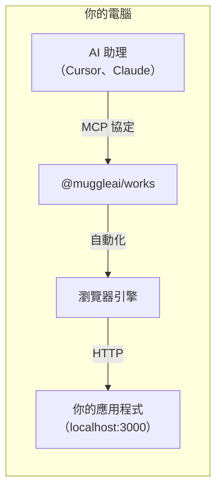
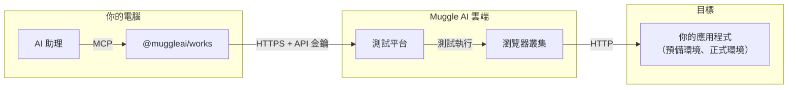

# MCP 總覽

交付高品質的產品，而不只是程式碼。Muggle Test MCP 套件提供 AI 驅動的端對端（E2E）驗收測試，透過採用[模型上下文協定（Model Context Protocol，MCP）](https://modelcontextprotocol.io/)的 AI 助理，像真實使用者一樣驗證你的 Web 應用程式。

## 本頁內容

| 章節 | 說明 |
| :------ | :---------- |
| [什麼是 MCP 套件？](#what-is-the-mcp-package) | 套件功能與支援的平台 |
| [快速安裝](#quick-install) | 各平台的一行安裝指令 |
| [各模式的適用時機](#when-to-use-each-mode) | 本機、雲端與整合模式比較 |
| [架構](#architecture) | 本機、雲端與整合模式的運作方式 |
| [主要優勢](#key-benefits) | 單一安裝、自然語言測試、從本機到雲端的工作流程 |
| [工具類別](#tool-categories) | 本機與雲端工具一覽 |
| [開始使用](#getting-started) | 快速入門與指南連結 |
| [系統需求](#requirements) | Node.js、MCP 用戶端與作業系統 |

## 什麼是 MCP 套件？

`@muggleai/works` 套件是一個**整合式 MCP 伺服器**，讓 AI 程式設計代理程式在真實瀏覽器中對你的 Web 應用程式執行 E2E 驗收測試——用日常語言產生測試腳本、在 localhost 上重播、擷取螢幕截圖，並驗證註冊、結帳、儀表板等使用者流程。

| 功能 | 說明 |
| :------ | :---------- |
| **本機測試** | 使用真實的 Electron 瀏覽器測試 localhost 與區域網路中的應用程式 |
| **雲端 E2E** | 測試預覽、預備與正式環境 |
| **AI 驅動的自動化** | 用日常語言描述要測試的內容——其餘交給 AI |
| **單一安裝** | 一個套件滿足所有測試需求，可在 Claude Code、Cursor、Antigravity 及其他相容 MCP 的用戶端中使用 |

## 快速安裝

**Claude Code：**

```
/plugin marketplace add https://github.com/multiplex-ai/muggle-ai-works
/plugin install muggleai@muggle-works
```

**Cursor、Antigravity 或其他 MCP 用戶端：**

```bash
npm install -g @muggleai/works@latest
```

只要一個指令，就能安裝 MCP 伺服器、下載瀏覽器引擎，並自動設定 Cursor（`~/.cursor/mcp.json`）。安裝完成後重新啟動 Cursor 即可。

## 各模式的適用時機

| 環境 | 範例網址 | 模式 |
| :---------- | :----------- | :--- |
| 本機開發 | `localhost:3000` | 本機（`--local`） |
| Docker | `localhost:8080` | 本機（`--local`） |
| 區域網路 | `192.168.1.x` | 本機（`--local`） |
| 預覽 | `pr-123.preview.example.com` | 雲端（`--e2e`） |
| 預備環境 | `staging.example.com` | 雲端（`--e2e`） |
| 正式環境 | `www.example.com` | 雲端（`--e2e`） |
| 兩者皆用 | 任意組合 | 預設（不加旗標） |

## 架構

### 本機測試模式



本機測試會在你的電腦上執行瀏覽器，針對你的 localhost 應用程式進行測試：
- 瀏覽器自動化引擎在本機執行測試
- 結果會儲存在本機的 `~/.muggle-ai/` 中，也可以發布到雲端
- 需要登入——測試會使用你 Muggle Test 帳戶中的測試案例

### 雲端 E2E 模式



雲端 E2E 測試使用 Muggle AI 的基礎架構：
- 測試在雲端瀏覽器叢集上執行
- 結果儲存在雲端儀表板中
- 支援 CI/CD 整合

### 整合模式（預設）

不加旗標執行 `muggle serve` 時，**兩種模式會同時啟用**：
- 使用 `muggle-local-*` 工具進行本機測試
- 使用 `muggle-remote-*` 工具進行雲端 E2E 測試
- 將本機專案無縫發布到雲端

## 主要優勢

### 單一安裝

不必管理多個套件。整合式的 `@muggleai/works` 套件取代了先前所有的套件：

| 舊版（已淘汰） | 目前 |
| :-------------------- | :------ |
| 舊版雲端 E2E MCP 套件（整合前） | `@muggleai/works` |
| `@muggle-ai/local-mcp` | `@muggleai/works` |
| 兩份設定 | 一份設定 |

**注意：** 先前的套件已停止提供，不再維護。所有新安裝請使用 `@muggleai/works`。

### 自然語言測試

不必在儀表板中逐頁操作，也不必撰寫腳本：

> 「為我的電商網站建立一個專案，並測試結帳流程」

### 從本機到雲端的無縫工作流程

1. **本機開發**——在 localhost 上測試
2. **產生腳本**——由 AI 建立自動化流程
3. **發布到雲端**——一個指令即可部署
4. **擴大測試規模**——在 CI/CD 中執行

## 工具類別

| 類別 | 數量 | 說明 |
| :------- | ----: | :---------- |
| **本機測試** | ~20 | 本機執行、結果、發布 |
| **雲端 E2E** | ~80 | 專案、使用者旅程、工作流程、報告 |
| **總計** | 100+ | 涵蓋所有瀏覽器 E2E 測試需求 |

### 本機工具（前綴：`muggle-local-`）

| 類別 | 工具 | 用途 |
| :------- | :---- | :------ |
| 狀態 | `muggle-local-check-status`、`muggle-local-list-sessions` | 檢查本機服務並列出工作階段 |
| 執行 | `muggle-local-execute-test-generation`、`muggle-local-execute-replay` | 針對 localhost 產生與重播腳本 |
| 結果 | `muggle-local-run-result-list`、`muggle-local-run-result-get` | 檢視本機執行結果 |
| 腳本 | `muggle-local-test-script-list`、`muggle-local-test-script-get` | 檢視本機產生的腳本 |
| 發布 | `muggle-local-publish-test-script` | 將本機腳本發布到雲端 |
| 控制 | `muggle-local-cancel-execution` | 取消執行中的作業 |

> 本機測試採雲端優先：即使在 localhost 上執行，專案、使用者旅程、測試案例與身分驗證仍透過 `muggle-remote-*` 工具管理。請參閱[本機測試工具參考](local-testing/tools-reference.md)。

### 雲端 E2E 工具（前綴：`muggle-remote-`）

| 類別 | 工具 | 用途 |
| :------- | :---- | :------ |
| 身分驗證 | `muggle-remote-auth-*` | 登入、登出與 API 金鑰管理 |
| 專案 | `muggle-remote-project-*` | 雲端專案管理 |
| 使用者旅程 | `muggle-remote-use-case-*` | 使用者旅程的探索、產生與核准 |
| 測試案例 | `muggle-remote-test-case-*` | 測試案例的產生與管理 |
| 工作流程 | `muggle-remote-workflow-*`、`muggle-remote-wf-*` | 掃描、產生、重播（單一與批次） |
| PRD 檔案 | `muggle-remote-prd-file-*` | 上傳與處理 PRD 文件 |
| 報告 | `muggle-remote-report-*` | 測試報告的產生與傳送 |
| 密鑰 | `muggle-remote-secret-*` | 憑證管理 |
| 錢包 | `muggle-remote-wallet-*` | 付款方式與 Token 加值 |
| 意見回饋 | `muggle-remote-user-feedback-*` | 提交與管理腳本意見回饋 |

## 開始使用

準備好將你的 AI 助理連接到 Muggle Test 了嗎？

1. **[MCP 快速入門](getting-started/mcp-quickstart.md)**——5 分鐘快速上手
2. **[MCP 安裝](mcp-installation.md)**——詳細的安裝與設定選項
3. **[本機測試安裝與設定](local-testing/setup.md)**——專注於 localhost 測試
4. **[MCP 概念與架構](mcp-concepts.md)**——了解架構
5. **[MCP API 參考](mcp-api-reference.md)**——完整的工具文件

## 系統需求

| 需求 | 版本 |
| :---------- | :------ |
| Node.js | 22+ |
| MCP 用戶端 | Claude Code、Cursor、Antigravity 或任何相容 MCP 的用戶端 |
| 作業系統 | macOS、Windows 或 Linux |
